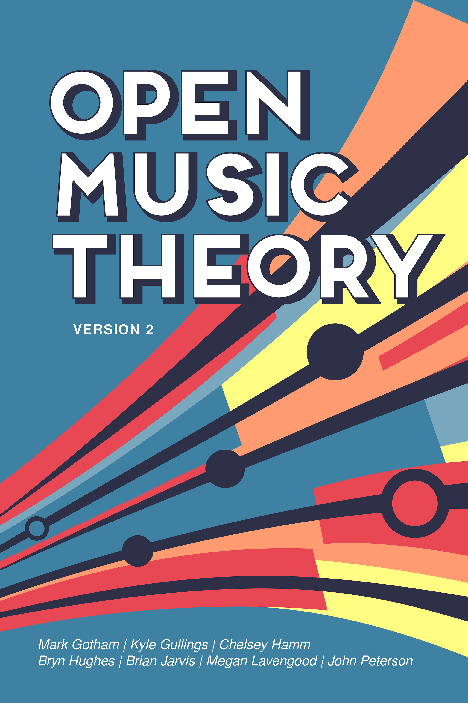

# 引言

*封面图 © [Bethany Nistler](https://www.bethanynistler.com)*

《开放音乐理论》（*Open Music Theory*，简称 *OMT*）是一套开放教育资源，旨在作为本科音乐理论课程的**主教材与练习册**。

## 特色

*多样的主题*

*嵌入 MuseScore 播放器的记谱谱例*

*互动内容*

*每章都配有作业*

###### 免费

大出版社的教科书动辄数百美元，而 *OMT* 完全免费使用。

###### 适配移动设备

整本教材原生于网络，并能自适应移动设备，这意味着学生可以在智能手机上舒适地使用本教材。

###### 多样的主题

*OMT* 不仅提供了一套完整的传统本科音乐理论核心课程所需的材料（基础乐理、自然音和声、半音和声、曲式、20 世纪技法），还为课程设置更加多元的教师提供了若干其他单元，如爵士乐、流行音乐、对位和配器（orchestration）。这得益于许多在这些子领域各有专长的音乐理论家之间的合作。

###### 灵活的课程设计

本书涵盖了传统理论课程序列中的全部主题，但 *OMT* 的各个部分不必按特定顺序讲授。大多数部分在写作时都只要求学生在学习某种方法或某类曲目之前熟悉基础乐理，因此本书非常适合采用模块化课程的学校。每个部分的导言都清楚说明了该部分所需的先修知识。

###### 包容性

*OMT* 的作者精心挑选了谱例，以呈现不同种族和性别的人群。

###### 多媒体

*OMT* 充分利用了在线、基于网页的形式，通篇都配有音频和视频示例。传统教科书往往要求学生转到另一个网站或亲自演奏谱例，从而给学生设置了障碍；*OMT* 则把这些内容直接嵌入在正文旁边，便于取用。

###### 互动性

许多章节含有互动内容，让学生能够轻松检验自己对某个概念的掌握程度，并立即得到正确答案，有助于自学。

###### 练习册

每一章（少数例外）都至少配有一份练习表（worksheet），作为该主题的家庭作业。练习表总是同时提供 PDF 和可编辑格式（MuseScore 或 Word 文档）。这样，学生既可以在纸上完成作业，也可以在设备上完成；教师也可以修改作业，使之更符合自己的教学目标。许多章节还汇集了学习音乐理论的其他在线资源链接。

###### 教师资源与社群

答案、考试、课程大纲样例、讨论区等资源都可以在我们的 Humanities Commons 小组中获取，任何使用 *OMT* 的教师都可以与他人分享材料（详见[下文](#resources-and-community-for-instructors)）。

## 第二版

本教材第二版由 Mark Gotham、Kyle Gullings、Chelsey Hamm、Bryn Hughes、Brian Jarvis、Megan Lavengood 和 John Peterson 合作编写。

每位作者负责教材的某些部分。Hamm 博士负责基础乐理，并共同负责后调性部分；Gotham 博士负责选集、十二音序列主义和配器部分；Gullings 博士负责所有章节的作业与练习册；Hughes 博士共同负责流行音乐和后调性部分；Jarvis 博士和 Peterson 博士负责和声与曲式部分；Lavengood 博士负责爵士乐部分，共同负责流行音乐部分，并编辑了本书的许多章节。此外，每一章都分别列出了撰写该章的作者。

虽然我们的大部分章节都是 *OMT* 第二版全新撰写的，但我们仍要感谢[第一版](http://openmusictheory.github.io)的远见。第一版建立在 Kris Shaffer、Bryn Hughes 和 Brian Moseley 编写的资源之上，由 Kris Shaffer 和 Robin Wharton 编辑，由 [Hybrid Pedagogy Publishing](http://www.hybridpedagogy.org/#publishing) 出版。第一版将继续保留在 <http://openmusictheory.github.io>。

## 无障碍

我们致力于践行网络无障碍原则。

- 为了帮助使用屏幕阅读器的读者，我们采用了一些不太标准的术语；特别是，我们从不用大写/小写字母 M 来区分大、小性质，而是使用缩写“ma”和“mi”。希望这种命名法会随着时间推移变得更加普遍。
- 虽然罗马数字的大小写确实反映了和弦性质，但性质也可以从上下文推断出来，因此对屏幕阅读器而言并非必要信息。
- 所有图片都提供了替代文字。
- 许多谱例和家庭作业使用 MuseScore，它是一款[无障碍乐谱阅读器](https://musescore.org/en/handbook/2/accessibility)。

如果你发现我们有可以改进的地方，请通过[建议与反馈](../99-back-matter/02-feedback.md)告诉我们。

## 更新

为避免干扰课堂教学，我们不会在学年期间（九月至次年五月）对本书的内容或结构做重大改动。不过，我们会在版本之间继续修正小错误、改善外观，这正是我们开放获取形式的好处之一。如果你发现任何错别字、失效链接或其他需要修正的问题，或者有关于新内容的想法，请通过[建议与反馈](../99-back-matter/02-feedback.md)告诉我们。每当有重大更新，我们都会在[更新日志](05-changelog.md)中列出。

## 教师资源与社群 {#resources-and-community-for-instructors}

不确定如何在课程中使用本书？想获取练习表的答案或考试样例？我们在 Humanities Commons 上为教师建立了一个社群，任何使用 *OMT* 的人都可以与其他教师分享材料。社群中还有一个讨论区。[填写此表格，申请加入教师社群。](https://docs.google.com/forms/d/e/1FAIpQLSeyFYqmFuRvcdvZb-xmP2vjBtE1g7IwVf1BrKFEOoTogNQZ_Q/viewform?usp=sf_link)

### 媒体署名

- table-of-contents © Megan Lavengood，采用 [CC BY-SA（署名—相同方式共享）](https://creativecommons.org/licenses/by-sa/4.0/)许可协议
- musescore-embed © Megan Lavengood，采用 [CC BY-SA（署名—相同方式共享）](https://creativecommons.org/licenses/by-sa/4.0/)许可协议
- interactive-content © John Peterson，采用 [CC BY-SA（署名—相同方式共享）](https://creativecommons.org/licenses/by-sa/4.0/)许可协议
- workbook © Chelsey Hamm，采用 [CC BY-SA（署名—相同方式共享）](https://creativecommons.org/licenses/by-sa/4.0/)许可协议
