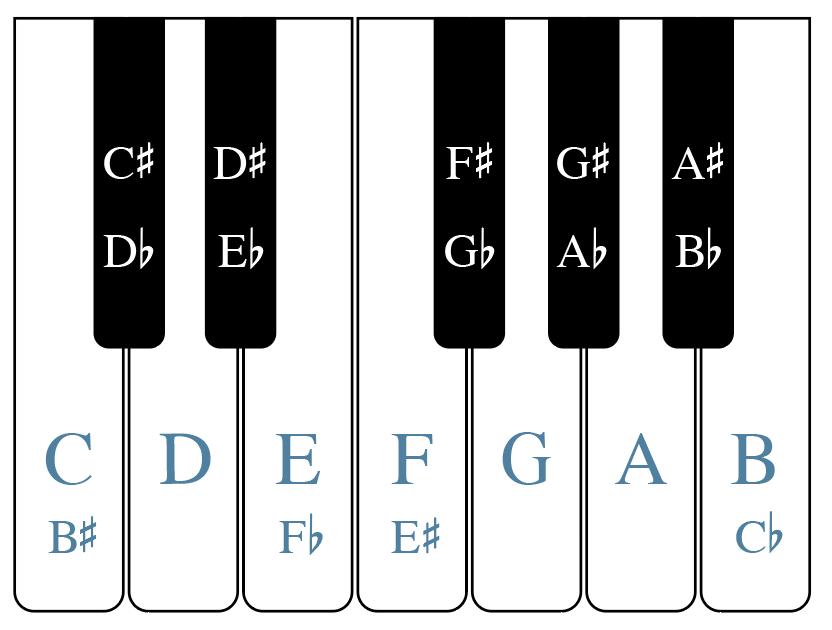

# 半音、全音与变音记号

> **要点**
>
> - 钢琴键盘上某个键上方的半音，就是它紧右边的那个键；某个键下方的半音，就是它紧左边的那个键。
> - 全音等于两个半音。某音上方的全音，是从它往右数的第二个键；下方的全音，是从它往左数的第二个键。
> - 变音记号（accidental）改变一个音的音高。升号把音升高半音，降号把音降低半音，还原号则取消此前的变音记号。
> - 重升号把一个音升高全音，重降号把一个音降低全音。
> - 一定要把变音记号写在音的左侧，并且正对着该音所在的那条线或那个间。
> - 当两个音拼写不同而音响相同，它们互为等音（enharmonic equivalence）。

在上一章[键盘与大谱表](04-the-keyboard-and-grand-staff.md)中，我们讨论了钢琴键盘上白键的字母名称，并提到黑键总是按两个一组或三个一组交替排列。不过，在讨论黑键的名称之前，我们必须先认识半音与全音。

## 半音与全音

在西方记谱法中，半音（half step）被视为最小的音程，也就是两个音之间最小的距离。谱例 1 是一个钢琴键盘，上面标出了白键音高的字母名称，还标出了若干半音。在钢琴键盘上（见谱例 1），对大多数白键音来说，它上方的半音是右上方那个黑键，下方的半音是左上方那个黑键。例如，G 右上方的黑键“夹在”G 与 A 之间；可以说，这个黑键比 G 高半音，比 A 低半音。有两对白键——E/F 与 B/C——之间没有黑键（见谱例 1）。这是因为 E–F 与 B–C 本身就是半音。黑键分成两个一组或三个一组，可以让键盘手更快地看清并摸到它们。

*谱例 1. 一个钢琴键盘，白键上标有字母名称；并标出了若干半音。*

全音（whole step）相当于两个半音。谱例 2 是一个钢琴键盘，标出了白键音高的字母名称，并用方括号标出了若干全音。中间隔着一个黑键的两对白键（A 与 B、C 与 D、D 与 E、F 与 G、G 与 A）相距一个全音。要找到 E 或 B 上方的全音，只需往右数两个键：E 上方的全音是 F 右边的黑键，B 上方的全音是 C 右边的黑键。同理，要找到 C 或 F 下方的全音，就往左数两个键，即分别是 B 与 E 左边的黑键。要从黑键找全音，也要往右或往左数两个键。例如，C 右边那个黑键上方的全音，是 D 右边的黑键；B 左边那个黑键下方的全音，是 A 左边的黑键。

*谱例 2. 一个钢琴键盘，白键上标有字母名称；并标出了若干全音。*

半音和全音听起来是什么样子？谱例 3 中的短视频作了演示：

▶️ [视频：半音与全音的声音](https://www.youtube.com/watch?v=a2q0xBYo4Z0)

<!-- video-begin: https://www.youtube.com/watch?v=a2q0xBYo4Z0 -->
<div class="omt-video"><iframe src="https://www.youtube-nocookie.com/embed/a2q0xBYo4Z0" title="video" loading="lazy" allow="accelerometer; autoplay; clipboard-write; encrypted-media; gyroscope; picture-in-picture; fullscreen" allowfullscreen></iframe></div>
<!-- video-end -->

谱例 3. Chelsey Hamm 博士（Christopher Newport University）演示半音与全音的声音。

## 升号、降号与还原号

变音记号（accidental）改变一个音的音高。升号（♯）看起来像一个倾斜的井号，把音升高半音。降号（♭）看起来像倾斜的小写字母“b”，把音降低半音。还原号（♮）看起来像一个倾斜的方框，左上方和右下方各伸出一截线头，用来取消此前的变音记号（如升号或降号）。升号、降号和还原号是最常用的三种变音记号。

重升号（double sharp，通常写作 𝄪，有时也写作 ♯♯）把一个音升高两个半音（即一个全音）。重降号（double flat，𝄫）把一个音降低两个半音（即一个全音）。无论符干朝哪个方向，变音记号总是写在音的左侧。变音记号应当正对着该音所在的那条线或那个间写。

谱例 4 展示了升号、降号和还原号的正确与错误写法：

*谱例 4. 变音记号的正确与错误写法。*

当两个音写在同一线或同一间上、但带有不同的变音记号时，这两个记号分别作用于第一个音和第二个音。谱例 5 展示了这种情况：

*谱例 5. 并排的降 B 与还原 B。*

<!-- lilylet-begin: media/2025/06/Same-Note-Two-Accidentals-e1750264867259.png -->
```lyl.play
\omit Score.TimeSignature \omit Score.BarLine \key c \major \clef "treble" <bf' b!>1 | %1
```
<!-- lilylet-end -->
你可以在下面这个较容易的练习中，通过拖放来练习在高音谱号和低音谱号上辨认半音与全音：

> **练习**
>
> 🧩 互动练习（H5P）：Half Steps and Whole Steps - Easy Treble and Bass Clefs Only，见[在线版](05-half-and-whole-steps.md)。

你可以在下面这个较难的练习中，通过拖放来练习在所有谱号上辨认半音与全音：

> **练习**
>
> 🧩 互动练习（H5P）：Half Steps and Whole Steps - All Clefs More Difficult，见[在线版](05-half-and-whole-steps.md)。

## 钢琴键盘上的黑键

谱例 6 是一个钢琴键盘，上面标出了黑键的字母名称。比白键高半音的黑键，是在白键的名称上加“升”字。例如，C 右边的黑键叫作“升 C”（C♯）。比白键低半音的黑键，是在白键的名称上加“降”字。例如，D 左边的黑键叫作“降 D”（D♭）。

*谱例 6. 一个钢琴键盘，标出了黑键的字母名称。*

F 也可以叫作 E♯，E 也可以叫作 F♭。C 也可以叫作 B♯，B 也可以叫作 C♭。谱例 7 还展示了重升号和重降号这两个变音记号。重升号比某音高两个半音。例如，D𝄪也就是 E；E𝄪也就是 F♯（或 G♭）。重降号比某音低两个半音。例如，A𝄫也就是 G；C𝄫也就是 B♭或 A♯。

*谱例 7. 钢琴键盘上的重变音记号。*

你可以在下面的练习中，通过拖放来练习辨认钢琴上的黑键与白键：

> **练习**
>
> 🧩 互动练习（H5P）：Label the Keys Drag and Drop，见[在线版](05-half-and-whole-steps.md)。

## 等音关系

你到现在应该已经注意到，钢琴键盘上的每一个键都不止一个名称。当两个音拼写不同而音响相同时，它们互为等音（enharmonic equivalence）。例如，从谱例 6 和谱例 7 可以看出，C♯ 与 D♭ 互为等音。谱例 7 还表明，D 与 C𝄪、E𝄫 互为等音。换句话说，弹 D、C𝄪 或 E𝄫，得到的音高完全相同。

> 延伸阅读

- Drabkin, William and Mark Lindley. 2001. “Semitone.” *Grove Music Online*. <https://doi.org/10.1093/gmo/9781561592630.article.25395>.
- Gerou, Tom and Linda Lusk. 1996. *Essential Dictionary of Music Notation*. Los Angeles: Alfred.
- Gould, Elaine. 2011, *Behind Bars: the Definitive Guide to Music Notation*. London: Bloomsbury.
- Hiley, David. 2001. “Accidental.” *Grove Music Online*. <https://doi.org/10.1093/gmo/9781561592630.article.00103>.
- Hoover, Cynthia Adams and Edwin M. Good. 2013. “Piano.” *Grove Music Online*. <https://doi.org/10.1093/gmo/9781561592630.article.A2257895>.
- McGrain, Mark. 1986. *Music Notation*. Boston: Berklee Press.
- Roemer, Clinton. 1985. *The Art of Music Copying: the Preparation of Music for Performance*, 2nd edition. Sherman Oaks: Roerick Music Company.
- Rushton, Julian. 2001. “Enharmonic.” *Grove Music Online*. <https://doi.org/10.1093/gmo/9781561592630.article.08837>.

> 在线资源

- [半音、全音与变音记号教程（musictheory.net）](https://www.musictheory.net/lessons/20)
- [练习半音、全音与变音记号的游戏（drawmusic.com）](http://www.drawmusic.com/music-theory/steps-game)
- [变音记号教程（mymusictheory.com）](https://www.mymusictheory.com/learn-music-theory/for-students/grade-1/grade-1-course/125-3-accidentals)
- [钢琴黑键教程（musicradar.com）](https://www.musicradar.com/how-to/learn-the-black-keys-on-the-piano)
- [钢琴键盘指认练习（musictheory.net）](https://www.musictheory.net/exercises/keyboard/999d)
- [钢琴键名标注游戏（quizlet.com）](https://quizlet.com/23438150/all-keys-on-piano-keyboard-flash-cards/)
- [等音关系教程（The Music Notation Project）](http://musicnotation.org/tutorials/enharmonic-equivalents/)
- [供学生或教师使用的空白键盘图](https://viva.pressbooks.pub/app/uploads/sites/12/2025/06/Blank-Piano-Keyboard.pdf)

> 网络上的作业

1. 钢琴键盘与五线谱上的半音与全音（[.pdf](http://static1.1.sqspcdn.com/static/f/801966/23104230/1373756418073/Music-Theory-Worksheet-18-Whole-Half-Stepsv2.pdf?token=GZEUx18WdVeYh2GuEgy70sWCvzI%3D)）
2. 五线谱上的半音与全音（[.pdf](http://people.wku.edu/michael.kallstrom/4.%20half%20and%20whole%20steps%20worksheet.pdf)）
3. 带变音记号的音的书写与辨认，第 1 页（[.pdf](http://jkornfeld.net/complete_exercises.pdf)），第 9–11 页（[.pdf](http://www.mypiano.com.au/uploads/1/5/5/7/15579660/theory_worksheets_complete.pdf)）
4. 键盘与五线谱对应（[.pdf](http://colorinmypiano.com/wp-content/files/Staff_to_Keyboard_Matching_-_digital_worksheet.pdf)）
5. 等音关系，第 3 页（[.pdf](http://jkornfeld.net/complete_exercises.pdf)），（[.pdf](https://mymission.lamission.edu/userdata/wentzj/docs/Enharmonics%20Worksheet.pdf)）

> 资源

- 供学生或教师使用的空白键盘图（[.pdf](https://viva.pressbooks.pub/app/uploads/sites/12/2025/06/Blank-Piano-Keyboard.pdf)）

> 作业

1. 钢琴上的黑键（[.pdf](https://viva.pressbooks.pub/app/uploads/sites/12/2024/06/WK-Half-and-Whole-Steps-and-Accidentals-–-Black-Keys-on-the-Piano.pdf)，[.docx](https://viva.pressbooks.pub/app/uploads/sites/12/2024/06/WK-Half-and-Whole-Steps-and-Accidentals-–-Black-Keys-on-the-Piano.docx)）。要求学生指出记谱的音高应弹在哪个琴键上。
2. 钢琴上的半音与全音（[.pdf](https://viva.pressbooks.pub/app/uploads/sites/12/2024/06/WK-Half-and-Whole-Steps-and-Accidentals-–-Half-and-Whole-Steps-on-the-Piano.pdf)，[.docx](https://viva.pressbooks.pub/app/uploads/sites/12/2024/06/WK-Half-and-Whole-Steps-and-Accidentals-–-Half-and-Whole-Steps-on-the-Piano.docx)）。要求学生指出记谱的音高应弹在哪个琴键上，并指出钢琴上哪两个相邻的键构成半音或全音。
3. 书写变音记号（[.pdf](https://viva.pressbooks.pub/app/uploads/sites/12/2024/06/WK-Half-and-Whole-Steps-and-Accidentals-–-Writing-Accidentals.pdf)，[.docx](https://viva.pressbooks.pub/app/uploads/sites/12/2024/06/WK-Half-and-Whole-Steps-and-Accidentals-–-Writing-Accidentals.docx)）。要求学生在谱表上画出带变音记号的音符。
4. 书写与辨认变音记号（[.pdf](https://viva.pressbooks.pub/app/uploads/sites/12/2024/06/WK-Half-and-Whole-Steps-and-Accidentals-–-Writing-and-Identifying-Accidentals.pdf)，[.docx](https://viva.pressbooks.pub/app/uploads/sites/12/2024/06/WK-Half-and-Whole-Steps-and-Accidentals-–-Writing-and-Identifying-Accidentals.docx)）。要求学生在五线谱上辨认并写出带变音记号符号的音高。
5. 五线谱上的半音与全音。要求学生在给定音的上方/下方写出全音与半音，在记谱中辨认全音/半音，并分析一段旋律，找出并标出全音与半音。
	- 所有谱号（[.pdf](https://viva.pressbooks.pub/app/uploads/sites/12/2025/08/WK-half-and-whole-steps-in-staff-notation.pdf)）
	- 仅高音谱号与低音谱号（[.pdf](https://viva.pressbooks.pub/app/uploads/sites/12/2025/08/WK-half-and-whole-steps-in-staff-notation-TB.pdf)）

        <!-- lilylet-begin: media/2025/08/WK-half-and-whole-steps-in-staff-notation-TB.mscz -->
        ```lyl.play
        [composer "Chelsey Hamm, Megan Lavengood, and Jeremy Freer"]
        [staves "s1,s2"]

        \key c \major \time 4/2 \clef "treble" \omit Score.TimeSignature R\breve \\\
        \clef "treble" \omit Score.TimeSignature gs'1 a | %1

        R\breve \\\
        ef1 s | %2

        R\breve \\\
        gf''1 s | %3

        R\breve \\\
        bf'1 s | %4

        R\breve \\\
        fs1 s | %5

        R\breve \\\
        ef'1 s | %6

        R\breve \\\
        cs'1 s | %7

        R\breve \\\
        df'1 s | %8

        R\breve \\\
        ds1 s | %9

        R\breve \\\
        ds'1 s | %10

        R\breve \\\
        \clef "bass" as,1 a | %11

        R\breve \\\
        fs,1 s | %12

        R\breve \\\
        ef,1 s | %13

        R\breve \\\
        gf1 s | %14

        R\breve \\\
        gs,1 s | %15

        R\breve \\\
        cs,1 s | %16

        R\breve \\\
        bf,1 s | %17

        R\breve \\\
        af1 s | %18

        R\breve \\\
        df,1 s | %19

        R\breve \\\
        fs,,1 s | %20

        R\breve \\\
        as1 bs | %21

        R\breve \\\
        cs1 s | %22

        R\breve \\\
        df1 s | %23

        R\breve \\\
        gf1 s | %24

        R\breve \\\
        ef1 s | %25

        R\breve \\\
        bf1 s | %26

        R\breve \\\
        af1 s | %27

        R\breve \\\
        cs,1 s | %28

        R\breve \\\
        fs1 s | %29

        R\breve \\\
        e,1 s | %30

        R\breve \\\
        \clef "treble" gs'1 fs | %31

        R\breve \\\
        ef1 s | %32

        R\breve \\\
        gf''1 s | %33

        R\breve \\\
        bf'1 s | %34

        R\breve \\\
        as'1 s | %35

        R\breve \\\
        fs1 s | %36

        R\breve \\\
        ef'1 s | %37

        R\breve \\\
        cs'1 s | %38

        R\breve \\\
        df'1 s | %39

        R\breve \\\
        ds1 s | %40

        R\breve \\\
        g'1 af \addlyrics { H _ } | %41

        R\breve \\\
        ef1 d | %42

        R\breve \\\
        d1 b | %43

        R\breve \\\
        e'1 f | %44

        R\breve \\\
        e'1 ef | %45

        R\breve \\\
        \clef "bass" d,1 cs | %46

        R\breve \\\
        a,1 b | %47

        R\breve \\\
        b,1 c | %48

        R\breve \\\
        d,1 cf | %49

        R\breve \\\
        gs1 a | %50

        R\breve \\\
        c1 b | %51

        R\breve \\\
        f,1 gs | %52

        R\breve \\\
        b1 as | %53

        R\breve \\\
        g,1 f | %54

        R\breve \\\
        e,1 g | %55

        \numericTimeSignature \time 4/4 \stemUp c'8^\markup "Swing"[ c] r^\markup "H" b c4^\markup "H" r \addlyrics { Give 'em the old } \\\
        \clef "treble" R1 | %56

        \stemDown c'4 \stemUp g a as^\markup "W" \addlyrics { ho -- cus po -- cus… } \\\
        R1 | %57

        r4 \stemUp b'8[ as] b[ a] g4 \\\
        R1 | %58

        R1 \\\
        R1 | %59

        \stemDown e'8[ ds] r e g4 c, \\\
        R1 | %60

        \stemDown a''4 g e c \\\
        R1 | %61

        a'1~ \\\
        R1 | %62

        a'1 \\\
        R1 | %63

        \stemDown f'8[ f~] f[ e] f4 e \\\
        R1 | %64

        \stemDown g''4 f e d \\\
        R1 | %65

        \stemDown e'8[ e~] e[ ds] e4 r8 \stemUp g, \\\
        R1 | %66

        \stemDown e'4 r8 c b4 \stemUp a \\\
        R1 | %67

        r4 \stemUp g'8[ gs] a[ af] g4 \\\
        R1 | %68

        r4 \stemDown d'8[ e] f[ d] b4 \\\
        R1 | %69

        c'1~ \\\
        R1 | %70

        \stemDown c'4 r r2 \bar "|." \\\
        R1 \bar "|." | %71
        ```
        <!-- lilylet-end -->

6. 等音关系。要求学生写出并辨认等音等价关系的音。
	- 所有谱号（[.pdf](https://viva.pressbooks.pub/app/uploads/sites/12/2025/08/WK-enharmonic-equivalence.pdf)）
	- 仅高音/低音谱号（[.pdf](https://viva.pressbooks.pub/app/uploads/sites/12/2025/08/WK-enharmonic-equivalence-TB.pdf)）。要求学生写出并辨认互为等音的音高。

        <!-- lilylet-begin: media/2025/08/WK-enharmonic-equivalence.mscz -->
        ```lyl.play
        [composer "Chelsey Hamm and Jeremy Freer"]
        [staves "{s1-s2}"]

        \staff "1" \key c \major \numericTimeSignature \time 4/4 \clef "treble" \omit Score.TimeSignature gs'2 s \\
        \staff "2" \clef "bass" s2 s | %1

        \staff "1" ef2 s \\
        \staff "2" s2 s | %2

        \staff "1" gf''2 s \\
        \staff "2" s2 s | %3

        \staff "1" bf'2 s \\
        \staff "2" s2 s | %4

        \staff "1" as'2 s \\
        \staff "2" R1 | %5

        \staff "1" fs2 s \\
        \staff "2" s2 s | %6

        \staff "1" ef'2 s \\
        \staff "2" s2 s | %7

        \staff "1" cs'2 s \\
        \staff "2" s2 s | %8

        \staff "1" df'2 s \\
        \staff "2" s2 s | %9

        \staff "1" ds2 s \\
        \staff "2" s2 s | %10

        \staff "1" s2 s \\
        \staff "2" as,2 s | %11

        \staff "1" s2 s \\
        \staff "2" fs,2 s | %12

        \staff "1" s2 s \\
        \staff "2" ef,2 s | %13

        \staff "1" s2 s \\
        \staff "2" gf2 s | %14

        \staff "1" s2 s \\
        \staff "2" gs,2 s | %15

        \staff "1" s2 s \\
        \staff "2" cs,2 s | %16

        \staff "1" s2 s \\
        \staff "2" bf,2 s | %17

        \staff "1" s2 s \\
        \staff "2" af2 s | %18

        \staff "1" s2 s \\
        \staff "2" df,2 s | %19

        \staff "1" s2 s \\
        \staff "2" fs,,2 s | %20

        \staff "1" s1 \\
        \staff "2" as2 s | %21

        \staff "1" s1 \\
        \staff "2" cs2 s | %22

        \staff "1" df2 s \\
        \staff "2" s1 | %23

        \staff "1" gf2 s \\
        \staff "2" s1 | %24

        \staff "1" s1 \\
        \staff "2" ef2 s | %25

        \staff "1" s1 \\
        \staff "2" bf2 s | %26

        \staff "1" af2 s \\
        \staff "2" s1 | %27

        \staff "1" cs2 s \\
        \staff "2" s1 | %28

        \staff "1" s1 \\
        \staff "2" fs2 s | %29

        \staff "1" fs,2 s \\
        \staff "2" s1 | %30

        \staff "1" g'2 af \\
        \staff "2" s1 | %31

        \staff "1" ef2 d \\
        \staff "2" s1 | %32

        \staff "1" d2 b \\
        \staff "2" s1 | %33

        \staff "1" e'2 f \\
        \staff "2" s1 | %34

        \staff "1" e'2 ef \\
        \staff "2" s1 | %35

        \staff "1" \clef "bass" d,2 cs \\
        \staff "2" s1 | %36

        \staff "1" a,2 b \\
        \staff "2" s1 | %37

        \staff "1" b,2 c \\
        \staff "2" s1 | %38

        \staff "1" d,2 cf \\
        \staff "2" s1 | %39

        \staff "1" gs2 a \\
        \staff "2" s1 | %40

        \staff "1" \clef "alto" c2 bss \\
        \staff "2" s1 | %41

        \staff "1" fs,2 gf \\
        \staff "2" s1 | %42

        \staff "1" b2 as \\
        \staff "2" s1 | %43

        \staff "1" g'2 fss \\
        \staff "2" s1 | %44

        \staff "1" es2 gf \\
        \staff "2" s1 | %45
        ```
        <!-- lilylet-end -->

            <!-- lilylet-begin: media/2025/08/WK-enharmonic-equivalence-TB.mscz -->
            ```lyl.play
            [composer "Chelsey Hamm and Jeremy Freer"]
            [staves "{s1-s2}"]

            \staff "1" \key c \major \numericTimeSignature \time 4/4 \clef "treble" \omit Score.TimeSignature gs'2 s \\
            \staff "2" \clef "bass" s2 s | %1

            \staff "1" ef2 s \\
            \staff "2" s2 s | %2

            \staff "1" gf''2 s \\
            \staff "2" s2 s | %3

            \staff "1" bf'2 s \\
            \staff "2" s2 s | %4

            \staff "1" as'2 s \\
            \staff "2" R1 | %5

            \staff "1" fs2 s \\
            \staff "2" s2 s | %6

            \staff "1" ef'2 s \\
            \staff "2" s2 s | %7

            \staff "1" cs'2 s \\
            \staff "2" s2 s | %8

            \staff "1" df'2 s \\
            \staff "2" s2 s | %9

            \staff "1" ds2 s \\
            \staff "2" s2 s | %10

            \staff "1" s2 s \\
            \staff "2" as,2 s | %11

            \staff "1" s2 s \\
            \staff "2" fs,2 s | %12

            \staff "1" s2 s \\
            \staff "2" ef,2 s | %13

            \staff "1" s2 s \\
            \staff "2" gf2 s | %14

            \staff "1" s2 s \\
            \staff "2" gs,2 s | %15

            \staff "1" s2 s \\
            \staff "2" cs,2 s | %16

            \staff "1" s2 s \\
            \staff "2" bf,2 s | %17

            \staff "1" s2 s \\
            \staff "2" af2 s | %18

            \staff "1" s2 s \\
            \staff "2" df,2 s | %19

            \staff "1" s2 s \\
            \staff "2" fs,,2 s | %20

            \staff "1" s1 \\
            \staff "2" as2 s | %21

            \staff "1" s1 \\
            \staff "2" cs2 s | %22

            \staff "1" df2 s \\
            \staff "2" s1 | %23

            \staff "1" gf2 s \\
            \staff "2" s1 | %24

            \staff "1" s1 \\
            \staff "2" ef2 s | %25

            \staff "1" s1 \\
            \staff "2" bf2 s | %26

            \staff "1" af2 s \\
            \staff "2" s1 | %27

            \staff "1" cs2 s \\
            \staff "2" s1 | %28

            \staff "1" s1 \\
            \staff "2" fs2 s | %29

            \staff "1" fs,2 s \\
            \staff "2" s1 | %30

            \staff "1" g'2 af \\
            \staff "2" s1 | %31

            \staff "1" ef2 d \\
            \staff "2" s1 | %32

            \staff "1" d2 b \\
            \staff "2" s1 | %33

            \staff "1" e'2 f \\
            \staff "2" s1 | %34

            \staff "1" e'2 ef \\
            \staff "2" s1 | %35

            \staff "1" \clef "bass" d,2 cs \\
            \staff "2" s1 | %36

            \staff "1" a,2 b \\
            \staff "2" s1 | %37

            \staff "1" b,2 c \\
            \staff "2" s1 | %38

            \staff "1" d,2 cf \\
            \staff "2" s1 | %39

            \staff "1" gs2 a \\
            \staff "2" s1 | %40

            \staff "1" \clef "treble" c2 bss \\
            \staff "2" s1 | %41

            \staff "1" fs2 gf \\
            \staff "2" s1 | %42

            \staff "1" b2 as \\
            \staff "2" s1 | %43

            \staff "1" g''2 fss \\
            \staff "2" s1 | %44

            \staff "1" es2 gf \\
            \staff "2" s1 | %45
            ```
            <!-- lilylet-end -->

### 媒体署名

- Piano Half Steps © Sarah Louden is licensed under a [CC BY-SA (Attribution ShareAlike)](https://creativecommons.org/licenses/by-sa/4.0/) license
- Piano Whole Steps © Sarah Louden is licensed under a [CC BY-SA (Attribution ShareAlike)](https://creativecommons.org/licenses/by-sa/4.0/) license
- Correct and Incorrect Accidentals © Sarah Louden is licensed under a [CC BY-SA (Attribution ShareAlike)](https://creativecommons.org/licenses/by-sa/4.0/) license
- Same Note Two Accidentals © Chelsey Hamm is licensed under a [CC BY-SA (Attribution ShareAlike)](https://creativecommons.org/licenses/by-sa/4.0/) license
- Piano Black Keys © Sarah Louden is licensed under a [CC BY-SA (Attribution ShareAlike)](https://creativecommons.org/licenses/by-sa/4.0/) license
- Piano Double Accidentals © Sarah Louden is licensed under a [CC BY-SA (Attribution ShareAlike)](https://creativecommons.org/licenses/by-sa/4.0/) license
