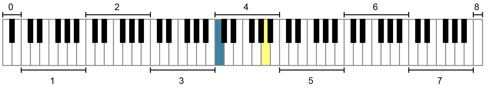

# 美国标准音高记谱法（ASPN）

> **要点**
>
> - 美国标准音高记谱法（American Standard Pitch Notation，ASPN）把音名（如 C）与下标形式的八度编号（如 4）结合起来，为具体频率的音高提供标记。
> - 音高（pitch）是具有各自频率的离散音（如 C<sub>4</sub>），而音级（pitch class）则不那么具体（如泛指的 C）。
> - ASPN 以从 C 到 B 为一个八度加以区分。八度由低到高编号，从 0 开始，按数字顺序递增（1、2 等）。
> - 钢琴键盘主要使用 ASPN 的第 1 至第 7 号八度，但也包含第 0 号和第 8 号八度的一小部分。
> - 中央 C 在 ASPN 中记作 C<sub>4</sub>。记住这个音的 ASPN 标记，可以作为起点，很有帮助。

## 美国标准音高记谱法与音高对音级

为了讨论具体的音，也就是音高（pitch），我们使用美国标准音高记谱法，简称 ASPN。ASPN 把音名（如 C）与下标形式的八度编号（如 4）结合起来，为具体音高命名，构成一个两部分的标记（例如 C<sub>4</sub>）。ASPN 标记非常有用，因为它能标出人耳听觉范围内的每一个可能的音，从最低的音到最高的音。

[读谱号](03-clefs.md)一章介绍了八度等价（octave equivalence），这一概念解释了为什么相隔一个或多个八度的音具有相同的字母名称。音乐理论家区分音高与音级：音高是具有各自频率的离散音（例如用 ASPN 记作 C<sub>4</sub>），而音级则不那么具体（例如泛指的 C）。一个音级包含任何八度中所有同名的音，以及它们的等音。例如，所有的 C 都属于同一个音级，而 C 的等音 D𝄫 和 B♯ 也属于 C 音级；详见[音高与音级](../08-20th-and-21st-century-techniques/02-pitch-and-pitch-class.md)。本章用 ASPN 为具体的音命名。

## ASPN 与八度编号

ASPN 以音高 C 开始、以音高 B 结束来划分八度。[^1] 这意味着每一个新的八度编号都从 C 音开始，如谱例 1 所示。八度由低到高编号，从 0 开始，按数字顺序递增（1、2、3 等）。中央 C 这一音高是 C<sub>4</sub>，值得记住。

*谱例 1. ASPN 的八度编号；每一个八度都以音高 C 开始。*

<!-- lilylet-begin: media/2019/05/Scientific_pitch_notation_octaves_of_C.png -->
```lyl.play
\omit Score.TimeSignature \omit Score.BarLine \key c \major \clef "bass" c,,,,4 c' c' c' \clef "treble" c' c' c' c' c' c' \undo \omit Score.BarLine \bar "|"
\addlyrics { C0 C1 C2 C3 C4 C5 C6 C7 C8 C9 } | %1
```
<!-- lilylet-end -->
一个八度内的所有音名（直到下一个八度的 C 之前）都使用同一个八度编号。例如，谱例 2 中的所有音都记入第 4 号八度，因为它们高于 C<sub>4</sub> 而低于 C5。加在音上的变音记号不影响它的 ASPN 编号。例如，B♯<sub>3</sub> 与 C<sub>4</sub> 虽然互为等音，但八度编号不同，因为 B♯ 仍被认为属于较低的八度。

*谱例 2. 音高 C<sub>4</sub>、D<sub>4</sub>、E<sub>4</sub>、F<sub>4</sub>、G<sub>4</sub>、A<sub>4</sub> 和 B<sub>4</sub>。*

<!-- lilylet-begin: media/2019/05/Screen-Shot-2019-07-24-at-3.50.53-PM.png -->
```lyl.play
\omit Score.TimeSignature \omit Score.BarLine \key c \major \clef "treble" c4 d e f g a b \undo \omit Score.BarLine \bar "|" | %1
```
<!-- lilylet-end -->
你可以在下面的练习中练习在所有谱号上写 ASPN 标记：

> **练习**
>
> 🧩 互动练习（H5P）：ASN Note Identification，见[在线版](06-aspn.md)。

## ASPN 与键盘

ASPN 标记对于在钢琴键盘上找到具体的音非常有帮助。谱例 3 是一个钢琴键盘，每个八度都用 ASPN 标记标出。如你所见，钢琴键盘横跨第 1 至第 7 号完整的八度，还包含第 0 号和第 8 号八度的一小部分。ASPN 标记不因乐器或声部类型而改变。换句话说，无论是用长笛、长号、小提琴还是人声奏出，C<sub>4</sub> 总是记作 C<sub>4</sub>。

*谱例 3. 一个标有 ASPN 八度编号的钢琴键盘；两个着色音符（蓝色和黄色）都属于第 4 号八度。*

## ASPN 与五线谱记谱

谱例 4 展示了高音、低音、中音和次中音谱号中常用音的 ASPN 标记。记住 C<sub>4</sub> 在每个谱号中的位置，可以让找到 ASPN 标记更快、更容易。

🎼 [MuseScore 曲谱](https://musescore.com/user/32728834/scores/8395191/s/5sFqPN)

<!-- embed-begin: https://musescore.com/user/32728834/scores/8395191/s/5sFqPN -->
<div class="omt-embed omt-embed-musescore"><iframe src="https://musescore.com/user/32728834/scores/8395191/s/5sFqPN/embed" title="MuseScore" loading="lazy" style="height: 600px" allow="autoplay; fullscreen" allowfullscreen></iframe></div>
<!-- embed-end -->

谱例 4. 四种谱号中音的 ASPN 标记。

> 延伸阅读

- Clendinning, Jane Piper and Elizabeth West Marvin. 2021. *The Musician’s Guide to Theory and Analysis*, fourth edition. New York: W. W. Norton and Company.
- Hoover, Cynthia Adams and Edwin M. Good. 2013. “Piano.” *Grove Music Online*. <https://doi.org/10.1093/gmo/9781561592630.article.A2257895>.
- Young, Robert W. 1939. “Terminology for Logarithmic Frequency Units.” *Journal of the Acoustical Society of America* 11 (1939): 134–9.

> 在线资源

- [“音高、音级、八度标记与等音关系”（YouTube）](https://www.youtube.com/watch?v=_z3b5fSDimI)

    <!-- video-begin: https://www.youtube.com/watch?v=_z3b5fSDimI -->
    <div class="omt-video"><iframe src="https://www.youtube-nocookie.com/embed/_z3b5fSDimI" title="video" loading="lazy" allow="accelerometer; autoplay; clipboard-write; encrypted-media; gyroscope; picture-in-picture; fullscreen" allowfullscreen></iframe></div>
    <!-- video-end -->

- [ASPN 八度标记教程（liveabout.com）](https://www.liveabout.com/pitch-notation-and-octave-naming-2701389)
- [ASPN 八度标记教程（flutopedia.com）](https://www.flutopedia.com/octave_notation.htm)
- [大谱表与钢琴上 ASPN 标记的有用图示（Music Theory Tips）](https://musictheorytutoring.weebly.com/octave-identification.html)
- [高音与低音谱号 ASPN 标记的识字卡（quizlet.com）](https://quizlet.com/178381719/write)

> 网络上的作业

1. ASPN 标记与五线谱（[.pdf](https://people.carleton.edu/~jellinge/m101s12/Pages/02/Media02/02pdf/Worksheet2-4.pdf)，[.pdf](https://mymission.lamission.edu/userdata/wentzj/docs/lynn_worksheet_1_4.pdf)）
2. ASPN 标记，第 25 页（[.pdf](https://he.kendallhunt.com/sites/default/files/uploadedFiles/Kendall_Hunt/Content/Higher_Education/Uploads/Gerhold_2e_Chapter1.pdf)）
3. ASPN 标记、五线谱记谱与钢琴键盘，第 1 页（[.pdf](https://musictheory.pugetsound.edu/hw/MT21C-PRACTICE-EXERCISES.pdf)）

> 作业

1. 美国标准音高记谱法（ASPN）（[.pdf](https://viva.pressbooks.pub/app/uploads/sites/12/2024/06/WK-American-Standard-Pitch-Notation-ASPN.pdf)）。要求学生根据 ASPN 标记辨认音高，并按照 ASPN 标记在正确的八度中写出音高。

    <!-- lilylet-begin: media/2024/08/WK-American-Standard-Pitch-Notation-ASPN.mscz -->
    ```lyl.play
    \key c \major \numericTimeSignature \time 4/4 \clef "treble" \omit Score.TimeSignature d'1 \bar "||" | %1

    g'1 \bar "||" | %2

    b'1 \bar "||" | %3

    e'1 \bar "||" | %4

    d1 \bar "||" | %5

    b'1 \bar "||" | %6

    g''1 \bar "||" | %7

    c'1 \bar "||" | %8

    f1 \bar "||" | %9

    a'1 \bar "||" | %10

    \clef "bass" g,1 \bar "||" | %11

    f,1 \bar "||" | %12

    c,1 \bar "||" | %13

    e,1 \bar "||" | %14

    b,1 \bar "||" | %15

    d,1 \bar "||" | %16

    a1 \bar "||" | %17

    a,1 \bar "||" | %18

    f,,1 \bar "||" | %19

    g1 \bar "||" | %20

    \clef "alto" b1 \bar "||" | %21

    d1 \bar "||" | %22

    f,1 \bar "||" | %23

    f1 \bar "||" | %24

    g'1 \bar "||" | %25

    c1 \bar "||" | %26

    a1 \bar "||" | %27

    a'1 \bar "||" | %28

    e1 \bar "||" | %29

    e,1 \bar "||" | %30

    \clef "tenor" b1 \bar "||" | %31

    e1 \bar "||" | %32

    e,1 \bar "||" | %33

    c,1 \bar "||" | %34

    g1 \bar "||" | %35

    d1 \bar "||" | %36

    f,1 \bar "||" | %37

    a1 \bar "||" | %38

    d,1 \bar "||" | %39

    c1 \bar "||" | %40

    \clef "treble" b''1 \bar "||" | %41

    c1 \bar "||" | %42

    g1 \bar "||" | %43

    d''1 \bar "||" | %44

    b1 \bar "||" | %45

    c''1 \bar "||" | %46

    a''1 \bar "||" | %47

    f,1 \bar "||" | %48

    e''1 \bar "||" | %49

    a1 \bar "||" | %50

    \clef "bass" c,,1 \bar "||" | %51

    e1 \bar "||" | %52

    e,,1 \bar "||" | %53

    g'1 \bar "||" | %54

    c1 \bar "||" | %55

    a,,1 \bar "||" | %56

    f1 \bar "||" | %57

    d,,1 \bar "||" | %58

    d1 \bar "||" | %59

    b,,1 \bar "||" | %60

    \clef "alto" g,1 \bar "||" | %61

    d,1 \bar "||" | %62

    c'1 \bar "||" | %63

    d'1 \bar "||" | %64

    c,1 \bar "||" | %65

    f'1 \bar "||" | %66

    b,1 \bar "||" | %67

    g''1 \bar "||" | %68

    b'1 \bar "||" | %69

    a,1 \bar "||" | %70

    \clef "tenor" c'1 \bar "||" | %71

    a'1 \bar "||" | %72

    a,1 \bar "||" | %73

    f,,1 \bar "||" | %74

    b'1 \bar "||" | %75

    e,,1 \bar "||" | %76

    d'1 \bar "||" | %77

    b,1 \bar "||" | %78

    g,1 \bar "||" | %79

    g'1 \bar "|." | %80

    \clef "treble" s1_\markup "C5" | %81

    s1_\markup "E4" | %82

    s1_\markup "F5" | %83

    s1_\markup "A4" | %84

    s1_\markup "D5" | %85

    s1_\markup "B3" | %86

    s1_\markup "G4" | %87

    s1_\markup "C4" | %88

    s1_\markup "F4" | %89

    s1_\markup "A5" | %90

    \clef "bass" s1_\markup "F3" | %91

    s1_\markup "E2" | %92

    s1_\markup "D3" | %93

    s1_\markup "B2" | %94

    s1_\markup "C4" | %95

    s1_\markup "A3" | %96

    s1_\markup "F2" | %97

    s1_\markup "G3" | %98

    s1_\markup "E3" | %99

    s1_\markup "D2" | %100

    \clef "alto" s1_\markup "B3" | %101

    s1_\markup "D4" | %102

    s1_\markup "E3" | %103

    s1_\markup "G4" | %104

    s1_\markup "D3" | %105

    s1_\markup "A4" | %106

    s1_\markup "G3" | %107

    s1_\markup "F4" | %108

    s1_\markup "C4" | %109

    s1_\markup "A3" | %110

    s1_\markup "D4" | %111

    s1_\markup "C3" | %112

    s1_\markup "A3" | %113

    s1_\markup "B3" | %114

    s1_\markup "D3" | %115

    s1_\markup "F4" | %116

    s1_\markup "B4" | %117

    s1_\markup "C4" | %118

    s1_\markup "G3" | %119

    s1_\markup "E3" \bar "|." | %120
    ```
    <!-- lilylet-end -->

2. 美国标准音高记谱法（ASPN），高音与低音谱号（[.pdf](https://viva.pressbooks.pub/app/uploads/sites/12/2024/08/WK-American-Standard-Pitch-Notation-ASPN-treble-bass.pdf)）。要求学生根据 ASPN 标记辨认音高，并按照 ASPN 标记在正确的八度中写出音高。不含 C 谱号。

    <!-- lilylet-begin: media/2024/08/WK-American-Standard-Pitch-Notation-ASPN-treble-bass.mscz -->
    ```lyl.play
    \key c \major \numericTimeSignature \time 4/4 \clef "treble" \omit Score.TimeSignature d'1 \bar "||" | %1

    g'1 \bar "||" | %2

    b'1 \bar "||" | %3

    e'1 \bar "||" | %4

    d1 \bar "||" | %5

    b'1 \bar "||" | %6

    g''1 \bar "||" | %7

    c'1 \bar "||" | %8

    f1 \bar "||" | %9

    a'1 \bar "||" | %10

    \clef "bass" g,1 \bar "||" | %11

    f,1 \bar "||" | %12

    c,1 \bar "||" | %13

    e,1 \bar "||" | %14

    b,1 \bar "||" | %15

    d,1 \bar "||" | %16

    a1 \bar "||" | %17

    a,1 \bar "||" | %18

    f,,1 \bar "||" | %19

    g1 \bar "||" | %20

    \clef "treble" b''1 \bar "||" | %21

    c1 \bar "||" | %22

    g1 \bar "||" | %23

    d''1 \bar "||" | %24

    b1 \bar "||" | %25

    c''1 \bar "||" | %26

    a''1 \bar "||" | %27

    f,1 \bar "||" | %28

    e''1 \bar "||" | %29

    a1 \bar "||" | %30

    \clef "bass" c,,1 \bar "||" | %31

    e1 \bar "||" | %32

    e,,1 \bar "||" | %33

    g'1 \bar "||" | %34

    c1 \bar "||" | %35

    a,,1 \bar "||" | %36

    f1 \bar "||" | %37

    d,,1 \bar "||" | %38

    d1 \bar "||" | %39

    b,,1 \bar "||" | %40

    \clef "treble" s1_\markup "C5" \bar "||" | %41

    s1_\markup "E4" \bar "||" | %42

    s1_\markup "F5" \bar "||" | %43

    s1_\markup "A4" \bar "||" | %44

    s1_\markup "D5" \bar "||" | %45

    s1_\markup "B3" \bar "||" | %46

    s1_\markup "G4" \bar "||" | %47

    s1_\markup "C4" \bar "||" | %48

    s1_\markup "F4" \bar "||" | %49

    s1_\markup "A5" \bar "||" | %50

    \clef "bass" s1_\markup "F3" \bar "||" | %51

    s1_\markup "E2" \bar "||" | %52

    s1_\markup "D3" \bar "||" | %53

    s1_\markup "B2" \bar "||" | %54

    s1_\markup "C4" \bar "||" | %55

    s1_\markup "A3" \bar "||" | %56

    s1_\markup "F2" \bar "||" | %57

    s1_\markup "G3" \bar "||" | %58

    s1_\markup "E3" \bar "||" | %59

    s1_\markup "D2" \bar "||" | %60
    ```
    <!-- lilylet-end -->

### 媒体署名

- [Octave Designations](https://upload.wikimedia.org/wikipedia/commons/4/41/Scientific_pitch_notation_octaves_of_C.png) © Wikimedia Commons is licensed under a [Public Domain](https://creativecommons.org/publicdomain/mark/1.0/) license
- Octave 4 ASPN Labels © Chelsey Hamm is licensed under a [CC BY-SA (Attribution ShareAlike)](https://creativecommons.org/licenses/by-sa/4.0/) license
- [Piano ASPN Labels](https://upload.wikimedia.org/wikipedia/commons/2/2e/Piano_Frequencies.svg) © [AlwaysAngry](https://commons.wikimedia.org/wiki/User:AlwaysAngry) adapted by Megan Lavengood is licensed under a [Public Domain](https://creativecommons.org/publicdomain/mark/1.0/) license

---

[^1]: 你也许会奇怪，为什么八度编号是从音高 C 而不是从 A（字母表的开头）开始变换。对此，Robert Young 写道：“在音乐中，习惯上把音 *C* 看作计算完整八度的起点。虽然这并非普遍成立，而且从逻辑上讲，*A* 或许也应当作起点，但通用的惯例已经落在了 *C* 上。”见 Robert W. Young, "Terminology for Logarithmic Frequency Units," *Journal of the Acoustical Society of America* 11 (1939): 135。
