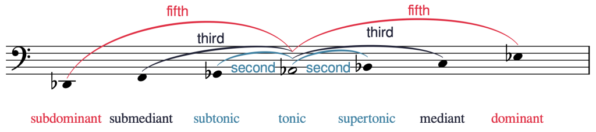

# 大调音阶、音阶级数与调号

> **要点**
>
> - 大调音阶是按全音（W）与半音（H）的顺序排列的音集，上行次序为 W‑W‑H‑W‑W‑W‑H。
> - 大调音阶以其第一个音（也是最后一个音）命名，包括作用于该音的任何变音记号。
> - 音阶级数（scale degree）是用阿拉伯数字加其上方的记号（^）记写的唱名音节。各音阶级数为 $\hat1-\hat2-\hat3-\hat4-\hat5-\hat6-\hat7$。
> - 视唱唱名（solfège）音节是命名大调音阶中各音的另一种方法。这些音节是 *do*、*re*、*mi*、*fa*、*sol*、*la* 和 *ti*。
> - 大调音阶的每个音还有一个音级名称：主音（tonic）、上主音（supertonic）、中音（mediant）、下属音（subdominant）、属音（dominant）、下中音（submediant）和导音（leading tone）。
> - 调号（key signature）由若干升号或降号组成，出现在作品的开头，位于谱号之后、拍号之前。
> - 调号中升号的顺序是 F、C、G、D、A、E、B，而降号的顺序相反：B、E、A、D、G、C、F。在升号调号中，最后一个升号是主音（音阶的第一个音）下方半音；在降号调号中，倒数第二个降号是主音。
> - 五度循环（circle of fifths）是记忆大调调号的一种便利的视觉工具。所有大调调号都按变音记号的数目依次排列在一个圆圈上。

音阶是按半音与全音的顺序排列的音集（复习见[半音、全音与变音记号](05-half-and-whole-steps.md)）。

## 大调音阶

大调音阶（major scale）是按以下上行次序排列的若干半音（缩写为 H）与全音（缩写为 W）的有序集合：W-W-H-W-W-W-H。听谱例 1 可以听到一个上行的大调音阶。每个全音用方括号和「W」标出，每个半音用尖括号和「H」标出。

🎼 [MuseScore 曲谱](https://musescore.com/user/32728834/scores/6815731)

谱例 1. 一个上行的大调音阶。

大调音阶总是起止于相同音名的两个音，相隔一个八度，而这一起止音决定音阶的名称。因此，谱例 1 描绘的是 C 大调音阶，因为它的第一个和最后一个音是 C。

你可以在下面的练习中练习识别大调音阶中的半音与全音：

> **练习**
>
> 🧩 互动练习（H5P）：大调音阶全音—半音识别，见[在线版](13-major-scales.md)。

音阶的名称包括作用于第一个和最后一个音的任何变音记号。谱例 2 展示的是 B♭（降 B）大调音阶——而不是 B 大调音阶，后者会使用另一组不同的音高。注意，每个大调音阶中半音与全音的模式都相同，如谱例 1 和谱例 2 所示。

🎼 [MuseScore 曲谱](https://musescore.com/user/32728834/scores/6823280)

谱例 2. 一个降 B 大调音阶。

大调音阶在许多不同的音乐体裁中都极为常见。泰勒·斯威夫特（Taylor Swift）的《Love Story》（2008）中就能听到一个大调音阶的例子。谱例 3 展示了这首歌结尾处的片段：

*谱例 3. 泰勒·斯威夫特《Love Story》（2008）片段。*

<!-- lilylet-begin: media/2025/07/Love-Story-Swift.png -->
```lyl.play
[composer "Taylor Swift"]
[staves "s,vn"]
[instrument-s "Soprano"]
[instrument-vn "Violin"]

\key e \major \numericTimeSignature \time 4/4 \clef "treble" R1 \\\\
\clef "treble" e'4 ds cs b | %1

r2 r4 r8 b8
\addlyrics { Cause' } \\\\
a'4 gs fs e | %2

e8[ e] e4 e r8 e
\addlyrics { we were both young when } \\\\
R1 | %3

ds8 e4 fs2 e8~
\addlyrics { I first saw you. } \\\\
R1 | %4

e1
\addlyrics { _ } \\\\
R1 | %5
```
<!-- lilylet-end -->
你可以在谱例 4 中从 3:42 处开始听谱例 3 中的音乐。请留意人声进入前不久小提琴奏出的下行大调音阶：

▶️ [视频：Taylor Swift - Love Story](https://www.youtube.com/watch?v=8xg3vE8Ie_E)

<!-- video-begin: https://www.youtube.com/watch?v=8xg3vE8Ie_E -->
<div class="omt-video"><iframe src="https://www.youtube-nocookie.com/embed/8xg3vE8Ie_E" title="video" loading="lazy" allow="accelerometer; autoplay; clipboard-write; encrypted-media; gyroscope; picture-in-picture; fullscreen" allowfullscreen></iframe></div>
<!-- video-end -->

谱例 4. 泰勒·斯威夫特的《Love Story》；从 3:42 处开始听。

你可以在下面的练习中练习识别大调音阶：

> **练习**
>
> 🧩 互动练习（H5P）：大调音阶拼写识别，见[在线版](13-major-scales.md)。

## 音阶级数、视唱唱名与音级名称

音乐家命名大调音阶各音的方法有好几种。音阶级数是用阿拉伯数字加其上方的记号（^）记写的唱名音节。音阶的第一个音是 $\hat{1}$，数字依次上行，直到音阶的最后一个音，它也是 $\hat{1}$（不过有些老师更愿意用 $\hat{8}$）。谱例 5 展示了一个 D 大调音阶，每个音阶级数都用阿拉伯数字加上方的记号标出。

🎼 [MuseScore 曲谱](https://musescore.com/user/32728834/scores/8452298)

谱例 5. 一个 D 大调音阶。

在音阶级数下方，谱例 3 还展示了命名大调音阶各音的另一种方法：视唱唱名（solfège）音节。视唱唱名（一套唱名音节）是命名大调音阶各音的另一种方法。音节 *do*、*re*、*mi*、*fa*、*sol*、*la* 和 *ti*（读作 doe、ray、me、fah、sew、lah、tea）可以用于任何大调音阶的前七个音；它们对应于音阶级数 $\hat{1}$、$\hat{2}$、$\hat{3}$、$\hat{4}$、$\hat{5}$、$\hat{6}$ 和 $\hat{7}$。最后一个音是 *do*（$\hat{1}$），因为它是对第一个音的重复。由于 *do*（$\hat{1}$）随大调音阶第一个音的不同而变化，这种视唱方法称为首调 *do*（movable *do*）。与之相对的是固定 *do*（fixed *do*）的唱名体系，其中 *do*（$\hat{1}$）永远是音级 C。

你可以在下面的练习中练习把大调调号与视唱唱名音节对应起来：

> **练习**
>
> 🧩 互动练习（H5P）：大调音阶唱名配对，见[在线版](13-major-scales.md)。

大调音阶的每个音还有一个音级名称：主音、上主音、中音、下属音、属音、下中音、导音，然后又是主音。谱例 6 展示了这些名称与上文所述的音阶级数数字及视唱唱名体系的对应关系。

| 音阶级数 | 视唱唱名 | 音级名称 |
| --- | --- | --- |
| $\hat{1}$ | *do* | 主音 |
| $\hat{2}$ | *re* | 上主音 |
| $\hat{3}$ | *mi* | 中音 |
| $\hat{4}$ | *fa* | 下属音 |
| $\hat{5}$ | *sol* | 属音 |
| $\hat{6}$ | *la* | 下中音 |
| $\hat{7}$ | *ti* | 导音 |
| $\hat{8}$ / $\hat{1}$ | *do* | 主音 |

谱例 6. 音阶级数、视唱唱名音节与音级名称。

谱例 7 展示了这些音级名称用于一个 A♭ 大调音阶的情形：

🎼 [MuseScore 曲谱](https://musescore.com/user/32728834/scores/8452340)

谱例 7. 一个标有音级名称的 A♭ 大调音阶。

谱例 8 以一种显示音级名称由来顺序的方式，展示 A♭ 大调音阶的音与音级名称。谱表上方的弧线显示每个音阶级数与主音之间的自然音程。

- *属音*（dominant）一词继承自中世纪音乐理论，指的是自然音音乐中主音上方五度的重要性。
- *中音*（mediant）一词意为「中间」，指的是中音正处在主音与属音这两个音高的中间。
- 拉丁语前缀 *super* 意为「在上方」，所以上主音比主音高一个二度。这是唯一的「super-」音程。
- 拉丁语前缀 *sub* 意为「在下方」；下主音（subtonic）、下中音（submediant）和下属音（subdominant）分别是上主音、中音和属音的倒置版本（即位于主音下方）。（注意：导音位于主音下方半音，而下主音位于主音下方全音。我们将在[小调音阶、音阶级数与调号](14-minor-scales.md)中进一步讨论下主音。）

[](../media/2025/07/Scale-Degree-Names-Derivation.png)*谱例 8. A♭ 大调音阶的各音按显示音级名称由来的顺序排列。*

<!-- lilylet-begin: media/2025/07/Scale-Degree-Names-Derivation-1024x228.png -->
```lyl.play
\omit Score.TimeSignature \omit Score.BarLine \clef "bass" df,,1^\markup "fifth" f^\markup "third" gf^\markup "second" af bf^\markup "second" c^\markup "third" ef^\markup "fifth" \undo \omit Score.BarLine \bar "|"
\addlyrics { subdominant submediant subtonic tonic supertonic mediant dominant } | %1
```
<!-- lilylet-end -->
你可以在下面的练习中练习把大调的音阶级数、视唱唱名和音级名称对应起来：

> **练习**
>
> 🧩 互动练习（H5P）：大调音阶级数与唱名测验，见[在线版](13-major-scales.md)。

## 调号

调号由若干升号或降号组成，出现在作品的开头，位于谱号之后、拍号之前。你可以按键名的字母顺序记住这个次序：谱号（clef）、调（key）、拍（time）。谱例 9 展示了一个位于低音谱号与拍号之间的调号。

调号把一个音阶中的变音记号收集起来，放在作品开头，以便更容易掌握哪些音带有变音记号。谱例 9 中，标记音 B、E 和 A 的线与间上都有降号（从左往右读）。因此，使用这一调号的作品中，每一个 B、E 和 A 都是降的，不论在哪个八度。谱例 10 中，这两个 B 都是降的，因为 B♭ 出现在调号中。

*谱例 9. 调号写在谱号之后、拍号之前。*

<!-- lilylet-begin: media/2019/05/Screen-Shot-2020-06-08-at-12.17.31-PM.png -->
```lyl.play
\key ef \major \numericTimeSignature \time 4/4 \clef "bass" R1 | %1
```
<!-- lilylet-end -->
*谱例 10. 不论在哪个八度，两个 B 都是降的。*

<!-- lilylet-begin: media/2019/05/Screen-Shot-2020-06-08-at-12.28.24-PM.png -->
```lyl.play
\key ef \major \numericTimeSignature \time 4/4 \clef "bass" bf,2 bf' | %1
```
<!-- lilylet-end -->
降号调号中降号的添加有特定的顺序，升号调号中升号的添加也是如此。这些顺序与谱号无关。谱例 11 展示了四种最常用谱号中升号与降号的顺序：

*谱例 11. 高音、低音、中音和次中音谱号中升号与降号的顺序。*

<!-- lilylet-begin: media/2019/05/Screen-Shot-2020-06-08-at-1.11.04-PM.png -->
```lyl.play
[staves ",,,"]

\omit Score.TimeSignature \omit Score.BarLine \key cs \major \clef "treble" s1 \\\\
\clef "bass" s1 \\\\
\clef "alto" s1 \\\\
\clef "tenor" s1 | %1
```
```lyl.play
[staves ",,,"]

\omit Score.TimeSignature \omit Score.BarLine \key cf \major \clef "treble" s1 \\\\
\clef "bass" s1 \\\\
\clef "alto" s1 \\\\
\clef "tenor" s1 | %1
```
<!-- lilylet-end -->
升号的顺序永远是 F、C、G、D、A、E、B。这可以用助记句「Fat Cats Go Down Alleys (to) Eat Birds」来记。这些升号形成锯齿形，一上一下交替。在高音、低音和中音谱号中，这一模式在 D♯ 之后「中断」，然后再继续。在次中音谱号中没有中断，但 F♯ 和 G♯ 出现在较低的八度而不是较高的八度。

降号的顺序与升号顺序相反：B、E、A、D、G、C、F。这使降号与升号的顺序互成回文。降号的顺序可以用这个助记句来记：「Birds Eat And Dive Going Copiously Far」。不论何种谱号，降号总是形成完美的锯齿形，一上一下交替，如谱例 11 所示。

有简便的方法记住哪个调号属于哪个大调音阶。在升号调号中，最后一个升号是主音（音阶的第一个音）下方半音。谱例 12 展示了不同谱号中的三个升号调号。用这种方法识别它们的过程如下：

*谱例 12. 高音、低音和中音谱号中的三个不同升号调号。*

<!-- lilylet-begin: media/2019/05/sharp-sigs.png -->
```lyl.play
\omit Score.TimeSignature \key g \major \clef "treble" ^\markup "1" s1 \bar "|" | %1
```
```lyl.play
\omit Score.TimeSignature \key a \major \clef "bass" ^\markup "2" s1 \bar "|" | %1
```
```lyl.play
\omit Score.TimeSignature \key fs \major \clef "alto" ^\markup "3" s1 \bar "|" | %1
```
<!-- lilylet-end -->
1. 最后一个升号（在此例中是唯一的升号）F♯ 位于音 G 的下方半音。因此，这是 G 大调的调号。
2. 最后一个升号 G♯ 位于音 A 的下方半音。因此，这是 A 大调的调号。
3. 最后一个升号 E♯ 位于音 F♯ 的下方半音。因此，这是升 F 大调的调号。

在降号调号中，倒数第二个降号是主音（音阶的第一个音）。谱例 13 展示了不同谱号中的三个降号调号。用这种方法识别它们的过程如下：

*谱例 13. 低音、高音和次中音谱号中的三个不同降号调号。*

<!-- lilylet-begin: media/2019/05/flat-sigs.png -->
```lyl.play
\omit Score.TimeSignature \key bf \major \clef "bass" ^\markup "1" s1 \bar "|" | %1
```
```lyl.play
\omit Score.TimeSignature \key af \major \clef "treble" ^\markup "2" s1 \bar "|" | %1
```
```lyl.play
\omit Score.TimeSignature \key df \major \clef "tenor" ^\markup "3" s1 \bar "|" | %1
```
<!-- lilylet-end -->
1. 这一调号中倒数第二个降号是 B♭。因此，这是降 B 大调的调号。
2. 倒数第二个降号是 A♭。因此，这是降 A 大调的调号。
3. 倒数第二个降号是 G♭。因此，这是降 G 大调的调号。

有两个调号没有任何「窍门」，只能靠记忆。它们是 C 大调（调号中什么也没有，没有升号也没有降号）和 F 大调（有一个降号：B♭）（谱例 14）。

[](../media/2019/05/cmajfmaj.png)*谱例 14. C 大调（上）与 F 大调（下）的调号。*

<!-- lilylet-begin: media/2019/05/cmajfmaj-e1659817325208.png -->
```lyl.play
\omit Score.TimeSignature \key c \major \clef "treble" s1 \bar "|" | %1
```
```lyl.play
\omit Score.TimeSignature \key f \major \clef "bass" s1 \bar "|" | %1
```
<!-- lilylet-end -->
谱例 15 先展示 C 大调的调号（无升号或降号），然后按顺序展示四种谱号中的全部升号调号：G、D、A、E、B、升 F 和升 C 大调。


<!-- lilylet-begin: media/2021/06/Sharp-Key-Signatures.png -->
```lyl.play
[staves ",,,"]

\time 1/4 \omit Score.TimeSignature \key c \major \clef "treble" s4 \bar "||" \\\\
\clef "bass" s4 \bar "||" \\\\
\clef "alto" s4 \bar "||" \\\\
\clef "tenor" s4 \bar "||" | %1

\key g \major s4 \bar "||" \\\\
s4 \bar "||" \\\\
s4 \bar "||" \\\\
s4 \bar "||" | %2

\key d \major s4 \bar "||" \\\\
s4 \bar "||" \\\\
s4 \bar "||" \\\\
s4 \bar "||" | %3

\key a \major s4 \bar "||" \\\\
s4 \bar "||" \\\\
s4 \bar "||" \\\\
s4 \bar "||" | %4

\key e \major s4 \bar "||" \\\\
s4 \bar "||" \\\\
s4 \bar "||" \\\\
s4 \bar "||" | %5

\key b \major s4 \bar "||" \\\\
s4 \bar "||" \\\\
s4 \bar "||" \\\\
s4 \bar "||" | %6

\key fs \major s4 \bar "||" \\\\
s4 \bar "||" \\\\
s4 \bar "||" \\\\
s4 \bar "||" | %7

\key cs \major s4 \bar "||" \\\\
s4 \bar "||" \\\\
s4 \bar "||" \\\\
s4 \bar "||" | %8
```
<!-- lilylet-end -->
谱例 15. C、G、D、A、E、B、升 F 和升 C 在四种谱号中的调号。

谱例 16 先展示 C 大调的调号（无升号或降号），然后按顺序展示四种谱号中的全部降号调号：F、降 B、降 E、降 A、降 D、降 G 和降 C 大调。

*谱例 16. C、F、降 B、降 E、降 A、降 D、降 G 和降 C 在四种谱号中的调号。*

<!-- lilylet-begin: media/2019/05/Screen-Shot-2020-06-08-at-1.57.09-PM-300x225.png -->
```lyl.play
[staves ",,,"]

\time 1/4 \omit Score.TimeSignature \key a \minor \clef "treble" s4 \bar "||" \\\\
\clef "bass" s4 \bar "||" \\\\
\clef "alto" s4 \bar "||" \\\\
\clef "tenor" s4 \bar "||" | %1

\key d \minor s4 \bar "||" \\\\
s4 \bar "||" \\\\
s4 \bar "||" \\\\
s4 \bar "||" | %2

\key g \minor s4 \bar "||" \\\\
s4 \bar "||" \\\\
s4 \bar "||" \\\\
s4 \bar "||" | %3

\key c \minor s4 \bar "||" \\\\
s4 \bar "||" \\\\
s4 \bar "||" \\\\
s4 \bar "||" | %4

\key f \minor s4 \bar "||" \\\\
s4 \bar "||" \\\\
s4 \bar "||" \\\\
s4 \bar "||" | %5

\key bf \minor s4 \bar "||" \\\\
s4 \bar "||" \\\\
s4 \bar "||" \\\\
s4 \bar "||" | %6

\key ef \minor s4 \bar "||" \\\\
s4 \bar "||" \\\\
s4 \bar "||" \\\\
s4 \bar "||" | %7

\key af \minor s4 \bar "||" \\\\
s4 \bar "||" \\\\
s4 \bar "||" \\\\
s4 \bar "||" | %8
```
<!-- lilylet-end -->
谱例 16 先展示 C 大调的调号（无升号或降号），然后是 F、降 B、降 E、降 A、降 D、降 G 和降 C 在四种谱号中的调号。

还有一个可能有助于记忆调号的「窍门」：C 大调是没有升号也没有降号的调号，降 C 大调是所有音都降的调号（共 7 个降号），升 C 大调是所有音都升的调号（共 7 个升号）。

如果大调对应于谱例 15 或 16 中的某一个调号，就称其为「实调」（real）。如果调号需要重升号或重降号，那个调号就是「虚调」（imaginary）。偶尔你可能会遇到虚调的音乐。谱例 17 展示了一个降 F 大调音阶；降 F 大调的调号是虚的，因为它需要用到 B𝄫。

🎼 [MuseScore 曲谱](https://musescore.com/user/32728834/scores/6817049)

谱例 17. 高音谱号中的降 F 大调音阶。

你可以在下面的练习中练习识别大调调号：

> **练习**
>
> 🧩 互动练习（H5P）：大调调号识别，见[在线版](13-major-scales.md)。

 

## 五度循环

五度循环是一幅便利的图示。在五度循环中，所有大调调号按变音记号的数目依次排列在一个圆圈上。它之所以叫五度循环，是因为每个调号与它两侧的调号都相隔一个五度。谱例 18 展示了大调调号的五度循环：

##

*谱例 18. 大调的五度循环。*

如果你从圆圈顶部（12 点钟位置）开始，看到的是 C 大调的调号，它没有升号也没有降号。如果顺时针继续，会出现升号调号，每后一个调号都多一个升号。如果从 C 大调逆时针继续，会出现降号调号，每后一个调号都多一个降号。谱例 16 底部的三个调号（7 点、6 点和 5 点钟位置）在等音上等同。例如，B 大调和降 C 大调音阶的调号不同——分别为五个升号和七个降号——但它们听起来一样，因为 B 与 C♭ 是等音的。

你可以在下面的练习中练习把大调调号的名称与五度循环对应起来：

> **练习**
>
> 🧩 互动练习（H5P）：五度循环配对（大调音阶），见[在线版](13-major-scales.md)。

> 延伸阅读

- Drabkin, William. 2001. “Circle of Fifths.” *Grove Music Online*.  <https://doi.org/10.1093/gmo/9781561592630.article.05806>.
- ——. 2001. “Degree.” *Grove Music Online*.  <https://doi.org/10.1093/gmo/9781561592630.article.07408>.
- ——. 2001. “Scale.” *Grove Music Online*.  <https://doi.org/10.1093/gmo/9781561592630.article.24691>.
- Hyer, Brian. 2001. “Tonality.” *Grove Music Online*.  <https://doi.org/10.1093/gmo/9781561592630.article.28102>.
- Jander, Owen. 2001. “Solfeggio.” *Grove Music Online*.  <https://doi.org/10.1093/gmo/9781561592630.article.26144>.
- McGrain, Mark. 1986. *Music Notation*. Boston: Berklee Press.
- Palmer, Willard A. et. al. 1994. *The Complete Book of Scales, Chords, Arpeggios & Cadences*. Van Nuys, CA: Alfred Publishing.
- Rechberger, Herman. *Scales and Modes around the World*. 2008. Finland: Fennica-Gehrman.
- Roemer, Clinton. 1985. *The Art of Music Copying: The Preparation of Music for Performance*, 2nd edition. Sherman Oaks: Roerick Music Company.

> 在线资源

- [大调音阶教程（musictheory.net）](http://www.musictheory.net/lessons/21)
- [大调音阶（YouTube）](https://www.youtube.com/watch?v=v44NY4fyxHA&t=13s)

    <!-- video-begin: https://www.youtube.com/watch?v=v44NY4fyxHA&t=13s -->
    <div class="omt-video"><iframe src="https://www.youtube-nocookie.com/embed/v44NY4fyxHA?start=13" title="video" loading="lazy" allow="accelerometer; autoplay; clipboard-write; encrypted-media; gyroscope; picture-in-picture; fullscreen" allowfullscreen></iframe></div>
    <!-- video-end -->

- [音级名称（musictheory.net）](https://www.musictheory.net/lessons/23)
- [音阶级数、视唱唱名与音级名称（YouTube）](https://www.youtube.com/watch?v=TB8r2M8oU5Y)

    <!-- video-begin: https://www.youtube.com/watch?v=TB8r2M8oU5Y -->
    <div class="omt-video"><iframe src="https://www.youtube-nocookie.com/embed/TB8r2M8oU5Y" title="video" loading="lazy" allow="accelerometer; autoplay; clipboard-write; encrypted-media; gyroscope; picture-in-picture; fullscreen" allowfullscreen></iframe></div>
    <!-- video-end -->

- [大调调号（musictheory.net）](http://www.musictheory.net/lessons/24)
- [升号调号（YouTube）](https://www.youtube.com/watch?v=TJEM4FS9WSg)

    <!-- video-begin: https://www.youtube.com/watch?v=TJEM4FS9WSg -->
    <div class="omt-video"><iframe src="https://www.youtube-nocookie.com/embed/TJEM4FS9WSg" title="video" loading="lazy" allow="accelerometer; autoplay; clipboard-write; encrypted-media; gyroscope; picture-in-picture; fullscreen" allowfullscreen></iframe></div>
    <!-- video-end -->

- [降号调号（YouTube）](https://www.youtube.com/watch?v=0mF6vwduEdY)

    <!-- video-begin: https://www.youtube.com/watch?v=0mF6vwduEdY -->
    <div class="omt-video"><iframe src="https://www.youtube-nocookie.com/embed/0mF6vwduEdY" title="video" loading="lazy" allow="accelerometer; autoplay; clipboard-write; encrypted-media; gyroscope; picture-in-picture; fullscreen" allowfullscreen></iframe></div>
    <!-- video-end -->

- [大调调号闪卡（music-theory-practice.com）](https://music-theory-practice.com/key-signatures/key-signature-flashcards.html)
- [五度循环（YouTube）](https://www.youtube.com/watch?v=NocewRDr3bk)

    <!-- video-begin: https://www.youtube.com/watch?v=NocewRDr3bk -->
    <div class="omt-video"><iframe src="https://www.youtube-nocookie.com/embed/NocewRDr3bk" title="video" loading="lazy" allow="accelerometer; autoplay; clipboard-write; encrypted-media; gyroscope; picture-in-picture; fullscreen" allowfullscreen></iframe></div>
    <!-- video-end -->

- [五度循环（Classic FM）](https://www.classicfm.com/discover-music/music-theory/what-is-the-circle-of-fifths/)

> 网络作业

1. 书写大调音阶（[.pdf](https://www.funmusiccoimages.com/pdf/13_bk2_writing-major-scales.pdf)，[内含 .pdf 的网站](https://jadebultitude.com/music-theory-resources/music-theory-resources/learn-your-major-scales/)），在键盘上（[.pdf](https://breakingbarlines.com/wp-content/uploads/2022/01/Scales-Complete-Worksheets.pdf)），以及用字母名称，第 2 页（[.pdf](https://wyandotchoirs.weebly.com/uploads/1/0/9/5/109555051/major_scale_wrkst.pdf)）
2. 书写大调调号，第 2、4 页（[.pdf](https://dsmusic.com.au/wp-content/uploads/2012/01/key_sig_worksheet.pdf?srsltid=AfmBOoo-HXTRJUKCVF665Xpr5IYLtFcorddCaCVmoGNvZfpTUrAdl2ES)）
3. 识别大调调号（[.pdf](https://www.wku.edu/music/documents/keysig.pdf)，[.pdf](https://breakingbarlines.com/wp-content/uploads/2021/03/Key-Signatures-Worksheet.pdf)），第 1、3、5 页（[.pdf](https://dsmusic.com.au/wp-content/uploads/2012/01/key_sig_worksheet.pdf?srsltid=AfmBOoo-HXTRJUKCVF665Xpr5IYLtFcorddCaCVmoGNvZfpTUrAdl2ES)，）
4. 书写与识别大调调号（[.pdf](https://michaelkravchuk.com/free-key-signatures-worksheet/)）
5. 简易大调练习表（[.pdf](http://www.musicfun.net.au/pdf_files/keysign_n_scales.pdf)）
6. 音阶级数或视唱唱名（[内含 .pdf 的网站](https://michaelkravchuk.com/free-solfege-worksheets-classroom-instruction/)）

> 作业

1. 大调音阶 A。要求学生书写大调音阶并书写/识别音阶级数。
	- 所有谱号（[.pdf](https://viva.pressbooks.pub/app/uploads/sites/12/2025/07/WK-Major-Scales-A.pdf)）

        <!-- lilylet-begin: media/2025/07/WK-Major-Scales-A.mscz -->
        ```lyl.play
        [composer "Kyle Gullings and Megan Lavengood"]

        \key c \major \time 8/4 \clef "treble" \omit Score.TimeSignature s1..^\markup "1" s4 \bar "||" | %1

        \clef "alto" s1..^\markup "2" s4 \bar "||" | %2

        \clef "treble" s1..^\markup "3" s4 \bar "||" | %3

        \clef "tenor" s1..^\markup "4" s4 \bar "||" | %4

        \clef "bass" s1..^\markup "5" s4 \bar "||" | %5

        s1..^\markup "6" s4 \bar "||" | %6

        \numericTimeSignature \time 4/4 \clef "treble" \omit Score.TimeSignature g'1_\markup "F: supertonic"^\markup "7" | %7

        s1^\markup "8"_\markup "B: " | %8

        s1^\markup "9"_\markup "D: " | %9

        \clef "alto" s1^\markup "10"_\markup "E♭: " | %10

        s1^\markup "11"_\markup "A: dominant" | %11

        \clef "bass" s1^\markup "12"_\markup "F♯: " | %12

        s1^\markup "13"_\markup "B♭: " | %13

        s1^\markup "14"_\markup "G: submediant" | %14

        \clef "tenor" s1^\markup "15"_\markup "D♭: " | %15

        s1^\markup "16"_\markup "E: " | %16

        \clef "treble" g'1^\markup "17"_\markup "E♭: ________"_\markup "" | %17

        a'1^\markup "18"_\markup "G: ________" | %18

        \clef "bass" fs,1^\markup "19"_\markup "D: ________" | %19

        \clef "tenor" af1^\markup "20"_\markup "D♭: ________" | %20

        \clef "alto" e,1^\markup "21"_\markup "F: ________" | %21

        \clef "treble" cs'1^\markup "22"_\markup "E: ____________"_\markup "submediant" | %22

        d1^\markup "23"_\markup "A: ____________" | %23

        \clef "alto" c1^\markup "25"_\markup "D♭: ____________" | %24

        \clef "bass" ef,1^\markup "26"_\markup "A♭: ____________" | %25
        ```
        <!-- lilylet-end -->

	- 仅高音与低音谱号（[.pdf](https://viva.pressbooks.pub/app/uploads/sites/12/2025/07/WK-Major-Scales-A-TB.pdf)）

        <!-- lilylet-begin: media/2025/07/WK-Major-Scales-A-TB.mscz -->
        ```lyl.play
        [composer "Kyle Gullings and Megan Lavengood"]

        \key c \major \time 8/4 \clef "treble" \omit Score.TimeSignature s1..^\markup "1" s4 \bar "||" | %1

        s1..^\markup "2" s4 \bar "||" | %2

        s1..^\markup "3" s4 \bar "||" | %3

        \clef "bass" s1..^\markup "4" s4 \bar "||" | %4

        s1..^\markup "5" s4 \bar "||" | %5

        s1..^\markup "6" s4 \bar "||" | %6

        \numericTimeSignature \time 4/4 \clef "treble" \omit Score.TimeSignature g'1_\markup "F: supertonic"^\markup "7" | %7

        s1^\markup "8"_\markup "B: " | %8

        s1^\markup "9"_\markup "D: " | %9

        s1^\markup "10"_\markup "E♭: " | %10

        s1^\markup "11"_\markup "A: dominant" | %11

        \clef "bass" s1^\markup "12"_\markup "F♯: " | %12

        s1^\markup "13"_\markup "B♭: " | %13

        s1^\markup "14"_\markup "G: submediant" | %14

        s1^\markup "15"_\markup "D♭: " | %15

        s1^\markup "16"_\markup "E: " | %16

        \clef "treble" g'1^\markup "17"_\markup "E♭: ________"_\markup "" | %17

        a'1^\markup "18"_\markup "G: ________" | %18

        \clef "bass" fs,1^\markup "19"_\markup "D: ________" | %19

        af1^\markup "20"_\markup "D♭: ________" | %20

        e,1^\markup "21"_\markup "F: ________" | %21

        \clef "treble" cs'1^\markup "22"_\markup "E: ____________"_\markup "submediant" | %22

        d'1^\markup "23"_\markup "A: ____________" | %23

        \clef "bass" c,1^\markup "25"_\markup "D♭: ____________" | %24

        ef,1^\markup "26"_\markup "A♭: ____________" | %25
        ```
        <!-- lilylet-end -->

2. 大调音阶 B。要求学生书写大调音阶并书写/识别音阶级数。
	- 所有谱号（[.pdf](https://viva.pressbooks.pub/app/uploads/sites/12/2025/07/WK-Major-Scales-B.pdf)）

        <!-- lilylet-begin: media/2025/07/WK-Major-Key-Signatures-B.mscz -->
        ```lyl.play
        [composer "Kyle Gullings and Megan Lavengood"]

        \key bf \major \clef "treble" s1_\markup "______________"_\markup "B♭ major" \bar "||" | %1

        \key gf \major s1_\markup "______________" \bar "||" | %2

        \key g \major s1_\markup "______________" \bar "||" | %3

        \key b \major s1_\markup "______________" \bar "||" | %4

        \key af \major \clef "bass" s1_\markup "______________" \bar "||" | %5

        \key d \major s1_\markup "______________" \bar "||" | %6

        \key a \major s1_\markup "______________" \bar "||" | %7

        \key cf \major s1_\markup "______________" \bar "||" | %8

        \key df \major \clef "alto" s1_\markup "______________" \bar "||" | %9

        \key f \major s1_\markup "______________" \bar "||" | %10

        \key ef \major \clef "tenor" s1_\markup "______________" \bar "||" | %11

        \key cs \major s1_\markup "______________" \bar "||" | %12

        \key d \major \clef "treble" s1 \bar "||" | %13

        \key c \major s1^\markup "B♭ major" \bar "||" | %14

        s1^\markup "D♭ major" \bar "||" | %15

        s1^\markup "F major" \bar "||" | %16

        \clef "bass" s1^\markup "G major" \bar "||" | %17

        s1^\markup "A major" \bar "||" | %18

        s1^\markup "B major" \bar "||" | %19

        s1^\markup "E♭ major" \bar "||" | %20

        \clef "alto" s1^\markup "E major" \bar "||" | %21

        s1^\markup "C♭ major" \bar "||" | %22

        \clef "tenor" s1^\markup "A♭ major" \bar "||" | %23

        s1^\markup "F♯ major" \bar "||" | %24

        \key df \major \time 8/4 \clef "treble" \omit Score.TimeSignature \stemUp df4^\markup "______________"^\markup "D♭ major" ef f gf af \stemDown bf c df \bar "||" | %25

        \key e \major s1..^\markup "______________" s4 \bar "||" | %26

        \key f \major \clef "bass" s1..^\markup "______________" s4 \bar "||" | %27

        \key g \major \clef "treble" \stemUp d4^\markup "D major" e fs g a \stemDown b cs d \bar "||" | %28

        \key af \major s1..^\markup "B♭ major" s4 \bar "||" | %29

        \key d \major \clef "bass" s1..^\markup "G major" s4 \bar "||" | %30

        \key bf \major \clef "alto" s1..^\markup "E♭ major" s4 \bar "||" | %31
        ```
        <!-- lilylet-end -->

	- 仅高音与低音谱号（[.pdf](https://viva.pressbooks.pub/app/uploads/sites/12/2025/07/WK-Major-Scales-B-TB.pdf)）

        <!-- lilylet-begin: media/2025/07/WK-Major-Scales-B-TB.mscz -->
        ```lyl.play
        [composer "Kyle Gullings and Megan Lavengood"]

        \key c \major \time 8/4 \clef "treble" \omit Score.TimeSignature s1..^\markup "1" s4 \bar "||" | %1

        s1..^\markup "2" s4 \bar "||" | %2

        s1..^\markup "3" s4 \bar "||" | %3

        \clef "bass" s1..^\markup "4" s4 \bar "||" | %4

        s1..^\markup "5" s4 \bar "||" | %5

        s1..^\markup "6" s4 \bar "||" | %6

        \numericTimeSignature \time 4/4 \clef "treble" \omit Score.TimeSignature g'1_\markup "F: supertonic"^\markup "7" | %7

        s1^\markup "8"_\markup "E: " | %8

        s1^\markup "9"_\markup "D♭: " | %9

        s1^\markup "10"_\markup "A: " | %10

        s1^\markup "11"_\markup "E♭: leading tone" | %11

        \clef "bass" s1^\markup "12"_\markup "A♭: " | %12

        s1^\markup "13"_\markup "F♯: " | %13

        s1^\markup "14"_\markup "G: subdominant" | %14

        s1^\markup "15"_\markup "B: " | %15

        s1^\markup "16"_\markup "B♭: " | %16

        \clef "treble" g'1^\markup "17"_\markup "E♭: ________"_\markup "" | %17

        c'1^\markup "18"_\markup "G: ________" | %18

        \clef "bass" g1^\markup "19"_\markup "A♭: ________" | %19

        b,1^\markup "20"_\markup "A: ________" | %20

        d,1^\markup "21"_\markup "B♭: ________" | %21

        \clef "treble" as'1^\markup "22"_\markup "C♯: ____________"_\markup "submediant" | %22

        cs'1^\markup "23"_\markup "D: ____________" | %23

        \clef "bass" f,1^\markup "25"_\markup "D♭: ____________" | %24

        b1^\markup "26"_\markup "E: ____________" | %25
        ```
        <!-- lilylet-end -->

3. 大调调号 A。要求学生书写并识别大调调号，以及在调号语境中书写音阶。
	- 所有谱号（[.pdf](https://viva.pressbooks.pub/app/uploads/sites/12/2025/07/WK-Major-Key-Signatures-A.pdf)）

        <!-- lilylet-begin: media/2025/07/WK-Major-Key-Signatures-A.mscz -->
        ```lyl.play
        [composer "Kyle Gullings and Megan Lavengood"]

        \key af \major \clef "treble" s1_\markup "______________"_\markup "A♭ major" \bar "||" | %1

        \key a \major s1_\markup "______________" \bar "||" | %2

        \key d \major s1_\markup "______________" \bar "||" | %3

        \key cf \major s1_\markup "______________" \bar "||" | %4

        \key bf \major \clef "bass" s1_\markup "______________" \bar "||" | %5

        \key g \major s1_\markup "______________" \bar "||" | %6

        \key gf \major s1_\markup "______________" \bar "||" | %7

        \key b \major s1_\markup "______________" \bar "||" | %8

        \key cs \major \clef "alto" s1_\markup "______________" \bar "||" | %9

        \key ef \major s1_\markup "______________" \bar "||" | %10

        \key f \major \clef "tenor" s1_\markup "______________" \bar "||" | %11

        \key df \major s1_\markup "______________" \bar "||" | %12

        \key b \major \clef "treble" s1^\markup "B major" \bar "||" | %13

        \key c \major s1^\markup "E♭ major" \bar "||" | %14

        s1^\markup "G major" \bar "||" | %15

        s1^\markup "A major" \bar "||" | %16

        \clef "bass" s1^\markup "D major" \bar "||" | %17

        s1^\markup "F major" \bar "||" | %18

        s1^\markup "C♯ major" \bar "||" | %19

        s1^\markup "B♭ major" \bar "||" | %20

        \clef "alto" s1^\markup "F♯ major" \bar "||" | %21

        s1^\markup "A♭ major" \bar "||" | %22

        \clef "tenor" s1^\markup "E major" \bar "||" | %23

        s1^\markup "G♭ major" \bar "||" | %24

        \key df \major \time 8/4 \clef "treble" \omit Score.TimeSignature \stemUp df4^\markup "______________"^\markup "D♭ major" ef f gf af \stemDown bf c df \bar "||" | %25

        \key g \major \clef "bass" s1..^\markup "______________" s4 \bar "||" | %26

        \key af \major \clef "alto" s1..^\markup "______________" s4 \bar "||" | %27

        \key g \major \clef "treble" \stemUp d4^\markup "D major" e fs g a \stemDown b cs d \bar "||" | %28

        \key e \major s1..^\markup "B major" s4 \bar "||" | %29

        \key ef \major \clef "bass" s1..^\markup "F major" s4 \bar "||" | %30

        \key g \major \clef "tenor" s1..^\markup "A major" s4 \bar "||" | %31
        ```
        <!-- lilylet-end -->

	- 仅高音与低音谱号（[.pdf](https://viva.pressbooks.pub/app/uploads/sites/12/2025/07/WK-Major-Key-Signatures-A-TB.pdf)）

        <!-- lilylet-begin: media/2025/07/WK-Major-Key-Signatures-A-TB.mscz -->
        ```lyl.play
        [composer "Kyle Gullings and Megan Lavengood"]

        \key af \major \clef "treble" s1_\markup "______________"_\markup "A♭ major" \bar "||" | %1

        \key a \major s1_\markup "______________" \bar "||" | %2

        \key d \major s1_\markup "______________" \bar "||" | %3

        \key cf \major s1_\markup "______________" \bar "||" | %4

        \key bf \major \clef "bass" s1_\markup "______________" \bar "||" | %5

        \key g \major s1_\markup "______________" \bar "||" | %6

        \key gf \major s1_\markup "______________" \bar "||" | %7

        \key b \major s1_\markup "______________" \bar "||" | %8

        \key cs \major \clef "treble" s1_\markup "______________" \bar "||" | %9

        \key ef \major s1_\markup "______________" \bar "||" | %10

        \key f \major \clef "bass" s1_\markup "______________" \bar "||" | %11

        \key df \major s1_\markup "______________" \bar "||" | %12

        \key b \major \clef "treble" s1^\markup "B major" \bar "||" | %13

        \key c \major s1^\markup "E♭ major" \bar "||" | %14

        s1^\markup "G major" \bar "||" | %15

        s1^\markup "A major" \bar "||" | %16

        \clef "bass" s1^\markup "D major" \bar "||" | %17

        s1^\markup "F major" \bar "||" | %18

        s1^\markup "C♯ major" \bar "||" | %19

        s1^\markup "B♭ major" \bar "||" | %20

        s1^\markup "F♯ major" \bar "||" | %21

        s1^\markup "A♭ major" \bar "||" | %22

        \clef "treble" s1^\markup "E major" \bar "||" | %23

        s1^\markup "G♭ major" \bar "||" | %24

        \key df \major \time 8/4 \omit Score.TimeSignature \stemUp df4^\markup "______________"^\markup "D♭ major" ef f gf af \stemDown bf c df \bar "||" | %25

        \key g \major s1..^\markup "______________" s4 \bar "||" | %26

        \key af \major \clef "bass" s1..^\markup "______________" s4 \bar "||" | %27

        \key g \major \clef "treble" \stemUp d4^\markup "D major" e fs g a \stemDown b cs d \bar "||" | %28

        \key e \major s1..^\markup "B major" s4 \bar "||" | %29

        \key ef \major \clef "bass" s1..^\markup "F major" s4 \bar "||" | %30

        \key g \major s1..^\markup "A major" s4 \bar "||" | %31
        ```
        <!-- lilylet-end -->

4. 大调调号 B。要求学生书写并识别大调调号，以及在调号语境中书写音阶。
	- 所有谱号（[.pdf](https://viva.pressbooks.pub/app/uploads/sites/12/2025/07/WK-Major-Key-Signatures-B.pdf)）
	- 仅高音与低音谱号（[.pdf](https://viva.pressbooks.pub/app/uploads/sites/12/2025/07/WK-Major-Key-Signatures-B-TB.pdf)）

        <!-- lilylet-begin: media/2025/07/WK-Major-Key-Signatures-B-TB.mscz -->
        ```lyl.play
        [composer "Kyle Gullings and Megan Lavengood"]

        \key bf \major \clef "treble" s1_\markup "______________"_\markup "B♭ major" \bar "||" | %1

        \key gf \major s1_\markup "______________" \bar "||" | %2

        \key g \major s1_\markup "______________" \bar "||" | %3

        \key b \major s1_\markup "______________" \bar "||" | %4

        \key af \major \clef "bass" s1_\markup "______________" \bar "||" | %5

        \key d \major s1_\markup "______________" \bar "||" | %6

        \key a \major s1_\markup "______________" \bar "||" | %7

        \key cf \major s1_\markup "______________" \bar "||" | %8

        \key df \major \clef "treble" s1_\markup "______________" \bar "||" | %9

        \key f \major s1_\markup "______________" \bar "||" | %10

        \key ef \major \clef "bass" s1_\markup "______________" \bar "||" | %11

        \key cs \major s1_\markup "______________" \bar "||" | %12

        \key d \major \clef "treble" s1 \bar "||" | %13

        \key c \major s1^\markup "B♭ major" \bar "||" | %14

        s1^\markup "D♭ major" \bar "||" | %15

        s1^\markup "F major" \bar "||" | %16

        \clef "bass" s1^\markup "G major" \bar "||" | %17

        s1^\markup "A major" \bar "||" | %18

        s1^\markup "B major" \bar "||" | %19

        s1^\markup "E♭ major" \bar "||" | %20

        s1^\markup "E major" \bar "||" | %21

        s1^\markup "C♭ major" \bar "||" | %22

        \clef "treble" s1^\markup "A♭ major" \bar "||" | %23

        s1^\markup "F♯ major" \bar "||" | %24

        \key df \major \time 8/4 \omit Score.TimeSignature \stemUp df4^\markup "______________"^\markup "D♭ major" ef f gf af \stemDown bf c df \bar "||" | %25

        \key e \major s1..^\markup "______________" s4 \bar "||" | %26

        \key f \major \clef "bass" s1..^\markup "______________" s4 \bar "||" | %27

        \key g \major \clef "treble" \stemUp d4^\markup "D major" e fs g a \stemDown b cs d \bar "||" | %28

        \key af \major s1..^\markup "B♭ major" s4 \bar "||" | %29

        \key d \major \clef "bass" s1..^\markup "G major" s4 \bar "||" | %30

        \key bf \major s1..^\markup "E♭ major" s4 \bar "||" | %31
        ```
        <!-- lilylet-end -->

### 媒体署名

- Love Story Taylor Swift © Chelsey Hamm，依据 [CC BY-SA（署名—相同方式共享）](https://creativecommons.org/licenses/by-sa/4.0/) 许可协议授权
- Scale Degree Names Derivation © Megan Lavengood，依据 [CC BY-SA（署名—相同方式共享）](https://creativecommons.org/licenses/by-sa/4.0/) 许可协议授权
- Key Signature © Chelsey Hamm，依据 [CC BY-SA（署名—相同方式共享）](https://creativecommons.org/licenses/by-sa/4.0/) 许可协议授权
- Key Signature Application © Chelsey Hamm，依据 [CC BY-SA（署名—相同方式共享）](https://creativecommons.org/licenses/by-sa/4.0/) 许可协议授权
- Order of Sharps and Flats © Chelsey Hamm，依据 [CC BY-SA（署名—相同方式共享）](https://creativecommons.org/licenses/by-sa/4.0/) 许可协议授权
- Sharp-sigs © Megan Lavengood，依据 [CC BY-SA（署名—相同方式共享）](https://creativecommons.org/licenses/by-sa/4.0/) 许可协议授权
- Flat-sigs © Megan Lavengood，依据 [CC BY-SA（署名—相同方式共享）](https://creativecommons.org/licenses/by-sa/4.0/) 许可协议授权
- C maj F maj © Megan Lavengood，依据 [CC BY-SA（署名—相同方式共享）](https://creativecommons.org/licenses/by-sa/4.0/) 许可协议授权
- Sharp Key Signatures © Chelsey Hamm，依据 [CC BY-SA（署名—相同方式共享）](https://creativecommons.org/licenses/by-sa/4.0/) 许可协议授权
- All Flat Key Signatures © Chelsey Hamm，依据 [CC BY-SA（署名—相同方式共享）](https://creativecommons.org/licenses/by-sa/4.0/) 许可协议授权
- Circle of Fifths © Bryn Hughes，依据 [CC BY-SA（署名—相同方式共享）](https://creativecommons.org/licenses/by-sa/4.0/) 许可协议授权
