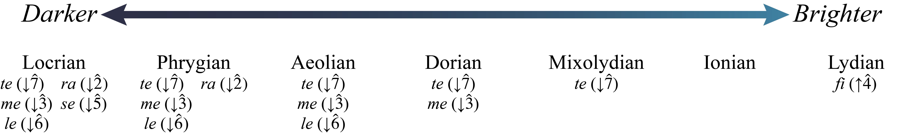

# 自然音调式与半音阶导论

> **要点**
>
> - 自然音调式（diatonic modes）是类似音阶的音集，具有不同的半音与全音模式。
> - 调式可以在一个调式明暗的连续谱系中描述：较明亮的调式听起来更像大调音阶，而较暗淡的调式听起来更像小调音阶。
> - 三个明亮的调式含有 *mi*（$\hat{3}$，主音上方大三度），它们是利底亚（lydian）、伊奥尼亚（ionian）和混合利底亚（mixolydian）。
> - 四个暗淡的调式含有 *me*（$\downarrow\hat{3}$，主音上方小三度），它们是多利亚（dorian）、爱奥利亚（aeolian）、弗里吉亚（phrygian）和罗克里亚（locrian）。
> - 半音阶由十二个相邻的半音组成。半音阶常常（但并非总是）在上行时用升号记写，在下行时用降号记写。
>
> *本书从许多不同角度讨论调式。关于调式的更多信息，见[和弦—音阶理论（爵士）](../06-jazz/07-chord-scale-theory.md)、[调式图式（流行）](../07-popular-music/13-modal-schemas.md)、[自然音调式（20/21 世纪）](../08-20th-and-21st-century-techniques/08-diatonic-modes.md)以及[用调式、音阶与音集分析（20/21 世纪）](https://viva.pressbooks.pub/openmusictheory/chapter/analyzing-with–collections-scales-and-modes/)。本书还在[音集](../08-20th-and-21st-century-techniques/09-collections.md)中更深入地讨论了五声音集。*

## 调式与同主音关系

自然音调式是类似音阶的音集，具有不同的半音与全音模式。如我们此前所学，共用主音的音阶之间具有同主音关系。在这一章中，我们将用同主音关系来描述各调式。我们还会在调式明暗的连续谱系中描述调式：较明亮的调式听起来更像大调音阶，而较暗淡的调式听起来更像小调音阶。

谱例 1 按相对明暗排列了七种自然音调式。它还总结了相对于伊奥尼亚（大调）调式而言，哪些音阶级数发生了变化，其细节将在下文中解释。

*谱例 1. 调式的相对明暗。*

最明亮的调式是利底亚调式。这一调式上行的半音与全音模式是 W‑W‑W‑H‑W‑W‑H。也可以把它看成升高了 $\hat{4}$ 的大调音阶，$\hat{4}$ 的视唱唱名是 *fi*（$\uparrow\hat{4}$）。谱例 2 展示了带视唱唱名的 C 利底亚。

🎼 [MuseScore 曲谱](https://musescore.com/user/32728834/scores/26439799)

谱例 2. 带视唱唱名的 C 利底亚。

次明亮的调式是伊奥尼亚调式。这一调式上行半音与全音的模式与大调音阶相同：W–W–H–W–W–W–H。谱例 3 展示了带视唱唱名的 C 伊奥尼亚。

🎼 [MuseScore 曲谱](https://musescore.com/user/32728834/scores/26439871)

谱例 3. 带视唱唱名的 C 伊奥尼亚。

再下一个明亮的调式是混合利底亚调式，其上行半音与全音模式为 W–W–H–W–W–H–W。也可以把它看成降低了 $\hat{7}$ 的大调音阶。谱例 4 展示了带视唱唱名的 C 混合利底亚。

🎼 [MuseScore 曲谱](https://musescore.com/user/32728834/scores/26439772)

谱例 4. 带视唱唱名的 C 混合利底亚。

利底亚、伊奥尼亚和混合利底亚通常被视为较明亮（或更接近大调）的调式，因为它们含有 *mi* 而不是 *me*（未改变的 $\hat{3}$ 而非降低的 $\hat{3}$）。多利亚、爱奥利亚、弗里吉亚和罗克里亚通常被视为较暗淡（或更接近小调）的调式，因为它们含有 *me* 而不是 *mi*（$\downarrow\hat{3}$ 而非未改变的 $\hat{3}$）。

多利亚调式是第一个较暗淡（或更接近小调）的调式。这一调式上行的半音与全音模式是 W–H–W–W–W–H–W。也可以把它看成升高了 $\hat{6}$（*la*）的小调音阶。谱例 5 展示了带视唱唱名的 C 多利亚：

🎼 [MuseScore 曲谱](https://musescore.com/user/32728834/scores/26439892)

谱例 5. 带视唱唱名的 C 多利亚。

下一个较暗淡的调式是爱奥利亚调式。爱奥利亚调式上行的半音与全音模式和自然小调音阶相同：W–H–W–W–H–W–W。谱例 6 展示了带视唱唱名的 C 爱奥利亚。

🎼 [MuseScore 曲谱](https://musescore.com/user/32728834/scores/26439928)

谱例 6. 带视唱唱名的 C 爱奥利亚。

再下一个较暗淡的调式是弗里吉亚调式。弗里吉亚调式上行的半音与全音模式是 H–W–W–W–H–W–W。它与自然小调音阶的模式相同，但降低了 $\hat{2}$，$\hat{2}$ 的视唱唱名是 *ra*。谱例 7 展示了带视唱唱名的 C 弗里吉亚：

🎼 [MuseScore 曲谱](https://musescore.com/user/32728834/scores/26439733)

谱例 7. 带视唱唱名的 C 弗里吉亚。

最暗淡的调式是罗克里亚调式。罗克里亚调式上行的半音与全音模式是 H–W–W–H–W–W–W。它与自然小调音阶的模式相同，但降低了 $\hat{2}$（*ra*）并降低了 $\hat{5}$——$\hat{5}$ 的视唱唱名是 *se*。谱例 8 展示了带视唱唱名的 C 罗克里亚：

🎼 [MuseScore 曲谱](https://musescore.com/user/32728834/scores/26439829)

谱例 8. 带视唱唱名的 C 罗克里亚。

每个调式都可以从任何音开始。例如，可以从 D♭ 开始构成一个混合利底亚音集，从 G♭ 开始构成一个爱奥利亚音集，或从 F♯ 开始构成一个利底亚音集。在写作调式音集时，务必仔细考虑变音记号。

谱例 9 展示了所有不同调式的音阶级数与视唱唱名，按由明到暗（利底亚到罗克里亚）排列：

🎼 [MuseScore 曲谱](https://musescore.com/user/32728834/scores/26438716)

谱例 9. 从 C 开始、由明到暗排列的各调式及其音阶级数。

仔细听谱例 9，观察各调式之间的差别。

## 五声音集

除了各调式之外，还有其他自然音音集。其中之一是五声音集（pentatonic collection）。这一五音音集使用音程序列大二度–大二度–小三度–大二度–小三度。它正好对应钢琴的黑键（谱例 10a），但可以从任何音开始（例如，谱例 10b 含有一个 D 五声音集）。也可以用视唱唱名来理解大调五声音集：*do*、*re*、*mi*、*sol*、*la* 和 *do*。用音阶级数来说，五声音阶的音级通常与大调音阶相联系，但省略了 $\hat4$ 和 $\hat7$：$\hat1-\hat2-\hat3-\hat5-\hat6$。

🎼 [MuseScore 曲谱](https://musescore.com/user/32728834/scores/26419297)

谱例 10. 一个带视唱唱名的大调五声音集，其后是一个小调五声音集。

你可以通过记住这些音集的视唱唱名模式，并把它们与从同一音开始的大调音阶相联系，来拼写这些音集。例如，如果你想拼写一个降 B 大调五声音集，你会先想到降 B 大调音阶，然后写出 *do*、*re*、*mi*、*sol*、*la* 和 *do*（$\hat1-\hat2-\hat3-\hat5-\hat6-\hat1$）：B♭–C–D–F–G–B♭。

## 半音阶

半音阶由十二个相邻的半音组成。[^1] 谱例 11 展示了三个半音阶：第一个从 C 开始，第二和第三个带有调号（A 和降 E）：

🎼 [MuseScore 曲谱](https://musescore.com/user/32728834/scores/26441134)

谱例 11. 从 A 和降 E 开始的两个半音阶。

如你在谱例 11 中所见，半音阶常常（但并非总是）在上行时用升号记写，在下行时用降号（和/或还原号）记写。以降号音开头的半音阶（如谱例 11 的第三行）通常在上行时用还原号/升号，在下行时用降号。写作半音阶时，不要忘记[键盘](04-the-keyboard-and-grand-staff.md)上有两对白键之间是半音：B/C 和 E/F。谱例 11 还引入了四个新的视唱唱名音节：*di*（升高的 *do*）、*ri*（升高的 *re*）、*si*（升高的 *sol*）和 *li*（升高的 *la*）。一般来说，升高的视唱唱名音节以 *-i* 元音结尾，降低的音节以 *-e* 结尾（*ra* 是例外）。

> 延伸阅读

- Day-O’Connell, Jeremy. 2001. “Pentatonic.” *Grove Music Online*. <https://doi.org/10.1093/gmo/9781561592630.article.21263>.
- Dyson, George, revised by William Drabkin. “Chromatic.” *Grove Music Online*. <https://doi.org/10.1093/gmo/9781561592630.article.05718>.
- McGrain, Mark. 1986. *Music Notation*. Boston: Berklee Press.
- Palmer, Willard A. et al. 1994. *The Complete Book of Scales, Chords, Arpeggios & Cadences*. Van Nuys, CA: Alfred Publishing.
- Powers, Harold S. et al. 2001. “Mode.” *Grove Music Online.*<https://doi.org/10.1093/gmo/9781561592630.article.43718>.
- Rechberger, Herman. *Scales and Modes around the World*. 2008. Finland: Fennica-Gehrman.
- Roemer, Clinton. 1985. *The Art of Music Copying: The Preparation of Music for Performance*, 2nd edition. Sherman Oaks: Roerick Music Company.

> 在线资源

- [调式概览与历史（Classic FM）](https://www.classicfm.com/discover-music/latest/guide-to-musical-modes/)
- [从关系视角理解调式（Learning Music）](https://learningmusic.ableton.com/advanced-topics/modes.html)
- [调式教程与测验（musictheoryfundamentals.com）](http://musictheoryfundamentals.com/MusicTheory/modes.php)
- [调式识别测验（music-theory-practice.com）](https://music-theory-practice.com/modes/scale-modes-quiz.html)
- [五声音阶教程（YouTube）](https://www.youtube.com/watch?v=Wroc0m7Hj-8)

    <!-- video-begin: https://www.youtube.com/watch?v=Wroc0m7Hj-8 -->
    <div class="omt-video"><iframe src="https://www.youtube-nocookie.com/embed/Wroc0m7Hj-8" title="video" loading="lazy" allow="accelerometer; autoplay; clipboard-write; encrypted-media; gyroscope; picture-in-picture; fullscreen" allowfullscreen></iframe></div>
    <!-- video-end -->

- [半音阶（Hello Music Theory）](https://hellomusictheory.com/learn/chromatic-scale/)

> 网络作业

1. 写作调式，第 3 页（[.pdf](https://s3.amazonaws.com/graceimmanuel.gracemusic/theory/worksheets/3.9.pdf)），从关系视角写作（[.pdf](http://funmusiccoimages.com/pdf/54_bk4_modal-scales-worksheet.pdf)）
2. 多利亚，第 1 页；利底亚，第 3 页（[.pdf](http://dsmusic.com.au/wp-content/uploads/2012/01/vce_worksheets_11_to_16.pdf)）
3. 调式识别（[.pdf](http://www.scottlaird.net/files/TheoryWorksheets/Adv__2_student.pdf)，[.pdf](https://www.scribd.com/document/351464211/Worksheet)），第 2、4 页（[.pdf](https://s3.amazonaws.com/graceimmanuel.gracemusic/theory/worksheets/3.9.pdf)）
4. 写作大调五声音集（[.pdf](https://www.musictechteacher.com/music_worksheets/worksheet_0019_pentatonic_practice.htm)）
5. 写作半音阶与调式，第 1 页；五声音集，第 3 页（[.pdf](http://dsmusic.com.au/wp-content/uploads/2012/01/vce_worksheets_17_to_22.pdf)）
6. 写作半音阶（[.pdf](https://earlhaig.ca/departments/music/downloads/Mr.%20Kettle/2)%20JAZZ/3)%20THEORY/05)%20Accidentals/10)%20chromatic%20scale%2037.pdf)）及第 1 页（[.pdf](https://thedockforlearning.org/document/worksheet-2-5-chromatic-scale/)）

> 作业

1. 自然音调式 A。要求学生在调号之内和之外写作自然音调式。
	- 所有谱号（[.pdf](https://viva.pressbooks.pub/app/uploads/sites/12/2025/08/WK-diatonic-modes-A.pdf)）

        <!-- lilylet-begin: media/2025/08/WK-diatonic-modes-A.mscz -->
        ```lyl.play
        [composer "Kyle Gullings and Megan Lavengood"]

        \key c \major \time 8/4 \clef "treble" \omit Score.TimeSignature f4 s s2 s s \bar "||" | %1

        d4 s s2 s s \bar "||" | %2

        c4 s s2 s s \bar "||" | %3

        \clef "bass" af,4 s s2 s s \bar "||" | %4

        f,,4 s s2 s s \bar "||" | %5

        a,4 s s2 s s \bar "||" | %6

        \clef "alto" d,4 s s2 s s \bar "||" | %7

        \clef "tenor" cs,4 s s2 s s \bar "||" | %8

        \key af \major \clef "treble" f4 g af bf c d ef f \bar "||" | %9

        \key a \major a'4 s s2 s s \bar "||" | %10

        \key d \major b'4 s s2 s s \bar "||" | %11

        \key df \major \clef "bass" df,4 s s2 s s \bar "||" | %12

        bf,4 s s2 s s \bar "||" | %13

        \key e \major e,4 s s2 s s \bar "||" | %14

        \key gf \major \clef "alto" ef,4 s s2 s s \bar "||" | %15

        \key b \major \clef "tenor" b,4 s s2 s s \bar "||" | %16
        ```
        <!-- lilylet-end -->

	- 仅高音/低音谱号（[.pdf](https://viva.pressbooks.pub/app/uploads/sites/12/2025/08/WK-diatonic-modes-A-TB.pdf)）
2. 自然音调式 B。要求学生在调号之内和之外写作自然音调式。
	- 所有谱号（[.pdf](https://viva.pressbooks.pub/app/uploads/sites/12/2025/08/WK-diatonic-modes-B.pdf)）

        <!-- lilylet-begin: media/2025/08/WK-diatonic-modes-B.mscz -->
        ```lyl.play
        [composer "Kyle Gullings and Megan Lavengood"]

        \key c \major \time 8/4 \clef "treble" \omit Score.TimeSignature a'4 s s2 s s \bar "||" | %1

        af'4 s s2 s s \bar "||" | %2

        c4 s s2 s s \bar "||" | %3

        \clef "bass" g,4 s s2 s s \bar "||" | %4

        e,,4 s s2 s s \bar "||" | %5

        d,4 s s2 s s \bar "||" | %6

        \clef "alto" ef,4 s s2 s s \bar "||" | %7

        \clef "tenor" b,4 s s2 s s \bar "||" | %8

        \key af \major \clef "treble" f4 g af bf c d ef f \bar "||" | %9

        \key g \major g'4 s s2 s s \bar "||" | %10

        \key af \major f4 s s2 s s \bar "||" | %11

        \key a \major \clef "bass" a,4 s s2 s s \bar "||" | %12

        \key e \major cs,4 s s2 s s \bar "||" | %13

        \key b \major b,4 s s2 s s \bar "||" | %14

        \key df \major \clef "alto" bf4 s s2 s s \bar "||" | %15

        \key d \major \clef "tenor" d,4 s s2 s s \bar "||" | %16
        ```
        <!-- lilylet-end -->

	- 仅高音/低音谱号（[.pdf](https://viva.pressbooks.pub/app/uploads/sites/12/2025/08/WK-diatonic-modes-B-TB.pdf)）

        <!-- lilylet-begin: media/2025/08/WK-diatonic-modes-B-TB.mscz -->
        ```lyl.play
        [composer "Kyle Gullings and Megan Lavengood"]

        \key c \major \time 8/4 \clef "treble" \omit Score.TimeSignature a'4 s s2 s s \bar "||" | %1

        af'4 s s2 s s \bar "||" | %2

        c4 s s2 s s \bar "||" | %3

        \clef "bass" g,4 s s2 s s \bar "||" | %4

        e,,4 s s2 s s \bar "||" | %5

        d,4 s s2 s s \bar "||" | %6

        \clef "treble" ef4 s s2 s s \bar "||" | %7

        \clef "bass" b,4 s s2 s s \bar "||" | %8

        \key af \major \clef "treble" f4 g af bf c d ef f \bar "||" | %9

        \key g \major g'4 s s2 s s \bar "||" | %10

        \key af \major f4 s s2 s s \bar "||" | %11

        \key a \major \clef "bass" a,4 s s2 s s \bar "||" | %12

        \key e \major cs,4 s s2 s s \bar "||" | %13

        \key b \major b,4 s s2 s s \bar "||" | %14

        \key df \major \clef "treble" bf'4 s s2 s s \bar "||" | %15

        \key d \major \clef "bass" d,4 s s2 s s \bar "||" | %16
        ```
        <!-- lilylet-end -->

3. 半音阶 A。要求学生在调性语境之内和之外写作半音阶。
	- 所有谱号（[.pdf](https://viva.pressbooks.pub/app/uploads/sites/12/2025/07/WK-chromatic-scales-A.pdf)）

        <!-- lilylet-begin: media/2025/07/WK-chromatic-scales-A.mscz -->
        ```lyl.play
        [composer "Kyle Gullings and Megan Lavengood"]

        \key c \major \time 13/4 \clef "bass" \omit Score.TimeSignature b,4^\markup "1" s\breve s1 | %1

        b4 s\breve s1 \bar "||" | %2

        \clef "treble" df4^\markup "2" s\breve s1 | %3

        df'4 s\breve s1 \bar "||" | %4

        \key a \major \clef "bass" a,4^\markup "A major"^\markup "3" as b bs cs d ds e es fs fss gs a | %5

        a4 gs g fs f e ef d cs c b bf a \bar "||" | %6

        \key c \major \clef "treble" s1..^\markup "E major"^\markup "4" s1. | %7

        s1.. s1. \bar "||" | %8

        \clef "bass" s1..^\markup "F major"^\markup "5" s1. | %9

        s1.. s1. \bar "||" | %10

        \clef "alto" s1..^\markup "C minor"^\markup "6" s1. | %11

        s1.. s1. \bar "||" | %12
        ```
        <!-- lilylet-end -->

	- 仅高音/低音谱号（[.pdf](https://viva.pressbooks.pub/app/uploads/sites/12/2025/07/WK-chromatic-scales-A-TB.pdf)）

        <!-- lilylet-begin: media/2025/07/WK-chromatic-scales-A-TB.mscz -->
        ```lyl.play
        [composer "Kyle Gullings and Megan Lavengood"]

        \key c \major \time 13/4 \clef "bass" \omit Score.TimeSignature b,4^\markup "1" s\breve s1 | %1

        b4 s\breve s1 \bar "||" | %2

        \clef "treble" df4^\markup "2" s\breve s1 | %3

        df'4 s\breve s1 \bar "||" | %4

        \key a \major \clef "bass" a,4^\markup "A major"^\markup "3" as b bs cs d ds e es fs fss gs a | %5

        a4 gs g fs f e ef d cs c b bf a \bar "||" | %6

        \key c \major \clef "treble" s1..^\markup "E major"^\markup "4" s1. | %7

        s1.. s1. \bar "||" | %8

        \clef "bass" s1..^\markup "F major"^\markup "5" s1. | %9

        s1.. s1. \bar "||" | %10

        s1..^\markup "C minor"^\markup "6" s1. | %11

        s1.. s1. \bar "||" | %12
        ```
        <!-- lilylet-end -->

4. 半音阶 B。要求学生在调性语境之内和之外写作半音阶。
	- 所有谱号（[.pdf](https://viva.pressbooks.pub/app/uploads/sites/12/2025/07/WK-chromatic-scales-B.pdf)）

        <!-- lilylet-begin: media/2025/07/WK-chromatic-scales-B.mscz -->
        ```lyl.play
        [composer "Kyle Gullings and Megan Lavengood"]

        \key c \major \time 13/4 \clef "tenor" \omit Score.TimeSignature ef,4^\markup "1" s\breve s1 | %1

        ef4 s\breve s1 \bar "||" | %2

        \clef "treble" g'4^\markup "2" s\breve s1 | %3

        g''4 s\breve s1 \bar "||" | %4

        \key a \major \clef "bass" a,4^\markup "A major"^\markup "3" as b bs cs d ds e es fs fss gs a | %5

        a4 gs g fs f e ef d cs c b bf a \bar "||" | %6

        \key c \major \clef "treble" s1..^\markup "B♭ major"^\markup "4" s1. | %7

        s1.. s1. \bar "||" | %8

        \clef "bass" s1..^\markup "E minor"^\markup "5" s1. | %9

        s1.. s1. \bar "||" | %10

        \clef "alto" s1..^\markup "C major"^\markup "6" s1. | %11

        s1.. s1. \bar "||" | %12
        ```
        <!-- lilylet-end -->

	- 仅高音/低音谱号（[.pdf](https://viva.pressbooks.pub/app/uploads/sites/12/2025/07/WK-chromatic-scales-B-TB.pdf)）

        <!-- lilylet-begin: media/2025/07/WK-chromatic-scales-B-TB.mscz -->
        ```lyl.play
        [composer "Kyle Gullings and Megan Lavengood"]

        \key c \major \time 13/4 \clef "bass" \omit Score.TimeSignature ef,,4^\markup "1" s\breve s1 | %1

        ef,4 s\breve s1 \bar "||" | %2

        \clef "treble" g'4^\markup "2" s\breve s1 | %3

        g''4 s\breve s1 \bar "||" | %4

        \key a \major \clef "bass" a,4^\markup "A major"^\markup "3" as b bs cs d ds e es fs fss gs a | %5

        a4 gs g fs f e ef d cs c b bf a \bar "||" | %6

        \key c \major \clef "treble" s1..^\markup "B♭ major"^\markup "4" s1. | %7

        s1.. s1. \bar "||" | %8

        \clef "bass" s1..^\markup "E minor"^\markup "5" s1. | %9

        s1.. s1. \bar "||" | %10

        s1..^\markup "C major"^\markup "6" s1. | %11

        s1.. s1. \bar "||" | %12
        ```
        <!-- lilylet-end -->

### 媒体署名

- Brightness and Darkness of Modes © Nathaniel Mitchell，依据 [CC BY-SA（署名—相同方式共享）](https://creativecommons.org/licenses/by-sa/4.0/) 许可协议授权

---

[^1]: 由于半音阶缺乏大调或小调音阶那样的功能性，音乐理论家有时把半音阶视为一个音集。
