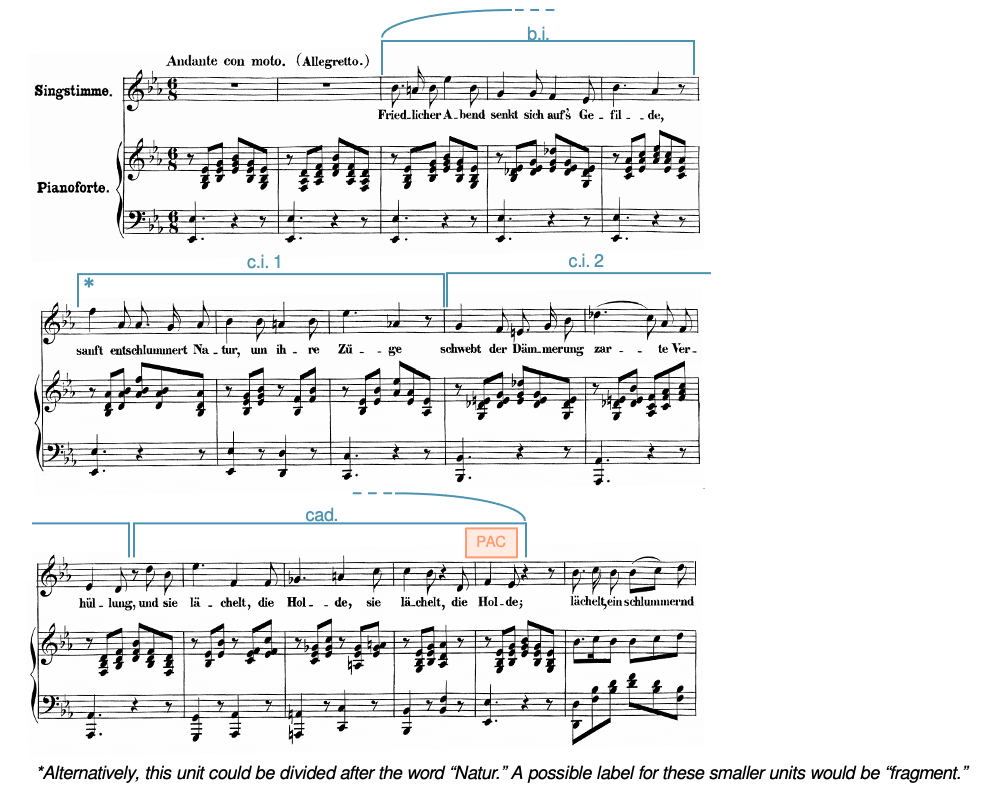
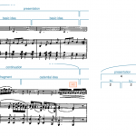
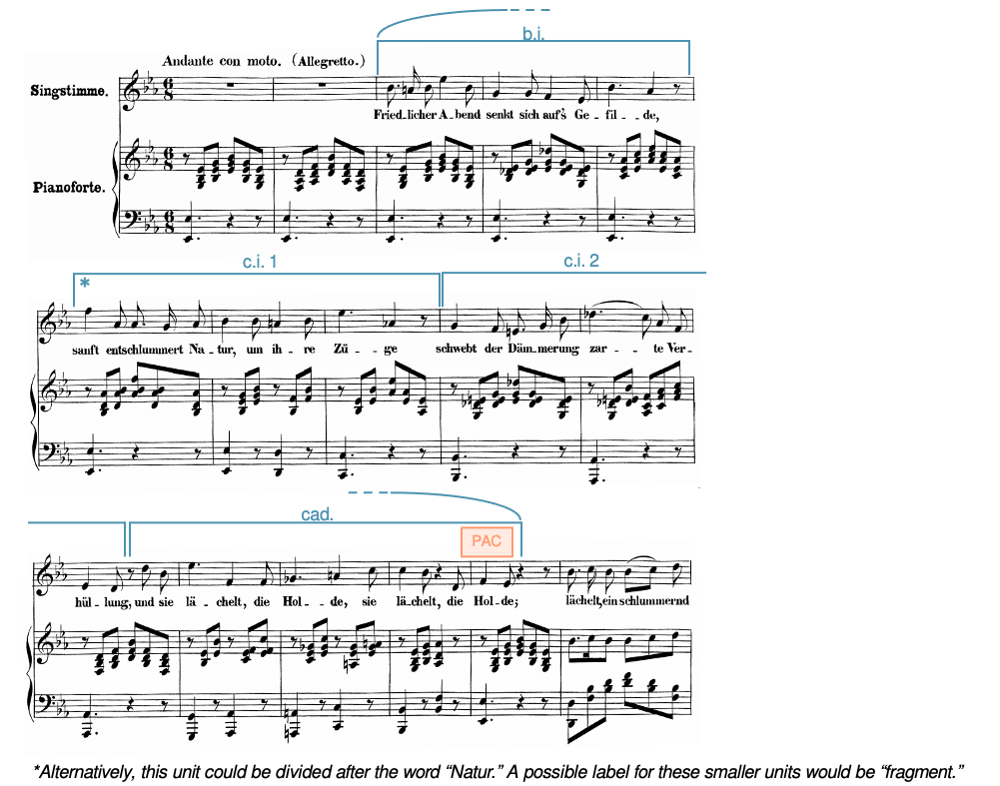

# 乐句、曲式原型与独特曲式

> **要点**
>
> 本章介绍乐句、乐句体（sentence）、乐段（period）、重复乐句、复合形式以及独特的乐句级曲式。
>
> - 乐句是一个相对完整的乐思，表现出走向某个目标的运动轨迹。在调性古典音乐中，这个目标几乎总是某一种传统终止式；但在其他类型的音乐中，这个目标可能是别的东西。
> 	- 乐句体是一种特殊的乐句，包含一个呈示部分和一个展开部分。
> - 有时乐句会组合成更大的形式。两种这样的乐句组合是：
> 	- 乐段：一种由前乐句与后乐句构成的乐句级曲式。
> 	- 重复乐句：两个乐句，其中第二个是对第一个的写出重复。
> - 有时两个乐句体会以前乐句—后乐句的关系组合起来，构成复乐段。
> - 尽管本章讨论的曲式都相当常见，但作曲家写出一个与这里讨论的曲式并无对话关系的独特乐句级曲式，同样常见。

[本章歌单](https://open.spotify.com/playlist/6xz945X5mJLAJepdyoB1Iv?si=582643127f9c48a0)

## 乐句

*谱例 1. [舒伯特《Du bist die Ruh》（0:21–0:32）](https://open.spotify.com/track/27K996qPlCcnWSxr3zkDg6)中一个常见长度乐句的分段分析。*

<!-- lilylet-begin: media/2019/06/Example_001-e1623944080164.png -->
```lyl.play
[composer "Franz Schubert"]
[staves "<voice> {pr-pl}"]
[instrument-voice "Voice"]
[instrument-pr-pl "Piano"]

\staff "1" \key ef \major \time 3/8 \clef "treble" R4. \\\\
\staff "1" \clef "treble" \stemUp bf''4.~ \\
\staff "1" \stemDown ef'8\>[ d16 c d8\!] \\
\staff "1" \stemDown bf'4. \\
\staff "2" \clef "treble" \stemUp f16[ af f af f af] \\
\staff "2" \stemDown bf4. | %1

\staff "1" R4. \\\\
\staff "1" \stemUp bf''8 s4 \\
\staff "1" \stemDown <bf' ef>8 g16[ bf g bf] \\
\staff "1" s4. \\
\staff "2" \stemUp <ef g>8 r r \clef "bass" \\
\staff "2" s4. | %2

\staff "1" bf'8^\markup "[mm. 3–4" bf8. bf16
\addlyrics { Du bist die } \\\\
\staff "1" g'16\pp[ bf g bf g bf] \\
\staff "2" \stemDown ef8[ ef8. ef16] | %3

\staff "1" c'4 c8^\markup "]"
\addlyrics { Ruh, der } \\\\
\staff "1" g'16[ c g c g c] \\
\staff "2" \stemDown ef4. | %4

\staff "1" ef'4^\markup "[mm. 5–6" d8
\addlyrics { Frie -- de } \\\\
\staff "1" \stemUp ef'4( d8 \\
\staff "1" \stemDown g'16[ bf g bf af bf] \\
\staff "2" <g ef'>4( <bf f'>8 | %5

\staff "1" ef'4.^\markup "PAC ]"
\addlyrics { mild, } \\\\
\staff "1" \stemUp ef'4.) \\
\staff "1" \stemDown g'16[ bf g bf g bf] \\
\staff "2" <g ef'>4.) | %6
```
<!-- lilylet-end -->
*谱例 2. [Fanny Hensel《Abendbild》（0:00–0:40）](https://open.spotify.com/track/6ZHUs1Lg0A1LjIMRZIEepl)中一个独特长度乐句的分段分析。*

<!-- lilylet-begin: media/2019/06/Example_002-e1623944015483.png -->
```lyl.play
[composer "Fanny Hensel"]
[staves "<voice> {pr-pl}"]
[instrument-voice "Singstimme" "Sgst."]
[instrument-pr-pl "Pianoforte" "Pfte."]

\staff "1" \key ef \major \time 6/8 \tempo "Andante con moto. (Allegretto.)" \clef "treble" R2. \\\\
\staff "1" \clef "treble" r8 <g bf ef>[ <bf ef g>] <ef g bf>[ <bf ef g> <g bf ef>] \\
\staff "2" \clef "bass" <ef,, ef'>4. r4 r8 | %1

\staff "1" R2. \\\\
\staff "1" r8 <f, af d>[ <af d f>] <d f bf>[ <af d f> <f af d>] \\
\staff "2" <ef,, ef'>4. r4 r8 | %2

\staff "1" bf'8.^\markup "phrase (13 mm., mm. 3–15): b.i. (mm. 3–5)" a16 bf8 ef4 bf8
\addlyrics { Fried -- li -- cher A -- bend } \\\\
\staff "1" r8 <g bf ef>[ <bf ef g>] <ef g bf>[ <bf ef g> <g bf ef>] \\
\staff "2" <ef,, ef'>4. r4 r8 | %3

\staff "1" g'4 g8 f4 ef8
\addlyrics { senkt sich auf's Ge -- } \\\\
\staff "1" r8 <bf df ef>[ <df ef g>] <ef g df'>[ <df ef g> <g, df' ef>] \\
\staff "2" <ef,, ef'>4. r4 r8 | %4

\staff "1" bf'4. af4 r8
\addlyrics { fil -- de; } \\\\
\staff "1" r8 <c ef af>[ <ef af c>] <af c ef>[ <ef af c> <c ef af>] \\
\staff "2" <ef,, ef'>4. r4 r8 | %5

\staff "1" f'4^\markup "c.i. 1 * (mm. 6–8)" af,8 af8. g16 af8
\addlyrics { sanft ent -- schlum -- mert Na -- } \\\\
\staff "1" r8 <bf d af'>[ <d af' bf>] <af' bf f'>[ <d, af' bf> <bf d af'>] \\
\staff "2" <ef,, ef'>4. r4 r8 | %6

\staff "1" bf'4 bf8 a4 bf8
\addlyrics { tur, um ih -- re } \\\\
\staff "1" r8 <bf ef g>[ <ef g bf>] r <af, f'>[ <f' bf>] \\
\staff "2" <ef,, ef'>4 r8 <d d'>4 r8 | %7

\staff "1" ef'4. af,4 r8
\addlyrics { Zü -- ge } \\\\
\staff "1" r8 <bf ef>[ <ef bf'>] <af ef'>[ <ef af> <af, ef'>] \\
\staff "2" <c,, c'>4. r4 r8 | %8

\staff "1" g'4^\markup "c.i. 2 (mm. 9–11)" f8 e8. g16 bf8
\addlyrics { schwebt der Däm -- me -- rung } \\\\
\staff "1" r8 <g df' e>[ <df' e g>] <e g df'>[ <df e g> <g, df' e>] \\
\staff "2" <bf,, bf'>4. r4 r8 | %9

\staff "1" df'4.( c8) af f
\addlyrics { zar -- te Ver -- } \\\\
\staff "1" r8 <g df' e>[ <df' e bf'>] <af c f>[ <c f af> <f af c>] \\
\staff "2" <af,, af'>4. r4 r8 | %10

\staff "1" ef4 d8 r d' bf
\addlyrics { hül -- lung, und sie } \\\\
\staff "1" r8 <f, bf d>[ <af c f>] <d f bf>[ <bf d f> <f bf d>] \\
\staff "2" <af,, af'>4. r4 r8 | %11

\staff "1" ef'4.^\markup "cad. (mm. 12–15)" f,4 f8
\addlyrics { lä -- chelt, die } \\\\
\staff "1" r8 <bf ef>[ <ef bf'>] r <c ef f>[ <ef f c'>] \\
\staff "2" <g,, g'>4 r8 <af af'>4 r8 | %12

\staff "1" gf'4. a4 c8
\addlyrics { Hol -- de, sie } \\\\
\staff "1" r8 <c ef gf>[ <ef gf c>] r <a, ef' gf>[ <ef' gf a>] \\
\staff "2" <a,, a'>4 r8 <c c'>4 r8 | %13

\staff "1" c'4 bf8 r4 d,8
\addlyrics { lä -- chelt, die } \\\\
\staff "1" r8 <g bf ef>[ <bf ef g>] <af d af'>4 r8 \\
\staff "2" <bf,, bf'>4 r8 <bf' f'>4 r8 | %14

\staff "1" f4^\markup "PAC" ef8 r4 r8
\addlyrics { Hol -- de; } \\\\
\staff "1" r8 <g bf ef>[ <bf ef g>] <ef g bf>[ <bf ef g> <g bf ef>] \\
\staff "2" <ef,, ef'>4. r4 r8 | %15

\staff "1" bf'8.[ c16] bf8 bf[( c]) d
\addlyrics { lä -- chelt, ein schlum -- mernd } \\\\
\staff "1" bf'8.[ c16 bf8] bf[ c d] \\
\staff "2" <d,, d'>8[ <f' bf> <bf d>] <d g>[ <bf d> <f bf>] | %16
```
<!-- lilylet-end -->
乐句是一个相对完整的乐思，表现出走向某个目标的运动轨迹，并到达某种收束感。在调性古典音乐中，乐句的目标几乎总是[和声、终止式与乐句结尾入门](../03-diatonic-harmony/01-intro-to-harmony.md)一章中所描述的那些终止式：完满正格终止（PAC）、不完满正格终止（IAC）与半终止（HC）。[^1]

乐句可以是任意长度，但四小节、八小节或十六小节的乐句特别常见。谱例 1 展示了一个四小节乐句（常见长度）的分段分析，而**谱例 2** 展示了一个十三小节乐句（不寻常长度）的分段分析。

乐句既可以由乐思构成，也可以由子乐句加乐思构成。谱例 3 中的示意图描绘了这两种情形。

我们为乐句画示意图时遵循两条一般原则：

1. 方括号用于乐思与子乐句（基本上是一切不必以终止式结束的东西）。
2. 弧线用于乐句层级及以上的东西（基本上是一切必须以终止式结束的东西）。[^2]

*谱例 3. 乐句分为（a）只有乐思，以及（b）子乐句与乐思。*

由于收束对于辨认乐句如此重要，正确辨认终止式就至关重要。并非每一个停顿或 V–I 进行都是终止式！谱例 4 讨论了一段音乐，其中有几处人们可能误标为终止式的地方。

🧩 交互练习（H5P）：海顿钢琴三重奏 H. 3 第一乐章中的终止式分析，见[在线版](02-phrase-archetypes-unique-forms.md)。

谱例 4. [海顿 F 大调钢琴三重奏 Hob. XV:6 第一乐章（0:00–0:24）](https://www.youtube.com/embed/wTdAw6IHxCg)中一段有几处可能被误标为终止式的音乐。

<!-- video-begin: https://www.youtube.com/embed/wTdAw6IHxCg -->
<div class="omt-video"><iframe src="https://www.youtube-nocookie.com/embed/wTdAw6IHxCg" title="video" loading="lazy" allow="accelerometer; autoplay; clipboard-write; encrypted-media; gyroscope; picture-in-picture; fullscreen" allowfullscreen></iframe></div>
<!-- video-end -->

 

## 两个类别：曲式原型与独特曲式

下面我们将探讨乐句级曲式可能有的两种主要组织方式：

1. 它们可以与所谓的“曲式原型”（archetype）发生关联。这是组织乐句的特殊方式，你将读到两种：乐句体与乐段。
2. 它们也可能与任何原型都无关，这种情况下我们说它们是“独特曲式”（unique forms），即它们并不是按乐句体或乐段来组织的。

要注意，这并不意味着原型比独特曲式更常见。属于这两个类别的乐句级曲式在共性写作时期的音乐中都频繁出现。而且，更好的看法也许是把这些类别看作一条光谱的两端（谱例 5）：一个乐句级曲式可以被理解为“更接近”其中某一类，而并不明确属于任何一类。

[](../media/2019/06/Example_005_Spectrum.png)

谱例 5. 乐句级曲式类别的光谱。

## 原型一：乐句体（一种特殊的乐句）

### 基础

[](../media/2019/06/Example_005-e1623945293487.png)*谱例 6. [Louise Farrenc 大提琴奏鸣曲第二乐章（0:00–0:28）](https://open.spotify.com/track/49N2pJ7uRcH1hvlZs77KGK)开头的一个乐句体。*

谱例 6 展示了构造乐句的一种常见方式，称为乐句体。乐句体由两个子乐句构成：呈示部分与展开部分。呈示部分通常长四小节，由一个基本乐思（b.i.）及其重复构成。展开部分往往与呈示部分等长，从而造成一种比例上的平衡感。它有四个特征，下面将加以讨论。

*谱例 7. 常见的乐句体长度。*

*谱例 8. 一个假想的乐句体，其展开部分比呈示部分更长。*

尽管呈示部分与展开部分等长很常见（谱例 7 展示了几种常见长度），但展开部分比呈示部分更长也同样是常事（谱例 8）。不过，展开部分比呈示部分短就不常见了。

### 更多细节：呈示部分

呈示部分是由一个基本乐思（b.i.）及其重复构成的子乐句（如谱例 6 的前半部分）。

基本乐思通常长两小节，但一小节或四小节的基本乐思也时常出现。

基本乐思的重复常常带有变化，这有时会让人难以判断面对的是重复还是一个完全不同的乐思。通常有助于弄清这一点的一个特征就是**轮廓**：如果两个乐思轮廓相同，我们往往会把第二个听成第一个的变化重复。如果两个乐思轮廓不同，我们就更可能把第二部分听成与第一部分形成对比——这一点在本章后面讨论乐段时还会谈到。

基本乐思的一些常见变形有：

- 节奏或旋律上的加花
- 移调
- 和声配置的改变
- 音程性质或大小的改变（或两者兼有）

呈示部分通常从主和声开始，并可能做下列几种事情之一：

- 通过 $\mathrm{I–V–V–I}$ 或 $\mathrm{I–ii^4_2–V^6_5–I}$ 之类的进行延长主和弦
- 从主进行到属：$\mathrm{I––V––}$
- 从主进行到非属的和声，最常见的是 ii<sup>(6)</sup> 之类的强前属

### 更多细节：展开部分

展开部分是通常比呈示部分更不稳定的子乐句。

它有四个特征：

- 碎片化（f.）：使单位长度比先前确立的单位长度更短（例如，如果每个基本乐思都是两小节，碎片可能只有一小节长）。
	- 注意，*碎片化只指单位的长度*。它不指单位的旋律内容，后者可能与基本乐思有关，也可能无关。
- 节奏活动增强：使用比先前各单位更快的时值。
- 模进：单位被重复并移调。
- 和声节奏加快：和弦变换比先前更频繁。例如，如果每个基本乐思都是两小节长、各由一个和弦配和声，展开部分就可能每小节换一次和弦。

展开子乐句如果包含上述特征越多，就越容易辨认；但非常常见的是，这些特征中只有一部分出现。也许最明显的一个是碎片化，即使其他特征都不存在，它通常也能标示展开部分，但并非所有展开部分都表现出碎片化。

因此，展开部分可以采取两种典型形式之一：带碎片化的（如谱例 6）与不带碎片化的（如谱例 9 与 10）。在谱例 9 中，展开部分不再分成更小的乐思层级。“单位”（u.）这一术语指这样一种分组：它只表达它所从属的上一层分组的特征；在谱例 10 中，它表明这个两小节的乐思表达的是展开（例如通过加快的和声节奏）。

*谱例 9. [贝多芬《军乐队波罗乃兹》（*Polonaise for Military Band*）（0:00–0:06）](https://open.spotify.com/track/2iMZvEsrceSmaeE5aJPyW4)中一个不带碎片化的乐句体。*

<!-- lilylet-begin: media/2019/06/Example_008-e1623945581474.png -->
```lyl.play
[composer "Ludwig van Beethoven"]
[staves "<picc-ob-cl-hn-tr-gc-tb-tri-pi-fg-cf>"]
[instrument-picc "Flauto piccolo" "Fl. picc."]
[instrument-ob "Oboi" "Ob."]
[instrument-cl "Clarinetti in A" "Cl."]
[instrument-hn "Corni in D" "Cor."]
[instrument-tr "Tromba in D" "Tr."]
[instrument-gc "Tamburo grande" "Tamb. gr."]
[instrument-tb "Tamburo militare" "Tamb. mil."]
[instrument-tri "Triangolo" "Tri."]
[instrument-pi "Cinelli" "Cin."]
[instrument-fg "Fagotti" "Fag."]
[instrument-cf "Contrafagotto" "Cfag."]

\key d \major \time 3/4 \partial 8 \clef "treble" a''8\f^\markup "b.i."^\markup "presentation"^\markup "sentence" \bar ".|:" \\\\
\partial 8 \clef "treble" <fs' a>8\f \\\\
\partial 8 \clef "treble" <a' c>8\f \\\\
\partial 8 \clef "treble" <e' g>8\f \\\\
\partial 8 \clef "treble" g'8\f \\\\
\partial 8 \clef "treble" r8 \\\\
\partial 8 \clef "treble" r8 \\\\
\partial 8 \clef "treble" r8 \\\\
\partial 8 \clef "treble" r8 \\\\
\partial 8 \clef "bass" <fs, a>8\f \\\\
\partial 8 \clef "bass" r8 | %1

a''8[ a] a4. d8^\markup "b.i." \\\\
<fs' a>8[ <fs a>] <fs a>4. <fs d'>8 \\\\
<a' c>8[ <a c>] <a c>4. <a f'>8 \\\\
<c' e>8[ <e g> <c e> <e g> <c e> <e g>] \\\\
g'8[ g] g4. g8 \\\\
d4\f r r \\\\
r4 d\f d \\\\
d'8\f[ d d d d d] \\\\
d'4\f r r \\\\
<d, d'>8 r <d d'> r <d d'> r \\\\
d,8\f r d r d r | %2

cs''8[ cs] cs4. cs8^\markup "continuation" \\\\
<e' cs'>8[ <e cs'>] <e cs'>4. <e cs'>8 \\\\
<g' e'>8[ <g e'>] <g e'>4. <g e'>8 \\\\
<g' d'>8[ <d' f> <g, d'> <d' f> <g, d'> <d' f>] \\\\
g'8[ g] g4. g8 \\\\
d4 r r \\\\
r4 d d \\\\
d'8[ d d d d d] \\\\
d'4 r r \\\\
<a, a'>8 r <a a'> r <a a'> r \\\\
a,8 r a r a r | %3

d''8([ cs b a g fs)] \\\\
<fs' d'>8([ <a cs> <g b> <fs a> <e g> <d fs>)] \\\\
<a' f'>8([ <c e> <bf d> <a c> <g e'> <a f'>)] \\\\
<c' e>4 r8 <e g>8[ <d f> <c e>] \\\\
c'4 r8 c16[ c] c8[ c,] \\\\
d4 d d \\\\
r4 d d8[ d] \\\\
d'8[ d d d d d] \\\\
d'4 d d \\\\
<d, d'>8([ <a' cs> <g b> <fs a> <e g> <d fs>)] \\\\
d,4 d8[ d a' d,] | %4

e'8^\markup "HC" a4 a8 s4 \\\\
<cs' e>8 <a a'>4 <a a'>8 s4 \\\\
<e' g>8[ <e g>16 <f a>] <g bf>8[ <f a>] s4 \\\\
<g' d'>8[ <g d'>16 <c e>] <d f>8[ <c e>] s4 \\\\
g'8 r g r s4 \\\\
d4 d s4 \\\\
d8[ d] d[ d] s4 \\\\
d'8 r d r s4 \\\\
d'4 d s4 \\\\
<a, e'>8[ <a e'>16 <d fs>] <e g>8[ <d fs>] s4 \\\\
a8 r a, r s4 | %5
```
<!-- lilylet-end -->
*谱例 10. [贝多芬钢琴奏鸣曲第 4 号 Op. 7 第二乐章（0:00–0:45）](https://open.spotify.com/track/35XvZd3hlRtc8iN8HQymUs)中一个展开部分不表现出碎片化的乐句体。*

<!-- lilylet-begin: media/2019/06/Example_009-e1623945687930.png -->
```lyl.play
[composer "Ludwig van Beethoven"]
[staves "{-}"]

\staff "1" \key c \major \time 3/4 \tempo "Largo, con gran espressione" \clef "treble" \stemUp <g c e>4(^\markup "b.i."^\markup "presentation"^\markup "sentence" <g d' f>8) r8 r4 \\
\staff "2" \clef "bass" <c,, g' c>4(\p <b g' b>8) r8 r4 | %1

\staff "1" \stemUp g'8.([ d16] e8) r8 r4 \clef "bass" \\
\staff "1" \stemDown g4 g8 s4. \\
\staff "2" <b,, g' b>4( <c g' c>8) r8 r4 | %2

\staff "1" \stemDown <e, g c e>4(^\markup "b.i." <d a' d>8) r8 r4 \\
\staff "2" <c,, c'>4( <fs, fs'>8) r8 r4 | %3

\staff "1" \stemUp d8.[ a16] c4.( b8) \\
\staff "1" \stemDown d,4 <d g>2\sf \\
\staff "2" <fs,,, fs'>4( <f f'>2) | %4

\staff "1" \stemDown <e, g c>4(^\markup "u."^\markup "continuation" <f g b d> <g c e> \\
\staff "2" e,,4 <d d'> <c c'> | %5

\staff "1" \stemUp <g e'>4 <f d'> <e a c>-.) \\
\staff "1" \stemDown a2 s4 \\
\staff "2" <f,,, f'>2. | %6

\staff "1" \stemUp b2~^\markup "cad." b8[ b] \\
\staff "1" \stemUp d,2 s4 \\
\staff "1" \stemDown a4 g8[ af <d, g> <d f>] \\
\staff "2" <g,, g'>2 <g g'>4 | %7

\staff "1" \partial 4. \stemUp <c e>4(^\markup "PAC" c8) \\
\staff "1" \partial 4. \stemDown f,4( e8) \\
\staff "2" \partial 4. \stemUp g,4( b8-.) \\
\staff "2" \partial 4. \stemDown c,,4. | %8
```
<!-- lilylet-end -->
因此，展开部分可以采取两种典型形式之一：

- 上面的谱例 6 展示了一个带碎片化的典型展开部分。
- 谱例 8 与 9 展示了不带碎片化的展开部分。
	- 在谱例 9 中，展开部分不再分成更小的乐思层级。
	- 谱例 10 中用“单位”（u.）这一术语来指一种分组：它只表达它所从属的上一层分组的特征。这里，单位意味着这个两小节的乐思通过加快的和声节奏表达展开。

由于展开部分在开头是不稳定的，很难概括它在和声上会如何开始。不过就其结尾而言，展开部分总是奔向一个终止式；在古典音乐中，这个终止式可以是三种常见类型中的任何一种（完满正格终止、半终止或不完满正格终止）。

### 小结：原型乐句体及其变体

乐句体有许多形态：最清晰、最明显的乐句体更接近理想化的原型，而不太清晰的乐句可能变化很大，却仍表现出乐句体的某些特征（我们把这样的乐句称为“乐句体式的”）。原型乐句体由下列要素构成：

- 4 或 8 小节
- 一个呈示部分
- 一个长度与呈示部分相平衡的展开部分
- 展开部分中的碎片化

说清楚一点：许多乐句体并不具备所有这些特征。最低限度上，一个乐句要称得上乐句体式的，需要有一个呈示部分和一个展开部分。

## 原型二：乐段（两个乐句的组合）

### 基础

*谱例 11. [莫扎特单簧管协奏曲第三乐章（0:00–0:11）](https://open.spotify.com/track/5johgHZOu21C42oDzKBBS8)中的一个乐段。*

<!-- lilylet-begin: media/2019/06/Example_010-e1623945819436.png -->
```lyl.play
[composer "Wolfgang Amadeus Mozart"]
[staves "<cl> {vn-bs}"]
[instrument-cl "Clarinet in A" "Cl."]
[instrument-vn-bs "Strings" "Str."]

\key c \major \time 6/8 \partial 8 \tempo "Allegro" \clef "treble" e'16(\p^\markup "basic idea"^\markup "antecedent"^\markup "Solo" f) \\\\
\staff "1" \partial 8 \clef "treble" r8 \\
\staff "2" \partial 8 \clef "bass" r8 | %1

g''8-. g-. g-. a16( g fs g a g) \\\\
\staff "1" <a' cs>8_\markup "Viol."\p[ r <a cs>] <a cs>[ <a cs> <a cs>] \\
\staff "2" R2. | %2

f'4.( e8) r c'16(^\markup "contrasting idea" b) \\\\
\staff "1" <d e gs b>4.( <a' cs>8) r r \\
\staff "2" R2. | %3

a''8-. a-. a16( g) f8-. f16( e d c) \\\\
\staff "1" <d a'>8-.[ <d a'>-.] r <fs a>-.[ <fs a>-.] r \\
\staff "2" R2. | %4

b'8([ c cs)] d^\markup "HC" r e16(^\markup "basic idea"^\markup "consequent" f) \\\\
\staff "1" e8-.([ <e fs>-. <e g>-.] <e gs>) r a16( b) \\
\staff "2" R2. | %5

g''8-. g-. g-. a16( g fs g a g) \\\\
\staff "1" <a' cs>8[ r <a cs>] <a cs>[ <a cs> <a cs>] \\
\staff "2" R2. | %6

a''4.(^\markup "(basic idea)"^\markup "(consequent)" c8) r c16(^\markup "contrasting idea" b) \\\\
\staff "1" \stemUp <b' d>4.( <fs a cs>8) r r \\
\staff "1" \stemDown e4( es8) s4. \\
\staff "2" R2. | %7

a''16([ g f e d c)] b([ c d e f b,)] \\\\
\staff "1" <fs a>8 r r <b, d> r r \\
\staff "2" d8 r r e,8 r r | %8

c'4(^\markup "PAC" e8) c4 s8 \\\\
\staff "1" cs4( e8) cs4 s8 \\
\staff "2" a8[ a a] a r s | %9
```
<!-- lilylet-end -->
除了乐句体之外，另一种常见的乐句级曲式是乐段（谱例 11）。与作为单个乐句的乐句体不同，乐段由两个乐句构成，每个乐句都由一个基本乐思（b.i.）后接一个对比乐思（c.i.）组成（关于这些乐思在每个乐句中处理方式的不同，见[下文](#more-detail-the-antecedent)）。第一个乐句称为前乐句（antecedent），通常长四小节，以一个较弱的终止式结束，最常见的是半终止（HC）。第二个乐句称为后乐句（consequent）。它以一个比前乐句更强的终止式结束，最常见的是完满正格终止（PAC）。它的长度可以与前乐句相同或更长；比前乐句短则罕见。

### 更多细节：前乐句 {#more-detail-the-antecedent}

前乐句有时被描述为“提出一个问题”，而后乐句“给出答案”。另一种理解方式是：前乐句作出一个不完整的陈述，后乐句把它补全。这两种描述都源于一个事实：前乐句总是以比后乐句更弱的终止式结束。

前乐句通常从主和声开始，最常以半终止结束。前乐句固然有可能转调，但它完全处于主调中更为常见。

### 更多细节：后乐句

与前乐句一样，后乐句也由基本乐思与对比乐思构成。多数后乐句以一个与前乐句相似或相同的基本乐思开始，但也可能不同。[^3] 如果两个基本乐思不同，把前乐句的基本乐思标为“b.i.<sup>1</sup>”、后乐句的标为“b.i.<sup>2</sup>”可能会有帮助。

后乐句的对比乐思几乎总是与前乐句的不同，因为它的终止式必须比前乐句的更强。差异的程度差别很大：有时后乐句的对比乐思开头与前乐句一样，只在接近结尾处才有变化；另一些时候，这个对比乐思完全不同。

后乐句最常从主和声开始，以 PAC 结束。

乐段可以始终停留在一个调中，也可以转调（即换调）。如果乐段转调，换调通常发生在后乐句期间。

## 重复乐句（另一种组合两个乐句的方式）

另一种相对常见的乐句级曲式——它有时会与乐段混淆——是重复乐句（repeated phrase），即一个乐句后接一个写出重复（谱例 12）。

[](../media/2019/06/Example_011-e1623945999625.png)*谱例 12. [舒伯特《Du bist die Ruh》（0:22–0:44）](https://open.spotify.com/track/27K996qPlCcnWSxr3zkDg6)中的一个重复乐句。*

<!-- lilylet-begin: media/2019/06/Example_011-150x150.png -->
```lyl.play
[composer "Franz Schubert"]
[staves "<voice> {pr-pl}"]
[instrument-voice "Voice"]
[instrument-pr-pl "Piano"]

\staff "1" \key ef \major \time 3/8 \clef "treble" R4. \\\\
\staff "1" \clef "treble" \stemUp bf''4.~ \\
\staff "1" \stemDown ef'8\>[ d16 c d8\!] \\
\staff "1" \stemDown bf'4. \\
\staff "2" \clef "treble" \stemUp f16[ af f af f af] \\
\staff "2" \stemDown bf4. | %1

\staff "1" R4. \\\\
\staff "1" \stemUp bf''8 s4 \\
\staff "1" \stemDown <bf' ef>8 g16[ bf g bf] \\
\staff "1" s4. \\
\staff "2" \stemUp <ef g>8 r r \clef "bass" \\
\staff "2" s4. | %2

\staff "1" bf'8^\markup "repeated phrase (8): phrase (4): b.i. (2)" bf8. bf16
\addlyrics { Du bist die } \\\\
\staff "1" g'16\pp[ bf g bf g bf] \\
\staff "2" \stemDown ef8[ ef8. ef16] | %3

\staff "1" c'4 c8
\addlyrics { Ruh, der } \\\\
\staff "1" g'16[ c g c g c] \\
\staff "2" \stemDown ef4. | %4

\staff "1" ef'4^\markup "c.i. (2)" d8
\addlyrics { Frie -- de } \\\\
\staff "1" \stemUp ef'4( d8 \\
\staff "1" \stemDown g'16[ bf g bf af bf] \\
\staff "2" <g ef'>4( <bf f'>8 | %5

\staff "1" ef'4.^\markup "PAC"
\addlyrics { mild, } \\\\
\staff "1" \stemUp ef'4.) \\
\staff "1" \stemDown g'16[ bf g bf g bf] \\
\staff "2" <g ef'>4.) | %6

\staff "1" bf'8^\markup "repetition of phrase (4): b.i. (2)" bf8. bf16
\addlyrics { die Sehn -- sucht } \\\\
\staff "1" g'16[ bf g bf g bf] \\
\staff "2" \stemDown ef8[ ef8. ef16] | %7

\staff "1" c'4 c8
\addlyrics { du, und } \\\\
\staff "1" g'16[ c g c g c] \\
\staff "2" \stemDown ef4. | %8

\staff "1" ef'4^\markup "c.i. (2)" d8
\addlyrics { was sie } \\\\
\staff "1" \stemUp ef'4( d8 \\
\staff "1" \stemDown g'16[ bf g bf af bf] \\
\staff "2" <g ef'>4( <bf f'>8 | %9

\staff "1" ef'4.^\markup "PAC"
\addlyrics { stillt. } \\\\
\staff "1" \stemUp ef'4.) \\
\staff "1" \stemDown g'16[ bf g bf g bf] \\
\staff "2" <g ef'>4.) | %10

\staff "1" c'8 c8. c16
\addlyrics { Ich wei -- he } \\\\
\staff "1" \stemUp <gf' a>16[ c <gf a> c <gf a> c] \\
\staff "2" \stemDown ef8[ ef8. ef16]( | %11

\staff "1" c'4( bf8)
\addlyrics { dir _ } \\\\
\staff "1" \stemUp f16[ c' f, c' f, bf] \\
\staff "2" \stemDown d4.) | %12
```
<!-- lilylet-end -->
两个反复记号之间的乐句通常不算重复乐句——这一术语指的是带写出重复、并且这个重复给作品增添了额外小节的乐句。重复往往带有变化（例如旋律可能在重复时加花），这也解释了作曲家为什么选择把乐句第二次写出来。

在重复乐句中，第一个乐句可以以任何类型的终止式结束，因此第二个乐句也必须以同样的终止式结束。这就把重复乐句与乐段区分开来：在乐段中，后乐句的终止式强于前乐句。

## 复合乐句级曲式（组合各种原型）

[](../media/2019/06/Example_012-e1623946034206.png)*谱例 13. [Christian Petzold G 大调小步舞曲（0:00–0:25）](https://open.spotify.com/track/31OT71sADyqUXlW7ZKLn8R)中的一个复乐段。*

<!-- lilylet-begin: media/2019/06/Example_012-150x150.png -->
```lyl.play
[composer "Christian Petzold"]
[staves "{-}"]

\staff "1" \key g \major \time 3/4 \clef "treble" d'4^\markup "b.i."^\markup "presentation"^\markup "antecedent" g,8[ a b c] \\
\staff "2" \clef "bass" <g b d>2 a4 | %1

\staff "1" d'4 g, g \\
\staff "2" b2. | %2

\staff "1" e'4^\markup "b.i." c8\mordent[ d e fs] \\
\staff "2" c2. | %3

\staff "1" g''4 g, g \\
\staff "2" b2. | %4

\staff "1" c'4^\markup "f."^\markup "continuation" d8[ c b a] \\
\staff "2" a2. | %5

\staff "1" b'4^\markup "f." c8[ b a g] \\
\staff "2" g2. | %6

\staff "1" fs4^\markup "cad." g8[ a b g] \\
\staff "2" d4 b g | %7

\staff "1" \grace b'8( a2.)^\markup "HC" \\
\staff "2" d4 d,8[ c' b a] | %8

\staff "1" d'4^\markup "b.i."^\markup "presentation"^\markup "consequent" g,8[ a b c] \\
\staff "2" b2 a4 | %9

\staff "1" d'4 g, g \\
\staff "2" g4 b g | %10

\staff "1" e'4^\markup "b.i."^\markup "(presentation)" c8\mordent[ d e fs] \\
\staff "2" c2. | %11

\staff "1" g''4 g,-. g \\
\staff "2" b4 c8[ b a g] | %12

\staff "1" c'4\mordent^\markup "f."^\markup "continuation" d8[ c b a] \\
\staff "2" a2 fs4 | %13

\staff "1" b'4^\markup "f." c8[ b a g] \\
\staff "2" g2 b4 | %14

\staff "1" a'4^\markup "cad." b8[ a g fs] \\
\staff "2" c4 d d, | %15

\staff "1" g'2.^\markup "PAC" \\
\staff "2" b2 g,4 \bar ":|." | %16
```
<!-- lilylet-end -->
由于乐句体是单个乐句，而乐段由两个乐句组成，因此一个乐段可以由两个乐句体构成，如谱例 13 所示。当一种曲式以这种方式包含另一种曲式时，我们把结果称为复合形式（compound form）。

*谱例 14. [Fanny Hensel《Abendbild》（0:00–0:40）](https://open.spotify.com/track/6ZHUs1Lg0A1LjIMRZIEepl)中的一个独特乐句级曲式。*

<!-- lilylet-begin: media/2019/06/Example_013-e1623946067355.png -->
```lyl.play
[composer "Fanny Hensel"]
[staves "<voice> {pr-pl}"]
[instrument-voice "Singstimme" "Sgst."]
[instrument-pr-pl "Pianoforte" "Pfte."]

\staff "1" \key ef \major \time 6/8 \tempo "Andante con moto. (Allegretto.)" \clef "treble" R2. \\\\
\staff "1" \clef "treble" r8 <g bf ef>[ <bf ef g>] <ef g bf>[ <bf ef g> <g bf ef>] \\
\staff "2" \clef "bass" <ef,, ef'>4. r4 r8 | %1

\staff "1" R2. \\\\
\staff "1" r8 <f, af d>[ <af d f>] <d f bf>[ <af d f> <f af d>] \\
\staff "2" <ef,, ef'>4. r4 r8 | %2

\staff "1" bf'8.^\markup "phrase (13 mm., mm. 3–15): b.i. (mm. 3–5)" a16 bf8 ef4 bf8
\addlyrics { Fried -- li -- cher A -- bend } \\\\
\staff "1" r8 <g bf ef>[ <bf ef g>] <ef g bf>[ <bf ef g> <g bf ef>] \\
\staff "2" <ef,, ef'>4. r4 r8 | %3

\staff "1" g'4 g8 f4 ef8
\addlyrics { senkt sich auf's Ge -- } \\\\
\staff "1" r8 <bf df ef>[ <df ef g>] <ef g df'>[ <df ef g> <g, df' ef>] \\
\staff "2" <ef,, ef'>4. r4 r8 | %4

\staff "1" bf'4. af4 r8
\addlyrics { fil -- de; } \\\\
\staff "1" r8 <c ef af>[ <ef af c>] <af c ef>[ <ef af c> <c ef af>] \\
\staff "2" <ef,, ef'>4. r4 r8 | %5

\staff "1" f'4^\markup "c.i. 1 * (mm. 6–8)" af,8 af8. g16 af8
\addlyrics { sanft ent -- schlum -- mert Na -- } \\\\
\staff "1" r8 <bf d af'>[ <d af' bf>] <af' bf f'>[ <d, af' bf> <bf d af'>] \\
\staff "2" <ef,, ef'>4. r4 r8 | %6

\staff "1" bf'4 bf8 a4 bf8
\addlyrics { tur, um ih -- re } \\\\
\staff "1" r8 <bf ef g>[ <ef g bf>] r <af, f'>[ <f' bf>] \\
\staff "2" <ef,, ef'>4 r8 <d d'>4 r8 | %7

\staff "1" ef'4. af,4 r8
\addlyrics { Zü -- ge } \\\\
\staff "1" r8 <bf ef>[ <ef bf'>] <af ef'>[ <ef af> <af, ef'>] \\
\staff "2" <c,, c'>4. r4 r8 | %8

\staff "1" g'4^\markup "c.i. 2 (mm. 9–11)" f8 e8. g16 bf8
\addlyrics { schwebt der Däm -- me -- rung } \\\\
\staff "1" r8 <g df' e>[ <df' e g>] <e g df'>[ <df e g> <g, df' e>] \\
\staff "2" <bf,, bf'>4. r4 r8 | %9

\staff "1" df'4.( c8) af f
\addlyrics { zar -- te Ver -- } \\\\
\staff "1" r8 <g df' e>[ <df' e bf'>] <af c f>[ <c f af> <f af c>] \\
\staff "2" <af,, af'>4. r4 r8 | %10

\staff "1" ef4 d8 r d' bf
\addlyrics { hül -- lung, und sie } \\\\
\staff "1" r8 <f, bf d>[ <af c f>] <d f bf>[ <bf d f> <f bf d>] \\
\staff "2" <af,, af'>4. r4 r8 | %11

\staff "1" ef'4.^\markup "cad. (mm. 12–15)" f,4 f8
\addlyrics { lä -- chelt, die } \\\\
\staff "1" r8 <bf ef>[ <ef bf'>] r <c ef f>[ <ef f c'>] \\
\staff "2" <g,, g'>4 r8 <af af'>4 r8 | %12

\staff "1" gf'4. a4 c8
\addlyrics { Hol -- de, sie } \\\\
\staff "1" r8 <c ef gf>[ <ef gf c>] r <a, ef' gf>[ <ef' gf a>] \\
\staff "2" <a,, a'>4 r8 <c c'>4 r8 | %13

\staff "1" c'4 bf8 r4 d,8
\addlyrics { lä -- chelt, die } \\\\
\staff "1" r8 <g bf ef>[ <bf ef g>] <af d af'>4 r8 \\
\staff "2" <bf,, bf'>4 r8 <bf' f'>4 r8 | %14

\staff "1" f4^\markup "PAC" ef8 r4 r8
\addlyrics { Hol -- de; } \\\\
\staff "1" r8 <g bf ef>[ <bf ef g>] <ef g bf>[ <bf ef g> <g bf ef>] \\
\staff "2" <ef,, ef'>4. r4 r8 | %15

\staff "1" bf'8.[ c16] bf8 bf[( c]) d
\addlyrics { lä -- chelt, ein schlum -- mernd } \\\\
\staff "1" bf'8.[ c16 bf8] bf[ c d] \\
\staff "2" <d,, d'>8[ <f' bf> <bf d>] <d g>[ <bf d> <f bf>] | %16
```
<!-- lilylet-end -->
谱例 13 为什么像一个乐段？第一个乐句（前乐句）以半终止结束，第二个乐句（后乐句）以一个更强的终止式结束：完满正格终止。这种由弱到强的终止式模式，使这个例子保留了那种“问与答”或“从不完整乐思到完整乐思”的感觉，而这正是乐段的典型特征。

谱例 13 又如何运用乐句体？前乐句与后乐句各自都是一个乐句体：在每个乐句中，前四小节是呈示部分，后四小节是展开部分。

## 独特的乐句级曲式

本章所考察的乐句级曲式都相当常见，但同样常见的是独特的乐句——它们不以任何明显的方式与这些原型发生关联。

分析这类音乐时，我们仍然可以做分段分析。我们可以选择灵活地使用标记，也可以随意放弃那些似乎并不支持我们的解释的标记。谱例 2 展示了一个独特长度乐句的分段分析，而谱例 14 现在展示了可以如何对其中的各个片段选用部分标记。

> 作业

1. 分析乐句体（[.pdf](https://viva.pressbooks.pub/app/uploads/sites/12/2021/07/WK-The-Phrase-Archetypes-and-Unique-Forms-–-Analyzing-Sentences.pdf)、[.docx](https://viva.pressbooks.pub/app/uploads/sites/12/2021/07/WK-The-Phrase-Archetypes-and-Unique-Forms-–-Analyzing-Sentences.docx)）。要求学生把选段与原型乐句体相比较、画出曲式示意图，并可选地为任一给定选段做和声分析。[练习表歌单](https://open.spotify.com/playlist/030b7BIJt8oxyJEEgdVc9X)
2. 分析原型与独特曲式（[.pdf](https://viva.pressbooks.pub/app/uploads/sites/12/2021/07/WK-The-Phrase-Archetypes-and-Unique-Forms-–-Analyzing-Archetypes-and-Unique-Forms.pdf)、[.docx](https://viva.pressbooks.pub/app/uploads/sites/12/2021/07/WK-The-Phrase-Archetypes-and-Unique-Forms-–-Analyzing-Archetypes-and-Unique-Forms.docx)）。要求学生辨认哪些选段属于原型（乐段、乐句体、复乐段）或独特曲式，并为属于原型的选段画出示意图。学生也可以对这些选段做和声分析。[练习表歌单](https://open.spotify.com/playlist/67Gz0G81OCGlHyWJ3UqHHg)
3. 创作只有旋律的乐句体（[.pdf](https://viva.pressbooks.pub/app/uploads/sites/12/2021/07/WK-The-Phrase-Archetypes-and-Unique-Forms-–-Composing-Brief-Melody-only-Sentences.pdf)）。学生根据给定的基本乐思创作四小节的乐句体（仅旋律）。

    <!-- lilylet-begin: media/2021/07/WK-The-Phrase-Archetypes-and-Unique-Forms-–-Composing-Brief-Melody-only-Sentences.mscx -->
    ```lyl.play
    \key a \major \numericTimeSignature \time 4/4 \clef "treble" \stemUp a'4.^\markup "1" \stemDown b16[ cs] b4 r | %1

    s1 | %2

    s1 | %3

    s1^\markup "Cadence:" \bar "||" | %4

    \key f \major \time 3/4 \stemUp a'8^\markup "2"[ a16 a] \stemDown c8[ a] \stemUp f4 | %5

    s2. | %6

    s2. | %7

    s2.^\markup "Cadence:" \bar "||" | %8

    \key af \major \time 6/8 \stemDown c'8^\markup "3"[ bf af] df4. | %9

    s2. | %10

    s2. | %11

    s2.^\markup "Cadence:" \bar "|." | %12
    ```
    <!-- lilylet-end -->

4. 创作完整写出的乐句体（[.pdf](https://viva.pressbooks.pub/app/uploads/sites/12/2021/07/WK-The-Phrase-Archetypes-and-Unique-Forms-–-Composing-Fully-realized-Sentences.pdf)）。学生从一组基本乐思中选取素材，创作一个织体完整的八小节乐句体（伴奏与旋律）。

    <!-- lilylet-begin: media/2021/07/WK-The-Phrase-Archetypes-and-Unique-Forms-–-Composing-Fully-realized-Sentences.mscx -->
    ```lyl.play
    [staves "{s1-s2},s3"]
    [instrument-s1-s2 "final texture" "Pno."]
    [instrument-s3 "simplified accompaniment (step 5)" "Pno."]

    \staff "1" \key bf \major \time 2/4 \clef "treble" \tempo "Adagio" \stemUp bf'8.^\markup "1"^\markup "Sample Opening Motives"[ a16^\markup "N"] \stemDown bf8-.[ d-.] \\
    \staff "2" \clef "bass" \stemDown bf16[ f' d f] bf,[ f' d f] \\\
    \staff "1" \clef "bass" \stemDown <bf d f>2 | %1

    \staff "1" \stemDown d'4^\markup "sus."( c) \\
    \staff "2" \stemDown a16[ f' c f] a,[ f' ef f] \\\
    \staff "1" \stemDown <a c f>4 <a ef' f> | %2

    \staff "1" R2 \\
    \staff "2" R2 \\\
    \staff "1" R2 | %3

    \staff "1" \key e \major \tempo "Adagio" \stemDown e'4^\markup "2" gs8-.[ gs-.] \\
    \staff "2" \stemDown e,16[ b' gs b] e,[ b' gs b] \\\
    \staff "1" \stemDown <e, gs b>2 | %4

    \staff "1" \stemDown e'4( b) \\
    \staff "2" \stemDown e,16[ b' gs b] e,[ b' gs b] \\\
    \staff "1" \stemDown <e, gs b>2 | %5

    \staff "1" R2 \\
    \staff "2" R2 \\\
    \staff "1" R2 | %6

    \staff "1" \key bf \major \time 4/4 \tempo "Moderato" \stemUp g'4.^\markup "3"( a8^\markup "P" \stemDown bf4 \stemUp a8^\markup "P"->[ g] \\
    \staff "2" \stemDown g8[ d' bf d] g,[ d' bf d] \\\
    \staff "1" <g bf d>1 | %7

    \staff "1" \stemUp fs2 a) \\
    \staff "2" \stemDown a8[ d c d] a[ d c d] \\\
    \staff "1" <a c d>1 | %8

    \staff "1" R1 \\
    \staff "2" R1 \\\
    \staff "1" R1 | %9

    \staff "1" \key c \major s1 \\
    \staff "2" s1 \\\
    \staff "1" s1 | %10

    \staff "1" s1 \\
    \staff "2" s1 \\\
    \staff "1" s1 | %11

    \staff "1" s1 \\
    \staff "2" s1 \\\
    \staff "1" s1 | %12

    \staff "1" s1 \\
    \staff "2" s1 \\\
    \staff "1" s1 | %13

    \staff "1" s1 \\
    \staff "2" s1 \\\
    \staff "1" s1 | %14

    \staff "1" s1 \\
    \staff "2" s1 \\\
    \staff "1" s1 | %15

    \staff "1" s1 \\
    \staff "2" s1 \\\
    \staff "1" s1 | %16

    \staff "1" s1 \bar "|." \\
    \staff "2" s1 \\\
    \staff "1" s1 \bar "|." | %17
    ```
    <!-- lilylet-end -->

### 媒体署名

- Segmentation of Schubert’s “Du bist die Ruh” © John Peterson and Megan Lavengood，依据 [CC BY-SA（署名—相同方式共享）](https://creativecommons.org/licenses/by-sa/4.0/) 许可使用
- Hensel, “Abendbild” © John Peterson and Megan Lavengood
- Example\_004
- Example\_005\_Spectrum © John Peterson and Megan Lavengood，依据 [CC BY-SA（署名—相同方式共享）](https://creativecommons.org/licenses/by-sa/4.0/) 许可使用
- Example\_005 © John Peterson and Megan Lavengood，依据 [CC BY-SA（署名—相同方式共享）](https://creativecommons.org/licenses/by-sa/4.0/) 许可使用
- Example\_006 © John Peterson and Megan Lavengood，依据 [CC BY-SA（署名—相同方式共享）](https://creativecommons.org/licenses/by-sa/4.0/) 许可使用
- Example\_007 © John Peterson and Megan Lavengood，依据 [CC BY-SA（署名—相同方式共享）](https://creativecommons.org/licenses/by-sa/4.0/) 许可使用
- Example\_008 © John Peterson and Megan Lavengood，依据 [CC BY-SA（署名—相同方式共享）](https://creativecommons.org/licenses/by-sa/4.0/) 许可使用
- Example\_009 © John Peterson and Megan Lavengood，依据 [CC BY-SA（署名—相同方式共享）](https://creativecommons.org/licenses/by-sa/4.0/) 许可使用
- Example\_010 © John Peterson and Megan Lavengood，依据 [CC BY-SA（署名—相同方式共享）](https://creativecommons.org/licenses/by-sa/4.0/) 许可使用
- Example\_011 © John Peterson and Megan Lavengood，依据 [CC BY-SA（署名—相同方式共享）](https://creativecommons.org/licenses/by-sa/4.0/) 许可使用
- Example\_012 © John Peterson and Megan Lavengood，依据 [CC BY-SA（署名—相同方式共享）](https://creativecommons.org/licenses/by-sa/4.0/) 许可使用
- Example\_013 © John Peterson and Megan Lavengood，依据 [CC BY-SA（署名—相同方式共享）](https://creativecommons.org/licenses/by-sa/4.0/) 许可使用

---

[^1]: 在其他类型的音乐中，例如后调性音乐或流行音乐，收束可能由其他类型的手段来标示。
[^2]: 关于乐句层级之上是什么，可参见[乐句级曲式的基础概念](01-foundational-concepts.md)中对曲式层级的讨论。
[^3]: 有些分析者用“平行乐段”（parallel period）这一说法描述后乐句与前乐句开头相同的乐段，用“对比乐段”（contrasting period）描述后乐句与前乐句开头不同的乐段。不过由于对比乐段非常罕见，本书干脆用“乐段”指平行乐段，只在罕见的对比乐段情形下才指明类型。
