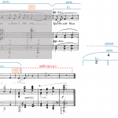
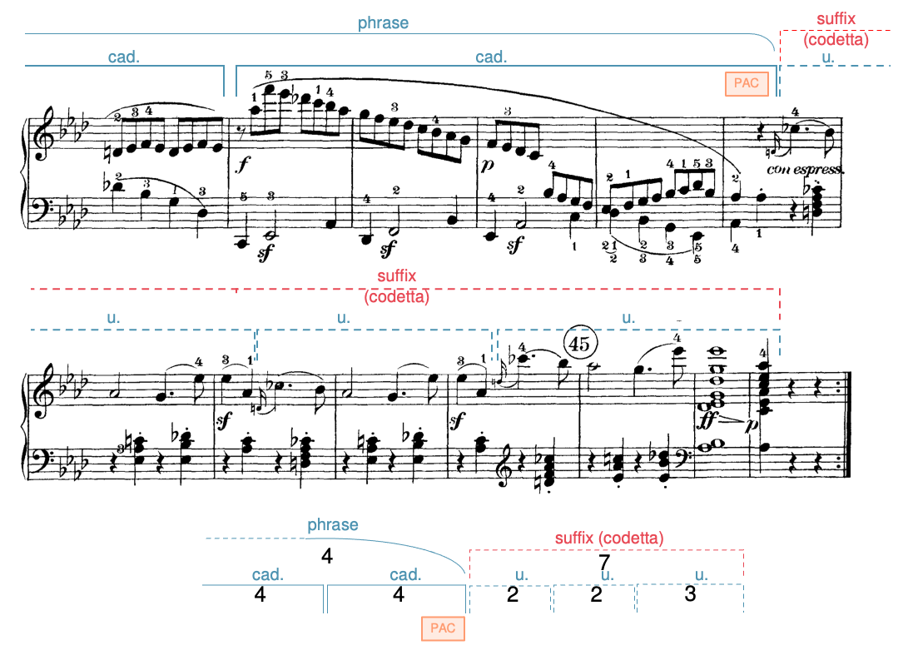

# 乐句层面的扩展与紧缩

> **要点**
>
> - 扩展（expansion）使乐句持续的时间比预期更长。扩展可以是内部的（位于乐句的开头与结尾之间），也可以是外部的（位于开头之前或结尾之后）。
> 	- 内部扩展手法包括重复、拉伸、"再来一次"手法和替代路径。
> 	- 外部扩展分为两类：
> 		- 前置段出现在开头之前，例如引子。
> 		- 后缀出现在终止式之后，例如终止后延伸、小尾声和尾声。
> - 紧缩（contraction）使乐句比预期更短。

[章节播放列表](https://open.spotify.com/playlist/6XzDtaE6Qtto0mvrKJvJT6?si=abb6c65eec4a449b)

扩展与紧缩这两个术语，指的是作曲家用来玩弄乐句预期长度的一些方式。

"预期长度"是什么意思？

- 当一个乐句套用某种原型却没有完全照搬时，我们往往能判断出这一原型更贴近原样的版本会有多长。
- 有时乐句的终止进行让我们能够预期终止式可能出现在哪里，而乐句却避开了预期的终止式。
- 有时一首作品会陈述同一个乐句的两个版本——一个未扩展的版本和一个扩展的版本——从而为我们提供一个可与扩展版本相比较的模型。

扩展指使乐句比我们预期更长的过程。这种延长可能发生在乐句*内部*（"内部扩展"），也可能发生在乐句*外部*（"外部扩展"）。紧缩则指使乐句比我们预期更短的过程，它总是发生在乐句内部。

本章概述了几种扩展与紧缩乐句的手法。这并非一份详尽的清单，但涵盖了一些较常见的手法。有关扩展与紧缩手法的术语很快就会变得令人目不暇接。最重要的是能够辨认出一个乐句何时比预期更长或更短，并能够描述是什么造成了长度上的差异。

## 内部扩展

下面讨论的四种手法——重复、拉伸、"再来一次"和替代路径——都发生在乐句*内部*：在乐句开头之后，但在其终止式之前。作曲家常常把这些手法组合起来使用；事实上，只用一种手法扩展的乐句相对少见。

### 重复

*谱例 1. Robert Sheldon《Bright Lights!》中通过精确重复实现的内部扩展（[0:49–1:03](https://youtu.be/rQCGWof1_us?t=48)）。*

<!-- video-begin: https://youtu.be/rQCGWof1_us?t=48 -->
<div class="omt-video"><iframe src="https://www.youtube-nocookie.com/embed/rQCGWof1_us?start=48" title="video" loading="lazy" allow="accelerometer; autoplay; clipboard-write; encrypted-media; gyroscope; picture-in-picture; fullscreen" allowfullscreen></iframe></div>
<!-- video-end -->

<!-- lilylet-begin: media/2019/07/Example_001_Repetition_Sheldon_Bright_Lights.png -->
```lyl.play
[composer "Robert Sheldon"]

\numericTimeSignature \key ef \major \time 4/4 \clef "treble" bf'4->(^\markup "b.i."^\markup "antecedent" ef) r8 bf-. r f'-. | %1

r8 bf'-. r g->~( g[ af]) bf4 | %2

ef4->^\markup "c.i." g8-.[ f->~] f[ ef16( f] g[ af bf8)] | %3

c'4-> ef8-.[ d->~] d[^\markup "HC" f16(^\markup "consequent" ef] d[ c bf af)] | %4

bf'4->(^\markup "(b.i.)" ef) r8 bf-. r f'-. | %5

r8 bf'-. r g->~( g[ af]) bf4 | %6

c'4->^\markup "c.i." ef8-.[ d->~] d4 c->_\markup "repeated motive" | %7

ef'8-.[ d->~] d4 c8[( d) ef-. f-.] | %8

g''1->~^\markup "(c.i.)"^\markup "(consequent)" | %9

g''8^\markup "IAC" r r4 r2 \bar "||" | %10
```
<!-- lilylet-end -->
有时作曲家重复材料，这种重复会创造出额外的长度。

谱例 1 展示了*在一个单位之内*对一个动机的精确重复所造成的额外长度：一个四小节的前乐句之后，跟着一个扩展到五小节的后乐句。多出的长度来自单位内部重复的动机。

*谱例 2. 莫扎特圆号协奏曲 K. 447 第一乐章第 1–9 小节中通过变化重复实现的内部扩展（[0:00–0:18](https://open.spotify.com/track/29lQckJgUUlqkiGFDIcNfU?si=nJK2FsKrRU-ScM9xR270kg)）。*

<!-- lilylet-begin: media/2021/06/combined-Example_002b_Repetition_Mozart_447-3.png -->
```lyl.play
[composer "Wolfgang Amadeus Mozart"]
[staves "cl,bn,hn,<v1-v2-va-vc>"]
[instrument-cl "Clarinetto in B" "Cl."]
[instrument-bn "Fagotto" "Fg."]
[instrument-hn "Corno in Es" "Cor."]
[instrument-v1 "Violino I" "Vl. I"]
[instrument-v2 "Violino II" "Vl. II"]
[instrument-va "Viola" "Va."]
[instrument-vc "Violoncello e Basso" "Vc."]

\key f \major \time 4/4 \partial 4 \clef "treble" r4 \\\
\key ef \major \time 4/4 \partial 4 \clef "bass" r4 \\\
\key c \major \time 4/4 \partial 4 \clef "treble" r4 \\\
\key ef \major \time 4/4 \partial 4 \clef "treble" bf4\p^\markup "b.i."^\markup "compound basic idea" \\\
\key ef \major \time 4/4 \partial 4 \clef "treble" r4 \\\
\key ef \major \time 4/4 \partial 4 \clef "alto" r4 \\\
\key ef \major \time 4/4 \partial 4 \clef "bass" r4 | %0

R1 \\\
R1 \\\
R1 \\\
g'4.( ef8) af([ f ef d)] \\\
r8 bf\p[ bf bf] bf[ bf bf bf] \\\
r8 ef,-.\p[ ef( g)] f([ af g f)] \\\
ef,4\p r bf r | %1

R1 \\\
R1 \\\
R1 \\\
ef4( bf) r8 bf([ ef g)] \\\
r8 bf[ bf bf] bf[ bf bf bf] \\\
r8 g[ g g] g[ g g g] \\\
ef,4 r r ef8 r | %2

R1 \\\
R1 \\\
R1 \\\
bf'2.(^\markup "c.i." bf16[ af g af)] \\\
bf8[ bf d d] ef[ ef f f] \\\
f,8[ f bf bf] bf[ bf bf bf] \\\
d,8 r bf r c r d r | %3

R1 \\\
r8 <ef, ef'>\p[ <ef ef'> <ef ef'>] <ef ef'>4 r \\\
R1 \\\
fs4( g) r8 ef'16\f[ f] g[ af bf g] \\\
d4( ef) r2 \\\
bf8([ ef ef,) ef] ef4 r \\\
ef,4 r r2 | %4

<b' af'>2\f <c g'> \\\
<ef gf>2\f <d f> \\\
c'2 g \\\
c''4.^\markup "model"^\markup "continuation" ef,,8 d4 bf'' \\\
gf''2:16\f f:16 \\\
a'2:16\f bf:16 \\\
ef8\f[ ef ef ef] d[ d d d] | %5

f'8[ bf a gs] a4 g8[ fs] \\
d'4 f e ef \\\
<c ef>2 <b d>4( <bf df> \\\
c2 r \\\
af''4.^\markup "copy" c,,8 b4 g'' \\\
ef'2:16 d4:16 df:16 \\\
c'16[ c af af] g[ g fs fs] g4:16 f16[ f e e] \\\
c8[ c c c] b[ b bf bf] | %6

g''4 f8[ e] f2 \\
d'4 df c2 \\\
<a c>4 <af cf>) <g cf>2 \\\
R1 \\\
f'4.^\markup "(copy)" af,,8 g4 ef'' \\\
c'4:16 cf:16 bf2:16 \\\
f4:16 ef16[ ef d d] ef4:16 g:16 \\\
a8[ a af af] g[ g g g] | %7

<bf' e>8 r <g' bf>4. <g c>8[ <f a> <f a>] \\\
<f, af>8 r <bf f'>4. <bf f'>8[ <g ef'> <g ef'>] \\\
r8 g'[ g g] g[ g e c] \\\
d'8^\markup "cadential" r <bf af'>4. <bf af'>8[ <bf g'> <bf g'>] \\\
bf'8 r <bf f'>4. <bf f'>8[ ef ef] \\\
af'4 r8 bf,16[ c] d[ bf c d] ef[ f g af] \\\
f,4 r8 bf,16[ c] d[ bf c d] ef[ f g af] | %8

<e' g>4 c r2 \\\
<bf d>4 bf, r2 \\\
g'4 g, r2 \\\
<bf' f'>4^\markup "HC" <bf, d bf'> r2 \\\
d'4 <bf, f' d'> r2 \\\
d'4 d, r2 \\\
bf4 bf, r2 | %9
```
<!-- lilylet-end -->
谱例 2 展示的是一种变化重复，其中*整个单位*被重复，以增加额外的长度：一个四小节的复合基本乐思（c.b.i.）之后，跟着一个五小节的展开部分。展开部分以一个模进开始，从而使它从预期的四小节扩展到五小节。

并非所有重复都会造成扩展！要注意区分造成扩展的重复（它是意料之外的）与更可预期的重复，例如呈示中基本乐思的重复。

### 拉伸

*谱例 3. 舒伯特钢琴奏鸣曲 D. 459 第一乐章第 1–9 小节中通过拉伸实现的内部扩展（[0:00–0:17](https://open.spotify.com/track/2w7acEUx1nzuh5ADgTvikr?si=7vpt2nHNQDGd8r-tqSj1kQ)）。*

<!-- lilylet-begin: media/2019/07/Example_003a_Stretching_Schubert_459.png -->
```lyl.play
[composer "Franz Schubert"]
[staves "{-}"]

\staff "1" \key e \major \time 4/4 \tempo "Allegro moderato" \clef "treble" e4.(\p\<^\markup "b.i."^\markup "presentation" fs16[ e] ds4 e)\! \\
\staff "2" \key e \major \time 4/4 \clef "bass" b1 \\
\staff "2" <e, gs>2( <fs a>4 <e gs>) | %1

\staff "1" fs4~\> fs16[(\! e ds cs)] b8([ b') b-. b-.] \\
\staff "2" b2. r4 \\
\staff "2" <b, fs' a>2. s4 | %2

\staff "1" b'1^\markup "b.i." \\
\staff "1" fs4.( gs16\<[ fs] e4 fss)\! \\
\staff "2" b1 \\
\staff "2" a2( gs4 ds) | %3

\staff "1" b'4~ b16[( a gs fs)] e8([ e') e-. e-.] \\
\staff "1" gs'4~ gs4 s2 \\
\staff "2" b4..(-> a16 gs4-.) r4 \\
\staff "2" e,2. s4 | %4

\staff "1" e'4->(^\markup "f."^\markup "continuation" ds16[ cs b as)] g'4->( as,8) r \\
\staff "2" cs4( ds e fs8[ g]) \clef "treble" \\
\staff "2" fs,2.-> s4 | %5

\staff "1" a''4->(^\markup "f."^\markup "(continuation)" gs16[ fs e ds)] cs'4( b16[ a gs fs)] \\
\staff "2" fs4(-> gs a ds,) \\
\staff "2" <b ds>2. <a b>4 | %6

\staff "1" \tuplet 3/2 { fss'8([^\markup "cad." gs b)] } \tuplet 3/2 { ds,8([ e gs)] } \tuplet 3/2 { as,8([ b e)] } \tuplet 3/2 { fss,8([ gs b)] } \\
\staff "2" <gs b e>4_\markup "(stretching - - -" r r2 \clef "bass"
\addlyrics { I6 } | %7

\staff "1" e2.\< fs8.([ gs16]) \\
\staff "1" s2. ds4 \\
\staff "2" r4 <g as>( <gs b> a) \\
\staff "2" r4 c,( b2)
\addlyrics { Ger6 V8–7 _ }
\addlyrics { _ 6–5 _ }
\addlyrics { _ 4–3 _ } | %8

\staff "1" <e e'>2\mf^\markup "PAC" s2 \bar "||" \\
\staff "2" <e, gs>2_\markup "- - -)" s2 \bar "||"
\addlyrics { I } | %9
```
<!-- lilylet-end -->
有时作曲家会通过增加时值来拉长某个和声或旋律，使它持续的时间比预期更长。出现这种情况时，我们说包含该和声或旋律的单位被拉伸了。在谱例 3 中，一个四小节的呈示之后，跟着一个五小节的展开部分。展开部分的终止式乐思之所以被拉伸，是因为一个 $\mathrm{I}^6$ 和弦与终止性属和弦（由 $\mathrm{Ger}^6$ 和终止四六和弦加以装饰）各自持续了整整一小节，而不是两者都出现在同一个小节之内。

### "再来一次"手法（o.m.t.）

"再来一次"手法由 Janet Schmalfeldt（1989）提出，包括三个步骤：1）音乐试图终止，2）这次尝试的终止式被避开，3）音乐再次尝试终止。再次尝试的终止式往往使用相同的材料，让人感觉音乐"往回退"，不过它也可能用不同的终止材料重新尝试。

*谱例 4. 门德尔松 Op. 8 第 5 首《朝圣者之言》（"Pilgerspruch"）中通过"再来一次"手法实现的内部扩展（[0:00–0:37](https://open.spotify.com/track/31CjWqgQhH2wMHumjyAcnF?si=PelVogCOSdez3BER7aMk0g)）。*

<!-- lilylet-begin: media/2019/07/Slide5-6.png -->
```lyl.play
[composer "Felix Mendelssohn"]
[staves "<voice> {pr-pl}"]
[instrument-voice "Voice"]
[instrument-pr-pl "Piano"]

\staff "1" \key f \major \time 4/4 \clef "treble" R1 \\\\
\staff "1" \clef "treble" \stemUp <c a'>2.(\p <bf g'>4) \\
\staff "2" \clef "bass" \stemUp f,,4( a c e) \\
\staff "2" \stemDown f,,1 \bar ".|:" | %1

\staff "1" r2 r4 c'4^\markup "b.i."
\addlyrics { Laß }
\addlyrics { Was } \\\\
\staff "1" \stemUp <bf g'>2( <a f'>4) r4 \\
\staff "2" \stemUp e,2( f4) r4 \\
\staff "2" \stemDown f,,2. s4 | %2

\staff "1" c'4. bf8 a4 g
\addlyrics { dich nur nichts nicht }
\addlyrics { willst du heu -- te } \\\\
\staff "1" <c a' c>8 r <d g bf> r <c f a> r <bf e g> r \\
\staff "2" f,8 r bf, r c r c r | %3

\staff "1" f2 f4 d'^\markup "c.i."
\addlyrics { dau -- ern, mit }
\addlyrics { sor -- gen auf } \\\\
\staff "1" <e g>2( <d f>4 <d f>) \\
\staff "2" \stemUp bf2 a4 <f a> \\
\staff "2" \stemDown d,2. s4 | %4

\staff "1" c'2 b4 b
\addlyrics { Trau -- ern sei }
\addlyrics { mor -- gen? Der } \\\\
\staff "1" <e g>2. <g, b d f>8 r \\
\staff "2" \stemDown g2. r4 \\
\staff "2" \stemUp s2. g,8 s | %5

\staff "1" c'4^\markup "HC" g r e^\markup "f."
\addlyrics { stil -- le! Wie }
\addlyrics { Ei -- ne steht } \\\\
\staff "1" <g c e>8 r <g c e> r r4 <g c e>4( \\
\staff "2" <c,, c'>8 r <c c'> r r4 bf'4 | %6

\staff "1" f4. g8 a4 a^\markup "f."
\addlyrics { Gott es fügt, so }
\addlyrics { al -- lem für, der } \\\\
\staff "1" <a d f>4.) <bf e g>8 <c f a>4 <c ef a> \\
\staff "2" a,4.( g8 f4) <f f'> | %7

\staff "1" bf'4. c8 d4 d8([^\markup "cad." c)]
\addlyrics { sei ver -- gnügt, so _ }
\addlyrics { giebt auch dir, der _ } \\\\
\staff "1" <bf ef bf'>4. <ef f c'>8 <d f d'>4 <e g> \\
\staff "2" <g, f'>4. <a f'>8 <bf f'>4 bf' | %8

\staff "1" c'4. bf8 a4 g
\addlyrics { sei ver -- gnügt mein }
\addlyrics { giebt auch dir das } \\\\
\staff "1" <c f>8 r <d f bf> r <c f a> r <bf e g> r \\
\staff "2" a,8 r bf r c r c r | %9

\staff "1" g'4^\markup "cad. (evaded)" f r d'8.([^\markup "o.m.t." c16)]
\addlyrics { Wil -- le, so _ }
\addlyrics { Dei -- ne, der _ } \\\\
\staff "1" \stemUp f2( <e g>2) \\
\staff "1" \stemDown c8 c c c c c c c \\
\staff "2" \stemUp c,8 c c c c c c c \\
\staff "2" \stemDown a,2( bf2) | %10

\staff "1" c'4(\p\< ef\! d\> a)\!
\addlyrics { sei _ _ ver -- }
\addlyrics { giebt _ _ auch } \\\\
\staff "1" <c f a>8 <c f a> r <c f c'> r <d f bf> r <d f a> \\
\staff "2" <f,, c'>4( a' bf <d, fs>) | %11

\staff "1" c'2~ c8([ bf)] a([ g)]
\addlyrics { gnügt _ _ mein _ }
\addlyrics { dir _ _ das _ } \\\\
\staff "1" r8 <d fs> <d fs> <d fs> <d fs> <d g> <c d> bf \\
\staff "2" g2 g,4 a8 bf | %12

\staff "1" f2( a4. g8)
\addlyrics { Wil -- _ _ }
\addlyrics { Dei -- _ _ } \\\\
\staff "1" r8 <f, a c> <f a c> <f a c> <g bf c e> <g bf c e> <g bf c e> <g bf c e> \\
\staff "2" c,2 c, | %13

\staff "1" f4^\markup "PAC" r r2
\addlyrics { le. }
\addlyrics { ne. } \\\\
\staff "1" \stemUp <c f a>4 <c a'>2( <bf g'>4) \\
\staff "2" \stemUp f,,4( a c e) \\
\staff "2" \stemDown f,,1 \bar ":|." | %14
```
<!-- lilylet-end -->
在谱例 4 中，第 10 小节提出了一个终止式，但它被避开了（$\mathrm{cad^6_4 – V^4_2 – I^6}$）。随后，终止式乐思以"再来一次"的方式重复出现。这个"再来一次"的单位被拉伸了：注意旋律下行 C–B♭–A–G 用了两小节（原来只用一小节），而终止四六和弦解决到 $\mathrm{V}^7$ 用了整整一小节（原来只用半小节）。

### 替代路径

当意外出现的新材料暂时或永久地使乐句偏离其通往终止式的预期轨迹时，就形成了一条替代路径（alternative path）。暂时的偏离称作绕行（detour）。绕行在乐句到达终止式之前，回到乐句内部先前的材料。永久的偏离称作改道（reroute）。改道在到达终止式时并不回到乐句内部先前的材料。

*谱例 5. 门德尔松《赫布里底群岛序曲》第 9–26 小节中通过替代路径（绕行）实现的内部扩展（[0:20–0:58](https://open.spotify.com/track/268QFsnVawnmGdlRhMum3T?si=2KI7fqQiRUyWKeGMsx0N3g)）。*

<!-- lilylet-begin: media/2019/07/Slide8-10.png -->
```lyl.play
[composer "Felix Mendelssohn"]
[staves "{-}"]

\staff "1" \key d \major \time 4/4 \clef "treble" \stemUp <b' ds>1(\pp \\
\staff "1" \stemDown fs1 \\
\staff "1" s2 \stemDown r8 fs8\p[ b a16 b] \\
\staff "2" \clef "bass" \repeat tremolo 4 { b,,16 b' } \repeat tremolo 4 { b, b' } | %7

\staff "1" \stemUp <b' e>2) <b cs> \\
\staff "1" \stemDown g'8[ fs16 g] e4~ e16\<[ fs e fs]\! g\>[ fs g fs]\! \\
\staff "2" \repeat tremolo 4 { e,,16 b' } \repeat tremolo 4 { e, b' } | %8

\staff "1" r8^\markup "presentation"^\markup "b.i." \stemUp fs'( d![ cs16 d] b4 fs) \\
\staff "1" \stemDown fs1 \\
\staff "2" \stemUp d,16[ cs b cs] d[ b e b] \stemDown d[ e fs b] d[ b fs e] | %9

\staff "1" r8 \stemUp fs'( d![ cs16 d] b4 fs) \\
\staff "1" \stemDown fs1 \\
\staff "2" \stemUp d,16[ cs b cs] d[ b e b] \stemDown d[ e fs b] d[ b fs e] | %10

\staff "1" r8^\markup "b.i." \stemUp a''( fs[ e16 fs] d4 a) \\
\staff "1" \stemDown a'1 \\
\staff "2" \stemUp d,16[ a fs a] d[ a e' a,] \stemDown fs'[ a fs e] d[ a' fs e] \\
\staff "2" \stemDown d,,4\sustainOn s2. | %11

\staff "1" r8 \stemUp a''( fs[ e16 fs] d4 a) \\
\staff "1" \stemDown a'1 \\
\staff "2" \stemUp d,16[ a fs a] d[ a e' a,] \stemDown fs'[ a fs e] d[ e d e] \\
\staff "2" \stemDown d,,4 s2.\sustainOff | %12

\staff "1" r8^\markup "continuation"^\markup "u." \stemUp cs'( fs[ e16 fs] d8[ cs16 d] b8[ d)] \\
\staff "1" \stemDown as'2(\p b) \\
\staff "2" fs,16[ cs' as cs] fs[ cs fs cs] b[ d b d] fs[ d fs d] | %13

\staff "1" r8 \stemUp cs'( fs[ e16 fs] d8[ cs16 d] b8[ b')] \\
\staff "1" \stemDown as'2( b) \\
\staff "2" fs,16[ cs' as cs] fs[ cs fs cs] b[ d b d] fs[ d fs d] | %14

\staff "1" \stemUp \grace as'8 <g' b>2\trill\sf^\markup "cad." \grace { g16[ fs] } <d fs>2(\sf_\markup "dim." \\
\staff "2" e,,16([ b' fs b] g[ b a b)] b,([ b' cs, b'] d,[ b' e,) b'] | %15

\staff "1" \stemDown <d' fs>8)\p^\markup "PAC"[ b( cs fs,)] \stemUp <b, b'>[ d( fs b)] \\
\staff "2" <fs,, d'>8 r <fs as e'> r d'16([ cs b cs] d[ cs d b)] | %16

\staff "1" r8^\markup "repetition of continuation"^\markup "u." \stemUp cs'( fs[ e16 fs] d8[ cs16 d] b8[ d)] \\
\staff "1" \stemDown as'2(\p b) \\
\staff "2" fs,,16\sustainOn([ cs'' as cs] fs[ cs fs cs\sustainOff] b,,\sustainOn[ d' b d] fs[ d fs d)\sustainOff] | %17

\staff "1" r8 \stemUp cs'( fs[ e16 fs] d8[ cs16 d] b8[ b'-.)] \\
\staff "1" \stemDown as'2(b) \\
\staff "2" fs,,16\sustainOn([ cs'' as cs] fs[ cs fs cs\sustainOff] b,,\sustainOn[ d' b d] fs[ d fs d)\sustainOff] | %18

\staff "1" \stemUp b''2(^\markup "cad." g4..) e'16\sf \\
\staff "1" \stemDown g''16\sf[ b, g' b,] g'[ b, g' b,] e[ b e b] e8 r \\
\staff "2" e,,8(_\markup "b: iv"[ fs g a] b[ cs ds e)] | %19

\staff "1" \stemUp e''2( b4) r4 \\
\staff "1" \stemDown g''16\sf[ e g e] g[ e g e] cs[ d cs d] e[ fs e fs] \\
\staff "2" fs,8[ g a b] \clef "treble" e[ d c b] | %20

\staff "1" <g'' e'>16(\pp^\markup "detour"[ cs e cs] as[ cs as cs] <g e'>[ cs e cs] as[ cs as cs)] \\
\staff "2" \stemUp e16([ g e g] e[ g e g] e[ g e g] e[ g e g)] \\
\staff "2" \stemDown as1_\markup "vii°7"\sustainOn | %21

\staff "1" <g'' e'>16([ cs <g e'> cs] <e, as>[ cs' <e, as> cs'] <cs, e>[ g' <cs, e> g'] as,[ cs as cs)] \\
\staff "2" \stemUp s2. e'16[ g e g] \\
\staff "2" \stemDown <as cs>2. s4\sustainOff \clef "bass" | %22

\staff "1" \stemUp <b' fs'>8^\markup "cad." r fs''4~(\sf fs8 <fs, b d>[ <fs b d> <fs b d>] \\
\staff "1" \stemDown s1 \\
\staff "2" d,,16\sustainOn[ fs d fs] fs[ b d b] d,[ fs d fs] fs[ b d b] | %23

\staff "1" \stemUp <b'' d>8[ cs b fs] e[ d cs b] \\
\staff "1" \stemDown s2 fs2 \\
\staff "2" fs,,16[ b fs b] fs[ b fs b] d,[ b' d, b'] d,[ b' d, b'] | %24

\staff "1" \stemUp a''8[ g e cs]) <fs, b d>8 r <e as cs> r \\
\staff "1" \stemDown cs2 s2 \\
\staff "2" <e,, g>16\p[ b' <e, g> b'] <e, g>[ b' <e, g> b'] fs8 r fs r | %25

\staff "1" \partial 4 r4^\markup "PAC" \\
\staff "1" \partial 4 s4 \\
\staff "2" \partial 4 b,4 | %26
```
<!-- lilylet-end -->
谱例 5 展示的是一个绕行：乐句体的展开部分被重复。当终止式乐思中的动机（第 19 小节）被重复时（第 20 小节），我们意识到这次重复"跑偏了"，因为在之前相应的地方（第 15 小节）并没有发生这种情况。随后出现了一段对比鲜明的两小节音乐（第 21–22 小节），引向对材料的回归（第 23–26 小节），该材料类似于第 19–20 小节中的终止式乐思，此刻已被拉伸。

*谱例 6. Maria Theresia von Paradis《西西里舞曲》第 1–10 小节中通过替代路径（改道）实现的内部扩展（[*0:00–0:42*](https://open.spotify.com/track/55dSAv52AK0DnVj5ZUIDBh?si=1G2p8eSASG-y2QyHp2xhRw)）。*

<!-- lilylet-begin: media/2019/07/Slide10-11.png -->
```lyl.play
[composer "Maria Theresia von Paradis"]
[staves "{s1-s2}-s3"]

\staff "1" \key ef \major \time 6/8 \partial 8 \tempo "Andantino" \clef "treble" g'8\p^\markup "b.i."^\markup "antecedent" \\
\staff "2" \partial 8 \clef "treble" r8 \\
\staff "3" \partial 8 \clef "bass" r8 \bar ".|:" | %0

\staff "1" bf'4 bf8 cf8.([ bf16 af8)] \\
\staff "2" <bf ef g>4 <bf ef g>8 <cf ef af>4 <cf ef af>8 \\
\staff "3" ef,,4 ef'8 ef4 ef8 | %1

\staff "1" bf'4 g8^\markup "c.i.¹" af8.(\prall[ g16 f8)] \\
\staff "2" <bf ef g>4 <bf g'>8 <cf ef f>4 <cf ef af>8 \\
\staff "3" ef,,4 ef'8 ef4 ef8 | %2

\staff "1" g'8.[ bf,16 ef g] f4.\trill \\
\staff "2" <bf ef g>4 <bf ef g>8 <af ef' f>4 <af d f>8 \\
\staff "3" ef,,4 ef'8 bf4 bf8 | %3

\staff "1" \grace { ef16[( f] } g4.)^\markup "IAC"~ g4 bf8\mf^\markup "b.i."^\markup "consequent" \\
\staff "2" <g bf ef>4 <g bf ef>8 <g bf ef>4 <bf ef g>8 \\
\staff "3" ef,,4 ef'8 ef4 ef8 | %4

\staff "1" ef'4 bf8 cf8.([ bf16 af8)] \\
\staff "2" <bf ef bf'>4 <bf ef bf'>8 <cf ef af>4 <cf ef af>8 \\
\staff "3" g4 g8 af4 af8 | %5

\staff "1" bf'4 ef16(\<^\markup "c.i.²"^\markup "reroute"[ f)] g4 g8\! \\
\staff "2" <ef bf'>4 <ef bf'>8 <d g d'>4 <d g d'>8 \\
\staff "3" g4 g8 bf4 bf8 | %6

\staff "1" g''4\f\> d8 ef8.([ d16 c8)]\! \\
\staff "2" <f g d'>4 <f g d'>8 <ef g c>4 <ef g c>8 \\
\staff "3" b4 b8 c4 c8 | %7

\staff "1" g''4\p d8 ef4 c8^\markup "cad." \\
\staff "2" <f g d'>4 <f g d'>8 <ef g c>4 <ef g c>8 \\
\staff "3" b4 b8 c4 c8 | %8

\staff "1" df'8.([ c16 bf af] g4) b,8 \\
\staff "2" <f af df>4 <f af df>8 <f g b>4 <b, f' g>8 \\
\staff "3" f,4 f8 g4 g,8 | %9

\staff "1" c'4.^\markup "PAC"^\markup "1."~ c4 g8 \\
\staff "2" <c ef g>4 <c ef g>8 <c ef g>4 r8 \\
\staff "3" c,4 c8 c4 r8 \bar ":|." | %10
```
<!-- lilylet-end -->
谱例 6 展示的是一个改道：一个四小节的前乐句之后，跟着一个六小节的扩展后乐句。后乐句与前者以相同的基本乐思开始，但它的对比乐思朝一个截然不同的方向发展，而那个方向并不通向终止式。因此需要一个全新的终止式乐思，才能使这个乐句到达完满正格终止（PAC）。

尽管"再来一次"手法和替代路径都涉及终止式，但它们是两种非常不同的手法，如下表所述：

| **"再来一次"手法** | **替代路径** |
| --- | --- |
| - 段落已经尝试过终止，但未能成功 - 感觉如同乐句往回退，以便再次尝试失败的终止式 | - 段落尚未尝试终止 - 感觉如同乐句偏离了轨道 |

## 外部扩展

当作曲家把一个乐句之外的长度加进来时，他们可能在开头之前增加小节（前置段），也可能在终止式之后增加小节（后缀）。在示意图中，我们用虚线弧或方括号来表示外部扩展。

### 前置段

*谱例 7. Cécile Chaminade《被俘的爱》（"L'amour captif"）第 1–10 小节中通过小型前置段实现的外部扩展（[0:00–0:13](https://open.spotify.com/track/243TaFRW3lZHhNNMIJqacw?si=Hnd3vfj3SFCniqoz2iiiPw)）。*

<!-- lilylet-begin: media/2019/07/Slide12-13.png -->
```lyl.play
[composer "Cécile Chaminade"]
[staves "<voice> {pr-pl}"]
[instrument-voice "Voice"]
[instrument-pr-pl "Piano"]

\staff "1" \key ef \major \time 3/8 \clef "treble" \partial 8 \tempo "Allegretto." ^\markup "prefix" r8 \\\\
\staff "1" \key ef \major \time 3/8 \clef "treble" \partial 8 r8 \\
\staff "2" \key ef \major \time 3/8 \clef "bass" \partial 8 a16(\p[ bf)] | %1

\staff "1" R4. \\\\
\staff "1" <d af' bf>4 r8 \\
\staff "2" r4 b16([ c)] | %2

\staff "1" r4 bf'8^\markup "dolce"^\markup "b.i."^\markup "c.b.i."
\addlyrics { Sweet -- }
\addlyrics { Mi -- } \\\\
\staff "1" <ef af bf>8 r <f af bf> \\
\staff "2" r8 cs16([ d)] r8 | %3

\staff "1" ef'4.
\addlyrics { heart, }
\addlyrics { gnon -- } \\\\
\staff "1" r4 <ef g bf c>8 \\
\staff "2" <ef,, ef'>8 bf''16[ c] r8 | %4

\staff "1" d'16 f d4
\addlyrics { I have bound }
\addlyrics { "ne, à" l'a -- mour } \\\\
\staff "1" r4 <d af' bf d>8 \\
\staff "2" <f,, f'>8 bf'16[ c] r8 | %5

\staff "1" c'16^\markup "c.i."^\markup "(c.b.i.)" ef d8 c
\addlyrics { way -- ward Love's light }
\addlyrics { j'ai li -- é les } \\\\
\staff "1" r8 <d' bf' d>[ <c af' c>] \\
\staff "2" r8 <c af'>[ <d af'>] \\
\staff "2" bf,4. | %6

\staff "1" g'16([ bf)] bf4
\addlyrics { pin -- _ ions, }
\addlyrics { ai -- _ les; } \\\\
\staff "1" <g' ef' g>8([ <bf g' bf> <bf' g' bf>)] \\
\staff "2" <ef,, ef'>8( <bf'' g'>4) | %7

\staff "1" ^\markup "u." ^\markup "cad." r16 bf' bf c bf c
\addlyrics { He nev -- er -- more can }
\addlyrics { Il ne pour -- ra plus } \\\\
\staff "1" r8 <df g bf>16([ c' <df, g bf> c')] \\
\staff "2" r8 bf16([ c bf c)] \\
\staff "2" <e,, e'>4. | %8

\staff "1" bf'8([ af)] af
\addlyrics { wan -- _ ton }
\addlyrics { pren -- _ dre } \\\\
\staff "1" bf'8([ af)] af \\
\staff "1" <c f>4. \\
\staff "2" bf8([ af)] af \\
\staff "2" f,4. | %9

\staff "1" g'4(^\markup "u." \tuplet 3/2 { f16[ g f] }
\addlyrics { oth -- er -- _ _ }
\addlyrics { son es -- _ _ } \\\\
\staff "1" g'4 \tuplet 3/2 { f16[ g f] } \\
\staff "1" r8 <af d>4 \\
\staff "2" g4 \tuplet 3/2 { f16[ g f] } \\
\staff "2" r8 bf,4 | %10

\staff "1" \partial 4 ef4)
\addlyrics { where, }
\addlyrics { sor } \\\\
\staff "1" \partial 4 ef8[ \staff "2" <g, bf>] \\
\staff "2" \partial 4 ef,8[ ef,] | %11
```
<!-- lilylet-end -->
前置段（prefix）出现在乐句开头之前，通常以引子的形式出现。前置段可以很短小，但也可以很长大，例如作曲家以一段缓慢的引子开启一部交响曲。谱例 7 展示的是一个短小的前置段。与歌曲中非常常见的情形一样，这首*艺术歌曲*（mélodie）以一段器乐引子开始，然后歌手才进入——也就是说，才进入乐句的开头。另请注意，这个乐句对典型的终止性核心低音模式作了变体处理。Chaminade 没有采用 *mi-fa-sol-do*（$\hat{3}-\hat{4}-\hat{5}-\hat{1}$），而是写作 *di-re-sol-do*（$\uparrow\hat{1}-\hat{2}-\hat{5}-\hat{1}$）（第 8–11 小节）。

### 后缀

后缀发生在乐句终止之后。谱例 8 中的术语可灵活地用来描述不同类型的后缀。虽然谱例 8 为它们的用法提供了指导，但一个人称作终止后延伸的东西，另一个人可能会称作小尾声。更重要的是辨认出某个后缀是在乐句边界之外增加长度，而不是去操心哪个术语最合适。

| 术语 | 平均长度 | 特征 | 典型位置 | 谱例 |
| --- | --- | --- | --- | --- |
| 终止后延伸（p.c.e.） | 短（1–2 小节） | - 内容单薄：几乎没有或完全没有旋律材料 - 常常重复终止式的和弦（例如 V–I）或最后一个主和弦 - 通常不会陈述完整的乐句 | 一个段落内，某个乐句结束之后 | 谱例 9 |
| 小尾声 | 中等（4–8 小节） | - 常常以反复出现的短小动机材料为特征 - 可能循环经过一整套终止进行 - 可能陈述、也可能不陈述完整的乐句 | 作品或乐章内，某个段落结束之后 | 谱例 10 |
| 尾声 | 长（8 小节以上） | - 内容丰富：可能以新的主题或先前主题的再现为特征 - 通常包含多个乐句 | 作品或乐章结束之后 | 谱例 11 |

谱例 8. 区分常见后缀类型的特征。

谱例 9 展示了一个长大的乐段的结尾。在结束后乐句的完满正格终止之后，一个两小节的终止后延伸通过琶音延长了最后一个主和弦。[^1]

在谱例 10 中，一个长大的乐句以第 41 小节 A♭ 大调上的 PAC 结束了这部钢琴奏鸣曲的呈示部。该终止式之后跟着一个小尾声：注意它以重复的两小节单位构成，配有终止性低音线 *fi-sol-do*（$\uparrow\hat{4}-\hat{5}-\hat{1}$）的和声。

谱例 11 展示的是最长的一类后缀：尾声。在引子再现（4:52）、随后加以变化（5:03）之后，一个叠接的 PAC 结束了作品的主体（5:32）。尾声（同样从 5:32 开始）呈现了对作品收束的充满活力的庆贺，以快速的版本奏出先前听到过的一个主题，并包含若干乐句。

[](../media/2019/07/Example_010_Chaminade_Presents-e1623956324859.png)

<!-- lilylet-begin: media/2019/07/Example_010_Chaminade_Presents-150x150.png -->
```lyl.play
[composer "Cécile Chaminade"]
[staves "<voice> {pr-pl}"]
[instrument-voice "Voice"]
[instrument-pr-pl "Piano"]

\staff "1" \key ef \major \time 3/4 \clef "treble" ef'2(^\markup "(ant.)" g,4
\addlyrics { tâche, a -- } \\\\
\staff "1" \key ef \major \time 3/4 \clef "treble" <c ef g c ef g c>2. \\
\staff "2" \key ef \major \time 3/4 \clef "bass" r4 bf2 \\
\staff "2" s4 <bf,, bf'>2 | %1

\staff "1" bf'4 af8 g bf af
\addlyrics { mi si doux à ché -- } \\\\
\staff "1" <cs e g cs e g cs>2. \\
\staff "2" r4 bf2 \\
\staff "2" s4 <bf,, bf'>2 | %2

\staff "1" g'2^\markup "HC" f8) r8
\addlyrics { rir, __ _ } \\\\
\staff "1" <d f af d af' bf d>2. \\
\staff "2" r4 bf2 \\
\staff "2" s4 <bf,, bf'>2 | %3

\staff "1" ef8(^\markup "dolce"^\markup "b.i."^\markup "cons."\pp ef f4 g)
\addlyrics { Qu'el -- le soit bien } \\\\
\staff "1" <ef g>4(_\markup "dolce"\pp <ef af> <ef bf'> \\
\staff "2" <bf, ef>4( <bf f'> <bf g'> | %4

\staff "1" af'4^\markup "b.i."^\markup "(cons.)" g f8(^\markup "c.i."[ ef)]
\addlyrics { lon -- gue, ta __ _ } \\\\
\staff "1" <ef c'>4 <ef bf'>) af8([ g)] \\
\staff "1" s2 ef4 \\
\staff "2" s2 f,8([ ef)] \\
\staff "2" <bf, af'>4 <bf g'>) bf | %5

\staff "1" g'2 f4
\addlyrics { vi -- _ } \\\\
\staff "1" r4 <bf' bf'>2 \\
\staff "1" <ef bf'>2 af4 \\
\staff "2" <bf, g'>2 bf4 \\
\staff "2" r4 bf,,2 | %6

\staff "1" ef4~^\markup "PAC" ef8 r8 r4
\addlyrics { e! __ _ } \\\\
\staff "1" <g ef' g>4 <c' g' c>\<^\markup "suffix (p.c.e.)" <d g bf d>\! \\
\staff "2" r4 \clef "treble" <c ef g>4 <d ef g> \\
\staff "2" <ef,,, ef'>2. | %7

\staff "1" R2. \\\\
\staff "1" \ottava #1 <ef' g ef'>4_\markup "cresc." <g ef' g> <bf g' bf> \\
\staff "2" <ef g bf>4 <bf ef g> <g bf ef> \clef "bass" | %8

\staff "1" R2. \bar "|." \\\\
\staff "1" <ef' g bf ef>2.\f \ottava #0 \bar "|." \\
\staff "2" <bf, ef g>2. \bar "|." \\
\staff "2" <ef,,, ef'>2. \bar "|." | %9
```
<!-- lilylet-end -->
谱例 9. Cécile Chaminade《礼物》（"Les presents"）中通过后缀（终止后延伸）实现的外部扩展（[2:31–2:57](https://open.spotify.com/track/1hyX06OrRGiO8AUJWIHrFH?si=efK7Hbc7TfK8kVt8NdvU2w)）。



<!-- lilylet-begin: media/2019/07/Example_011_codetta_Beethoven_2_1-e1623956414121.png -->
```lyl.play
[composer "Ludwig van Beethoven"]
[staves "{-}"]

\staff "1" \key af \major \time 4/4 \omit Score.TimeSignature \clef "treble" ^\markup "cad." ^\markup "phrase" d8(-2[ ef-3 f-4 ef] d[ ef f ef)] \\
\staff "2" \key af \major \time 4/4 \clef "bass" df4(-2 bf-3 g-1 df)-3 | %36

\staff "1" r8 af''(-1\f^\markup "cad."[ f'-5 ef-3] df[ c-1 bf-4 af] \\
\staff "2" c,,4-5 ef2-3 af4 | %37

\staff "1" g''8[ f ef-3 df] c[ bf-4 af g] \\
\staff "2" df,4-4 f2-2\sf bf4 | %38

\staff "1" f8\p[ ef-3 df c] \staff "2" bf-4[ af g f] \\
\staff "2" ef,4-4 af2-2\sf c4-1 | %39

\staff "2" ef,8-2[ f-1 g af] bf-4[ c-1 df-5 bf-3] \\
\staff "2" df,4-1 bf-2 g-3 ef-5 | %40

\staff "2" af4)-2^\markup "PAC" \staff "1" r4 \grace d8( cf'4.-4^\markup "u."^\markup "suffix (codetta)" bf8)_\markup "con espress." \\
\staff "2" <af, af'>4-4 af'-.-1 r <d, f af cf>-. | %41

\staff "1" af'2 g4.( ef'8)-4 \\
\staff "2" r4 <ef, a c>-. r <ef bf' df>-. | %42

\staff "1" ef'4(-3\sf af,)-1 \grace d,8( cf'4.^\markup "u." bf8) \\
\staff "2" r4 <af c>-. r <d, f af cf>-. | %43

\staff "1" af'2 g4.( ef'8) \\
\staff "2" r4 <ef, a c>-. r <ef bf' df>-. | %44

\staff "1" ef''4(-3\sf af,)-1 \grace d,8( cf'4.-4^\markup "u." bf8) \\
\staff "2" r4 <af c>-. \clef "treble" r <d f af cf>-. | %45

\staff "1" af''2 g4.( ef'8)-4 \\
\staff "2" r4 <ef a c>-. r <ef bf' df>-. \clef "bass" | %46

\staff "1" <df ef g df' g ef'>1\ff\> \\
\staff "2" <af bf>1 | %47

\staff "1" \partial 2. <c ef af c ef af>4-4\!\p r r \bar ":|." \\
\staff "2" \partial 2. af4 r r \bar ":|." | %48
```
<!-- lilylet-end -->
谱例 10. 贝多芬钢琴奏鸣曲 Op. 2 第 1 首第 36–48 小节中通过后缀（小尾声）实现的外部扩展（[0:45–0:58](https://open.spotify.com/track/2E0Q7KZ2b6wTMsuDA8lRhz?si=0oMmAbdxTYCWfHp2HDeHqw)）。

| 时间点 | 事件 |
| --- | --- |
| 4:52 | 引子以变化的形式再现 |
| 5:03 | 引子的第二个变奏开始 |
| 5:32 | 尾声开始；其材料取自第二主题（2:00 处） |

谱例 11. [肖斯塔科维奇《节日序曲》](https://open.spotify.com/track/6Mz6UuaghVRC2VEF5Td7SF?si=1XChkFQMRY2WWyTKjriFHA)中通过后缀（尾声）实现的外部扩展。

## 紧缩

[](../media/2019/07/Example_013_Contraction_Elmas_PC_1_III.png)*谱例 12. Stéphan Elmas 第一钢琴协奏曲第三乐章第 15–21 小节中的紧缩（[32:21–32:28](https://www.youtube.com/watch?v=O-iFgieitho&t=231s)）。*

<!-- video-begin: https://www.youtube.com/watch?v=O-iFgieitho&t=231s -->
<div class="omt-video"><iframe src="https://www.youtube-nocookie.com/embed/O-iFgieitho?start=231" title="video" loading="lazy" allow="accelerometer; autoplay; clipboard-write; encrypted-media; gyroscope; picture-in-picture; fullscreen" allowfullscreen></iframe></div>
<!-- video-end -->

紧缩比扩展少见。当一个乐句比我们可能预期的更短时，就发生了紧缩。

在谱例 12 中，一个四小节的复合基本乐思之后，跟着一个三小节的展开部分。鉴于复合基本乐思的长度，我们原本可能预期展开部分也长四小节，以形成比例上的平衡。聆听时请注意终止式显得多么突兀，这种感觉通常伴随着紧缩出现。

> 延伸阅读

- Jarvis, Brian, and John Peterson. 2019. “Alternative Paths, Phrase Expansion, and the Music of Felix Mendelssohn.” *Music Theory Spectrum* 41, no. 2 (Fall): 187–217.
- Schmalfeldt, Janet. 1992. “Cadential Processes: The Evaded Cadence and the ‘One More Time’ Technique.” *Journal of Musicological Research* 12 (1–2): 1–52.

> 作业

1. 分析扩展手法（[.pdf](https://viva.pressbooks.pub/app/uploads/sites/12/2021/07/WK-Expansion-and-Contraction-at-the-Phrase-Level-–-Analyzing-Expansion-Techniques.pdf)，[.docx](https://viva.pressbooks.pub/app/uploads/sites/12/2021/07/WK-Expansion-and-Contraction-at-the-Phrase-Level-–-Analyzing-Expansion-Techniques.docx)）。要求学生为所选片段命名、划分并标注其曲式，并指出任何扩展手法所在的位置。包含可选的和声分析。[练习表播放列表](https://open.spotify.com/playlist/6b7oUNlbuo8RVxIgwikZba)
2. 分析多种扩展手法（[.pdf](https://viva.pressbooks.pub/app/uploads/sites/12/2021/07/WK-Expansion-and-Contraction-at-the-Phrase-Level-–-Analyzing-Multiple-Phrase-Expansion-Techniques.pdf)，[.docx](https://viva.pressbooks.pub/app/uploads/sites/12/2021/07/WK-Expansion-and-Contraction-at-the-Phrase-Level-–-Analyzing-Multiple-Phrase-Expansion-Techniques.docx)）。谱例比练习表 1 更复杂。每个片段都经过了大幅扩展。[练习表播放列表](https://open.spotify.com/playlist/5ZnYTLqxS8CMMEyfSnWHpx)
3. 重新写作以去除扩展（[.pdf](https://viva.pressbooks.pub/app/uploads/sites/12/2021/07/WK-Expansion-and-Contraction-at-the-Phrase-Level-–-Recomposing-to-Remove-Expansions.pdf)，[.docx](https://viva.pressbooks.pub/app/uploads/sites/12/2021/07/WK-Expansion-and-Contraction-at-the-Phrase-Level-–-Recomposing-to-Remove-Expansions.docx)）。要求学生改写练习表 1 中的片段，去除原型曲式中被扩展的部分。[练习表播放列表](https://open.spotify.com/playlist/3y0bMIkzRtZ5ccYRRi70xH)

### 媒体署名

- Example\_001\_Repetition\_Sheldon\_Bright\_Lights © John Peterson and Megan Lavengood，依 [CC BY-SA（署名—相同方式共享）](https://creativecommons.org/licenses/by-sa/4.0/)许可使用
- combined-Example\_002b\_Repetition\_Mozart\_447-3 © John Peterson and Megan Lavengood，依 [CC BY-SA（署名—相同方式共享）](https://creativecommons.org/licenses/by-sa/4.0/)许可使用
- Example\_003a\_Stretching\_Schubert\_459 © John Peterson and Megan Lavengood，依 [CC BY-SA（署名—相同方式共享）](https://creativecommons.org/licenses/by-sa/4.0/)许可使用
- Slide5-6 © John Peterson and Megan Lavengood
- Slide8-10 © John Peterson and Megan Lavengood
- Slide10-11 © John Peterson and Megan Lavengood
- Slide12-13 © John Peterson and Megan Lavengood，依 [CC BY-SA（署名—相同方式共享）](https://creativecommons.org/licenses/by-sa/4.0/)许可使用
- Example\_013\_Contraction\_Elmas\_PC\_1\_III © John Peterson and Megan Lavengood，依 [CC BY-SA（署名—相同方式共享）](https://creativecommons.org/licenses/by-sa/4.0/)许可使用

---

[^1]: 文中所链接的录音是这部作品唯一的商业录音。我们希望有更多的人来录制这部优美的作品。
