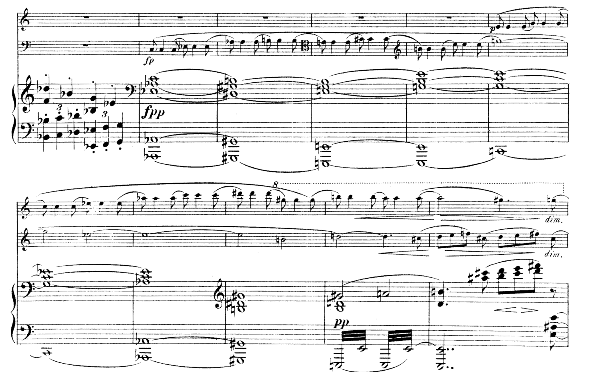

# 新黎曼三和弦进行

> **要点**
>
> - 新黎曼理论（Neo-Riemannian theory）以音乐理论家胡戈·黎曼（Hugo Riemann）命名，它为那些以共享共同音为基础的三和弦进行提供了一种合理化解释方式，比起把它们解释为停留在某一调内，这种方式更贴切。
> - 每一种新黎曼变换都在一个大三和弦与一个小三和弦之间切换。
> - 最基本的新黎曼变换移动一个音、保留两个共同音。
> 	- **R**（关系，Relative）把一个大三和弦与低小三度的小三和弦联系起来，如 C 与 Ami。
> 	- **P**（平行，Parallel）把一个大三和弦与根音相同的小三和弦联系起来，如 C 与 Cmi。
> 	- **L**（导音交换，Leading-tone exchange）把一个大三和弦与高大三度的小三和弦联系起来，如 C 与 Emi。
> - 其他重要的新黎曼变换保留一个共同音、移动两个音。
> 	- **S**（滑移，Slide）把一个大三和弦与高一个半音的小三和弦联系起来，如 C 与 C♯mi。
> 	- ***N**ebenverwandt*（邻接）把一个大三和弦与低纯五度的小三和弦联系起来，如 C 与 Fmi。
> - **H**expole 把一个大三和弦与低大三度的小三和弦联系起来，如 C 与 A♭mi。这一变换的特殊之处在于它不保留任何共同音；每个音都移动半音到达新的和弦。
> - 新黎曼变换各自缩写为一个字母：R、P、L、S、N、H。
> - 理论家们提出了若干种变换网络，帮助把这些关系可视化，例如*Tonnetz*（音网）、魏茨曼区域（Weitzmann regions）与立方体之舞（Cube Dance）。
>
> **变换的一页速查表可参见[交互式曲谱](https://musescore.com/user/30425053/scores/5413587/s/FAcXZl)和 [PDF](https://viva.pressbooks.pub/app/uploads/sites/12/2019/07/Transformations.pdf)。**

 

19世纪末，作曲家常用一些令传统罗马数字分析无所适从的三和弦进行。请看下面勃拉姆斯小提琴与大提琴协奏曲的片段（谱例 1）：

*谱例 1. 勃拉姆斯，小提琴与大提琴协奏曲，第一乐章，第 268–79 小节[（10:22）](https://open.spotify.com/track/3m0nPszSygkCSHcuHthkK6)。*

<!-- lilylet-begin: media/2019/07/brahms-concerto-for-vln-vc-268-79.png -->
```lyl.play
[composer "Johannes Brahms"]
[staves "<vn> <vc> {pr-pl}"]
[instrument-vn "Violin" "Vl."]
[instrument-vc "Violoncello" "Vc."]
[instrument-pr-pl "Piano"]

\omit Score.TimeSignature \key c \major \time 4/4 \clef "treble" R1 \\\\
\clef "bass" R1 \\\\
\staff "1" \clef "treble" <f df'>4 bf-. <bf, g'>-. ef-. \\
\staff "2" \clef "bass" \tuplet 3/2 { <bf, bf'>4_. <c c'>_. <df df'>_. } \tuplet 3/2 { <ef, ef'>_. <f f'>_. <g g'>_. } | %268

R1 \\\\
c,8(\fp c4 c8) ef( ef4 ef8) \\\\
\staff "1" \clef "bass" <ef, af c>1_\markup "fpp"( \\
\staff "2" <af,, af'>1( | %269

R1 \\\\
af8( af4 af8) b( b4 b8) \clef "tenor" \\\\
\staff "1" <ds, gs b>1) \\
\staff "2" <gs,, gs'>1) | %270

R1 \\\\
e8( e4 e8) gs( gs4 gs8) \clef "treble" \\\\
\staff "1" <e, gs b>1( \\
\staff "2" <e,,, e'>1~ | %271

R1 \\\\
b'8( b4 b8) e( e4 e8) \\\\
\staff "1" <g b e>1) \\
\staff "2" <e,,, e'>1 | %272

c'8(\p c4 c8) e( e4 e8) \\\\
g''1~ \\\\
\staff "1" <g c e>1( \\
\staff "2" c,,1~ | %273

c'8( c4 c8) ef( ef4 ef8) \\\\
g''2 ef~ \\\\
\staff "1" <g c ef>1) \\
\staff "2" c,,1 | %274

af''8( af4 af8) c( c4 c8) \\\\
ef'1~ \\\\
\staff "1" <af c ef>1 \clef "treble" \\
\staff "2" <af,, af'>1( | %275

ds''8( ds4 ds8) \ottava #1 gs( gs4 gs8) \\\\
ef'2 b \\\\
\staff "1" <gs' b ds>1 \\
\staff "2" <gs,, gs'>1) | %276

b'''8(\< b4 b8) a(\> a4 a8)\! \\\\
g'!2(\< d'4.)\> cs8(\! \\\\
\staff "1" \stemUp g'2(_\pp a) \\
\staff "1" \stemDown <b d>1 \\
\staff "2" \repeat tremolo 8 { e,,,32 e' } \repeat tremolo 8 { e,32 e' } | %277

c'''2(\< gs4.)\> g8\!_\markup "dim." \\\\
d'8[\< e f] cs d[\> e fs]\! cs)_\markup "dim." \\\\
\staff "1" <d b'!>4. <a'' cs>8 <b d>8[\< <cs e>\> <d fs>]\! r8 \\
\staff "2" <e,,, e'>2.. <e'' gs d'>8 | %278
```
<!-- lilylet-end -->
上面片段中和弦进行的缩编谱见谱例 2。这个段落连接了两个降 A 大三和弦；然而这两个三和弦之间的和弦，无论怎么解释都不属于降 A 大调，也不遵循功能和声的任何惯例。

*谱例 2. 勃拉姆斯，小提琴与大提琴协奏曲，第一乐章，第 270–76 小节，缩编谱。*

<!-- lilylet-begin: media/2019/07/brahms_vc_vln_concerto_reduction.png -->
```lyl.play
[composer "Johannes Brahms"]
[staves "{-}"]

\staff "1" \time 4/4 \key c \major \clef "treble" <af' c ef>1 \\
\staff "2" \clef "bass" af1 | %1

\staff "1" <gs' b ds>1 \\
\staff "2" gs1 | %2

\staff "1" <gs' b e>1 \\
\staff "2" e,1 | %3

\staff "1" <g' b e>1 \\
\staff "2" e,1 | %4

\staff "1" <g' c e>1 \\
\staff "2" c,1 | %5

\staff "1" <g' c ef>1 \\
\staff "2" c,1 | %6

\staff "1" <af' c ef>1 \bar "|." \\
\staff "2" af,1 \bar "|." | %7
```
<!-- lilylet-end -->
人们或许会干脆把这个段落当作「非功能和声」而置之不理，但听一听就会发现，它遵循着某种逻辑。正如理查德·科恩（Richard Cohn）所写：「如果这种音乐［三和弦性、但功能上不确定的音乐］按照自然音调性的原则并不完全连贯，那么它又可能依据什么别的原则而连贯呢？」（1998, 169）。

## 新黎曼变换

新黎曼理论描述了一种在没有调性语境的情况下连接大三和弦与小三和弦的方式。谱例 3 展示了三种基本的新黎曼运算。请注意，每一种运算在三和弦中保留两个共同音，并改变其调式。

- **R**（关系，Relative）变换保留三和弦中的大三度，把余下的音移动全音。
- **P**（平行，Parallel）变换保留三和弦中的纯五度，把余下的音移动半音。
- **L**（导音交换，Leading-Tone Exchange）变换保留三和弦中的小三度，把余下的音移动半音。

*谱例 3. 三种基本的新黎曼运算：关系、平行与导音交换。*

<!-- lilylet-begin: media/2019/07/NROs_-_basic_voice_leading_examples-PLR.png -->
```lyl.play
\omit Score.TimeSignature \time 3/1 \key c \major \clef "treble" <c e g>1^\markup "Relative (R)" s1 <c e a>1 \bar "||" | %1
<c e g>1^\markup "Parallel (P)" s1 <c ef g>1 \bar "||" | %2
<c e g>1^\markup "Leading-Tone Exchange (L)" s1 <b e g>1 \bar "||" | %3
```
<!-- lilylet-end -->
重要的是，每一种变换都是两个和弦之间的切换。打个比方，想想键盘上的大写锁定键，它在两种字母大小写状态之间切换。如果你正在用小写字母打字，按一下大写锁定键，键盘就开始输入大写字母。但你再按一次，它就切回小写——不会进入第三种状态。

同样，对 C 大三和弦做 L 变换，你得到 e 小三和弦。对 e 小三和弦再做 L 变换，你又回到 C 大三和弦。换句话说，同一变换连续重复，就在两个和弦之间来回交替，如谱例 4 所示。

*谱例 4. 对 C 大三和弦与 e 小三和弦连续做 L 变换。*

<!-- lilylet-begin: media/2019/07/multiple-L-transforms.png -->
```lyl.play
\omit Score.TimeSignature \omit Score.BarLine \key c \major \clef "treble" <c e g>1 ^\markup "L" s1 <b e g>1 ^\markup "L" s1 <c e g>1 ^\markup "L" s1 <b e g>1 ^\markup "L" s1 <c e g>1 ^\markup "L" s1 <b e g>1 ^\markup "etc." s1 | %1
```
<!-- lilylet-end -->
虽然19世纪的大多数作曲家并不反复用同一变换写作进行，但你会在20世纪的作品中见到这种手法，如[劳丽·安德森（Laurie Anderson）的《O Superman》](https://open.spotify.com/track/421Gp1eSmOIcD6alTWowFR)，它全曲都使用连续的 L 变换。

## *Tonnetz*

谱例 5 展示了一个*Tonnetz*。*Tonnetz* 是音高的视觉表示，其中纯五度从左向右读，大三度从左上向右下斜着读，小三度从左下向右上斜着读。任何构成一个三角形的三个音高，都组成大三和弦或小三和弦。虽然这里把它画成一个扁平、有界的平面，但从理论上说，若不考虑等音等价关系，*Tonnetz* 会无限延伸下去；若考虑等音等价关系，*Tonnetz* 则构成[环面形状](../media/2023/09/TonnetzTorus.gif)。

新黎曼变换可以看作把三角形沿它某一条边翻转。

*谱例 5. Tonnetz。*

- （P）平行变换沿属于纯五度线（从左到右）的那条边翻转三角形。
- （R）关系变换沿属于大三度线（从左上到右下）的那条边翻转三角形。
- （L）导音变换沿属于小三度线（从右上到左下）的那条边翻转三角形。

*谱例 6. 展示对 C 大三和弦与 g 小三和弦施行三种新黎曼运算（P、L、R）的 *Tonnetz*。*

谱例 6 展示了在 *Tonnetz* 上的每一种变换。如果你对以红边标出的 C 大三和弦做 P 变换，它会沿 C–G 边翻转，成为 c 小三和弦。同样，L 会沿 G–E 边翻转这个三和弦，使之成为 e 小三和弦；R 会沿 C–E 边翻转，使之成为 a 小三和弦。请注意，如果从小三和弦出发，比如以绿边标出的 g 小三和弦，那么所有翻转的方向都相反。

回到勃拉姆斯小提琴与大提琴协奏曲的例子，我们现在有了理解这个和弦进行如何运作的手段。谱例 7 表明，两个降 A 大三和弦由一系列 P 变换与 L 变换连接起来。

*谱例 8. 勃拉姆斯小提琴与大提琴协奏曲第 270–76 小节在 *Tonnetz* 上的表示。*

勃拉姆斯协奏曲的这个片段，在 *Tonnetz* 上沿着从右下方往上的一个三角形纵列行进，如谱例 8 所示。请注意，起点处需要把升 G 大三和弦等音重新理解为降 A 大三和弦。

*Tonnetz* 有助于把大三和弦与小三和弦之间的邻近关系可视化；请注意，某一调内的所有三和弦彼此靠近，而调性上差异很大的调在 *Tonnetz* 上也相距遥远。反过来，*Tonnetz* 也有助于想象一些你如果局限于典型共性写作句法就不会想到的、有趣的进行。

## 变换链或变换循环

新黎曼理论几乎可以用来创作或分析任何和弦进行，不过作曲家往往专注于那些构成闭合三和弦循环的运算链。循环从同一个和弦开始并结束，遵循特定的变换模式（很像一个序列）。上述勃拉姆斯例子中的进行是一个 PL 循环，因为它交替使用 P 变换与 L 变换，并起止于同一个和弦。

使用两种变换的循环一共有三种：PL 循环、RP 循环与 RL 循环。如谱例 9 所示，PL 与 RP 循环在相对较少的变换之后就「闭合回路」：PL 循环六次，RP 循环八次。

*谱例 9. PL 与 RP 循环。*

<!-- lilylet-begin: media/2019/07/PL-and-RP-cycles.png -->
```lyl.play
[staves ","]

\omit Score.TimeSignature \omit Score.BarLine \key c \major \clef "treble" <c e g>1^\markup "P" s2 <c ef g>1^\markup "L" s2 <c ef af>1^\markup "P" s2 <cf ef af>1^\markup "L" s2 \\\\
\key c \major \clef "treble" <c e g>1^\markup "R" <c e a>1^\markup "P" <cs e a>1^\markup "R" <cs fs a>1^\markup "P" <cs fs as>1^\markup "R" <ef gf bf>1^\markup "P" | %1

<b e gs>1^\markup "P" s1 \\\\
<ef g bf>1^\markup "R" <ef g c>1^\markup "P" | %2

<b e g>1^\markup "L" \\\\
<e g c>1 | %3

<c e g>1 \undo \omit Score.BarLine \bar "||" \\\\
s1 \undo \omit Score.BarLine \bar "||" | %4
```
<!-- lilylet-end -->
反过来，RL 循环（谱例 10）相当长：它遍及全部 24 个大小三和弦。由于这个循环要很久才「闭合回路」，它常常被忽略，或者以截短的形式呈现。

*谱例 10. RL 循环。*

<!-- lilylet-begin: media/2019/07/RL-cycle.png -->
```lyl.play
\omit Score.TimeSignature \omit Score.BarLine \key c \major \clef "treble" <c e g>1^\markup "R" s2 <c e a>1^\markup "L" s2 <c f a>1^\markup "R" s2 <d f a>1^\markup "L" s2 <d f bf>1^\markup "R" s2 <d g bf!>1^\markup "L" s2 <ef g bf!>1^\markup "R" s2 <ef! g c>1^\markup "L" s2 <ef! af c>1^\markup "R" s2 <f af! c>1^\markup "etc." s2 | %1
```
<!-- lilylet-end -->
有一种三变换循环值得一提：PLR 循环。如谱例 11 所示，要做两轮 PLR 变换才能回到起始和弦。

*谱例 11. PLR 循环。*

<!-- lilylet-begin: media/2019/07/PLR-cycle.png -->
```lyl.play
\omit Score.TimeSignature \omit Score.BarLine \key c \major \clef "treble" <c e g>1^\markup "P" s2 <c ef g>1^\markup "L" s2 <c ef! af>1^\markup "R" s2 <c f af!>1^\markup "P" s2 | %1
<c f a>1^\markup "L" s2 <c e a>1^\markup "R" s2 <c e g>1 s2 \undo \omit Score.BarLine \bar "||" | %2
```
<!-- lilylet-end -->
*谱例 12. PL、RP 与 PLR 循环及其母音阶／共同音的关系。*

在上述循环中，PL 与 RP 循环各自生成一个母音阶，由构成该循环的三和弦所用的全部音高组成。PL 循环生成六声音阶，即由半音与小三度交替构成的对称音阶。RP 循环生成八声音阶，即另一个由半音与大二度交替构成的对称音阶。你可以把这些音阶看作代表该循环的「整体音响」。每一个 PLR 循环都围绕一个单一音高，循环中每个三和弦都含有这个音高。

这些循环都已在谱例 12 中示意。

## 其他变换

还有三种新黎曼变换在曲目中出现的频率足够高，值得在此一提。

- **S**（滑移，Slide）变换实际上与 P 变换相反：它把三和弦中构成纯五度的两个音移动半音，并改变三和弦的调式。[^1]
- ***N**ebenverwandt*（N）变换把三和弦中小三度的两个音都移动半音，同样改变调式。*Nebenverwandt* 在德语中意为「相邻关系」，描述的正是这个三度的辅助音式运动。[^2]
- **H**expole（H）变换把三和弦与相隔三度的调式对立和弦连接起来，做法是把每个声部都移动一个半音，从而生成上文讨论过、并在谱例 12 中展示的六声 PL 循环中的六声极（hexatonic poles）。[^3]

这三种变换见谱例 13。

*谱例 13. S、N 与 H 变换。*

<!-- lilylet-begin: media/2019/07/SNH-transformations.png -->
```lyl.play
\omit Score.TimeSignature \time 4/4 \key c \major \clef "treble" <c e g>1^\markup "S (\"Slide\")" | %1
<cs e gs>1 | %2
<c e g>1^\markup "N (\"Neberverwandt\")" | %3
<c f af>1 | %4
<c e g>1^\markup "H (\"Hexatonic Pole\")" | %5
<cf ef af>1 \bar "||" | %6
```
<!-- lilylet-end -->
当然，上述所有变换都可以看作基本 P、L、R 变换的组合。例如，你可以把 H 描述为「PLP」。事实上，你*任何*两个大三和弦和／或小三和弦之间的连接都可以描述为变换的组合：从任一三和弦到任何其他三和弦，最多五步就能到达。最有意思的是那些使用*精简*（parsimonious）声部进行的变换：即没有任何一个声部移动超过一个级的声部进行。你还可以想出许多其他组合——不妨自己试一试！

## 更多新黎曼变换网络

### 增三和弦

虽然增三和弦并不属于只处理大、小三和弦的基本新黎曼变换，但它为*大、小三和弦之间*提供了有用的连接，尤其是那些由 R 变换连接的三和弦。仔细审视上面的例子，你也许已经注意到，R 变换与 P、L 变换并不完全相同：它把未被保留的音移动两个半音，而其他变换只移动一个半音。某种意义上，R 变换的「工作量」是 P 与 L 变换的两倍。如果我们把两个 R 关系三和弦之间的空隙填上，就会出现一个增三和弦，如谱例 14 所示。

*谱例 14. 中间插入增三和弦的 R 变换。*

<!-- lilylet-begin: media/2019/07/augmented-triads.png -->
```lyl.play
\omit Score.TimeSignature \time 4/4 \key c \major \clef "treble" <c e g>4^\markup "R" s4 <c e gs>4 a'4 \bar "|"
\addlyrics { C C+ Am } | %1
```
<!-- lilylet-end -->
考虑到增三和弦的模糊性，事情就变得有意思了。由于它是对称和弦（像减七和弦一样），你可以把增三和弦作等音改写，使其中任何一个和弦音都能充当根音。例如，谱例 14 中的 C 增三和弦也可以写成 E 增三和弦（E–G♯–B♯），或降 A 增三和弦（A♭–C–E）。因此，视其根音如何解释，你可以通过移动一个声部半音，把增三和弦解决到三个不同的小三和弦。谱例 15 展示了 C<sup>+</sup> 三和弦的三种可能解决。

*谱例 15. 增三和弦的三种不同写法解决到三个不同的小三和弦。*

<!-- lilylet-begin: media/2019/07/augmented_triads2.png -->
```lyl.play
\omit Score.TimeSignature \time 4/4 \key c \major \clef "treble" <c e gs>1
\addlyrics { C+ } | %1
<c e a>1
\addlyrics { Am } | %2
<bs e gs>1
\addlyrics { E+ } | %3
<cs e gs>1
\addlyrics { C♯m } | %4
<c e af>1
\addlyrics { A♭+ } | %5
<c f af>1
\addlyrics { Fm } | %6
```
<!-- lilylet-end -->
同样，同一个增三和弦也可以通过移动一个声部半音，与三个不同的大三和弦相连，如谱例 16 所示。

*谱例 16. 三个不同的大三和弦连接到同一个增三和弦。*

<!-- lilylet-begin: media/2019/07/augmented_triads3.png -->
```lyl.play
\omit Score.TimeSignature \time 4/4 \key c \major \clef "treble" <c e g>1
\addlyrics { C } | %1
<c e gs>1
\addlyrics { C+ } | %2
<b e gs>1
\addlyrics { E } | %3
<bs e gs>1
\addlyrics { E+ } | %4
<c ef af>1
\addlyrics { A♭ } | %5
<c e af>1
\addlyrics { A♭+ } | %6
```
<!-- lilylet-end -->
*谱例 17. 四个魏茨曼区域。*

谱例 17 示意了四个增三和弦（是的，由于和弦的对称性，*只*有四个），以及它们仅通过移动一个声部半音就能解决到的大、小三和弦。每个增三和弦连同与它相关的六个三和弦，称为一个魏茨曼区域，得名于理论家卡尔·弗里德里希·魏茨曼（Carl Friedrich Weitzmann）——他在19世纪的若干论著中详尽论述了增三和弦及其多面性。

魏茨曼区域中的每一条线，都代表把三和弦中的一个音移动一个半音。当你沿着从左边的三和弦到右边的三和弦的路径走时，会发现前面讨论过的几种变换。R、S 和 N 各自需要总共移动两个半音，而每一种都可以在任何一个给定的魏茨曼区域中追踪出来。

### 立方体之舞

回想一下，LP、RP 与 PLR 循环都是「闭合回路」。这些反复出现的模式很有意思，但时间久了也可能变得乏味。要是有办法在循环之间「转调」呢？这时增三和弦就登场了。

*谱例 18. 加入增三和弦的 PL 循环。*

再看一看与 C<sup>+</sup> 魏茨曼区域相连的大三和弦：C、E 与降 A。请注意，这三个大三和弦与谱例 12 中起始于 C 的 PL 循环里出现的完全一样。那个 PL 循环中的小三和弦则可在另一个魏茨曼区域中找到：降 E<sup>+</sup> 区域。如果我们在 PL 循环中加入增三和弦，循环内可能的和弦就从六个增加到八个。与其用六边形来表示这些循环，不如用立方体来示意，如谱例 18 所示。

起始于 C 的 PL 循环可以在谱例 18 的右上方找到。立方体的每一条边，都代表三和弦中一个音移动半音。当三和弦在大调与小调之间移动时，要么是 P 变换，要么是 L 变换。与大、小三和弦相连的增三和弦位于立方体的对角，自然，它们与每个相邻三和弦之间也是靠移动一个半音相连的。

*谱例 19. 立方体之舞（最初由 Douthett 与 Steinbach 构想）。*

那么，我们怎样才能从一个 PL 循环「转调」到另一个 PL 循环呢？注意，*同一个*增三和弦可以出现在两个不同的立方体中。如果我们在一个 PL 循环内写作和弦进行，就可以通过走到两个增三和弦之一，而「跳」到相邻的 PL 循环，并在新循环中继续。某种意义上，每个立方体都通过一个增三和弦与另外两个立方体相连。我们可以利用这些连接，做出一张涵盖所有由单个半音相连的大、小三和弦的图。这最初由杰克·杜塞特与彼得·施泰因巴赫（Jack Douthett and Peter Steinbach，1998）阐释，他们把这个图称为「立方体之舞」。立方体之舞已重制于谱例 19。

利用立方体之舞模型，你可以创作一个起始于包含 C 的 PL 循环的和弦进行，并通过 C<sup>+</sup> 或降 E<sup>+</sup> 三和弦转到新的 PL 循环。如果你想从 C 走到比如 D，就得转调两次：或经由 C<sup>+</sup> 与降 D<sup>+</sup>，或经由降 E<sup>+</sup> 与 D<sup>+</sup>。虽然其他循环在立方体之舞模型上并未清楚画出，你同样可以用增三和弦在 RP 循环、PLR 循环之间转调，事实上，任何包含 R 变换的新黎曼变换组合之间都可以。

立方体之舞或许比 *Tonnetz* 更好地展示了大、小三和弦之间的邻近关系。如果我们把邻近等同于从一个三和弦移动到另一个三和弦所需要的半音总数，立方体之舞图就把我们直觉上认为「近」的和弦放在一起，而把我们可能认为「远」的和弦隔得相对较远。此外，立方体之舞（乃至 *Tonnetz*）做这件事并不参照调中心，因此它有助于合理化19世纪、20世纪（乃至21世纪）那些三和弦性、却回避功能和声的音乐中的和弦进行。这在分析这类音乐时极为有用，即使在你创作自己的音乐时也是如此。

> 延伸阅读

- Cohn, Richard. 1996. “Maximally Smooth Cycles, Hexatonic Systems, and the Analysis of Late-Romantic Triadic Progressions.” *Music Analysis* 15, no. 1 (March): 9–40.
- Cohn, Richard. 1997. “Neo-Riemannian Operations, Parsimonious Trichords, and Their *Tonnetz* Representations.” *Journal of Music Theory* 41, no. 1 (Spring): 1–66.
- Cohn, Richard. 1998. “Introduction to Neo-Riemannian Theory: A Survey and a Historical Perspective.” *Journal of Music Theory* 42, no. 2 (Autumn): 167–80.
- Cohn, Richard. 1998. “Square Dances with Cubes.” *Journal of Music Theory* 42, no. 2 (Autumn): 283–96.
- Cohn, Richard. 2004. “Uncanny Resemblances: Tonal Signification in the Freudian Age.” *Journal of the American Musicological Society* 57, no. 2 (Summer): 285–323.
- Douthett, Jack, and Peter Steinbach. 1998. “Parsimonious Graphs: A Study in Parsimony, Contextual Transformations, and Modes of Limited Transposition.” *Journal of Music Theory* 42, no. 2 (Autumn): 241–63.
- Engebretsen, Nora, and Per F. Broman. 2007. “Transformational Theory in the Undergraduate Curriculum – A Case for Teaching the Neo-Riemannian Approach.” *Journal of Music Theory Pedagogy* 21:39–69.
- Jarvis, Brian Edward. “Tonnetz Master.” https://brianedwardjarvis.com/MusicTheoryWebApps/tonnetz\_master/tonnetz\_master.html
- Mason, Laura Felicity. 2013. “Essential Neo-Riemannian Theory for Today’s Musician.” Master’s thesis, University of Tennessee, Knoxville. https://trace.tennessee.edu/utk\_gradthes/1646.

> 作业

1. 新黎曼变换练习表（[.pdf](https://viva.pressbooks.pub/app/uploads/sites/12/2019/07/WK-neo-riemannian-1.pdf)）。要求学生：对单个三和弦施行 P、L、R、滑移、N 与 H 变换，实现变换链，并找出能连接两个和弦的变换链。

    <!-- lilylet-begin: media/2021/09/WK-neo-riemannian.mscz -->
    ```lyl.play
    \key c \major \numericTimeSignature \time 4/4 \clef "treble" \omit Score.TimeSignature <bf df f>1^\markup "Neo-Riemannian transformations relate one major and one minor triad. \n• Every transformation toggles back and forth between the same two triads. \n• Example 3 in the Neo-Riemannian chapter concisely summarizes Parallel (P), Relative (R), and \n    Leading-tone exchange (L).\n• Example 13 in the chapter summarizes Slide, Nebenverwandt (N), and Hexatonic pole (H)."^\markup "You are given a starting chord, and below the staff, a transformation.\n• Apply the requested Neo-Riemannian transformation, and notate the chord in the empty measure.\n• Write the appropriate chord symbol above each chord.\nThe first exercise has been completed as an example."^\markup "1" \chords "Bbmi" \addlyrics { P } | %1

    <bf d f>1 \chords "Bb" | %2

    <df f af>1^\markup "2" \addlyrics { R } | %3

    s1 | %4

    <d f a>1^\markup "3" \addlyrics { L } | %5

    s1 | %6

    <e gs b>1^\markup "4" \addlyrics { R } | %7

    s1 | %8

    <c ef g>1^\markup "5" \addlyrics { R } | %9

    s1 | %10

    <g' b d>1^\markup "6" \addlyrics { L } | %11

    s1 | %12

    <ef g bf>1^\markup "7" \addlyrics { P } | %13

    s1 | %14

    <f af c>1^\markup "8" \addlyrics { L } | %15

    s1 | %16

    <b' ds fs>1^\markup "9" \addlyrics { SLIDE } | %17

    s1 | %18

    <fs a cs>1^\markup "10" \addlyrics { SLIDE } | %19

    s1 | %20

    <af' c ef>1^\markup "11" \addlyrics { N } | %21

    s1 | %22

    <a' cs e>1^\markup "12" \addlyrics { H } | %23

    s1 | %24

    <c e g>1^\markup "PART 2"^\markup "• Start on the given C major chord, and then perform the chain of transformations (indicated by letters\n   beneath the staff, between each measure). \n• Connect all common tones.\n• Write the appropriate chord symbol above each chord.\n\nThe first has been completed for you as an example."_\markup "L"^\markup "1" \chords "C" | %25

    <b e g>1_\markup "R" \chords "Emi" | %26

    <b d g>1_\markup "L" \chords "G" | %27

    <b d fs>1_\markup "R" \chords "Bmi" | %28

    <a d fs>1_\markup "L" \chords "D" | %29

    <a cs fs>1 \chords "F#mi" \bar "||" | %30

    <c e g>1_\markup "R"^\markup "2" \chords "C" | %31

    s1_\markup "L" | %32

    s1_\markup "R" | %33

    s1_\markup "L" | %34

    s1_\markup "R" | %35

    s1 \bar "||" | %36

    <c e g>1_\markup "• Begin on the first chord given, and find a series of Neo-Riemannian transformations that will \n  lead to the chord given in the final measure. \n• You can use as many transformations as you need to. \n• Label each transformation with an abbreviation below the staff (as in Part 2, or the examples in the text). \n• Write the appropriate chord symbol above each chord."_\markup "PART 3"_\markup "P"^\markup "3" \chords "C" | %37

    s1_\markup "L" | %38

    s1_\markup "R" | %39

    s1_\markup "P" | %40

    s1_\markup "L" | %41

    s1_\markup "R" | %42

    s1 | %43

    <ef g bf>1 \chords "Eb" | %44

    s1 | %45

    s1 | %46

    s1 | %47

    s1 | %48

    s1 \chords "A" \bar "||" | %49
    ```
    <!-- lilylet-end -->

2. 用新黎曼变换作曲（[.pdf](https://viva.pressbooks.pub/app/uploads/sites/12/2019/07/WK-neo-riemannian-composing.pdf)）。要求学生：用立方体之舞及其他新黎曼循环，创作一首简短的极简主义钢琴独奏曲。

    <!-- lilylet-begin: media/2019/07/WK-neo-riemannian-composing.mscz -->
    ```lyl.play
    [staves "{s1-s2}"]

    \staff "1" \key bf \major \time 4/4 \clef "treble" \stemUp f8[ \chords "Bb" d f d] f[ d f d] \\
    \staff "2" \clef "bass" <bf, bf'>1 | %1

    \staff "1" \stemUp f8[ d f d] f[ d f d] \\
    \staff "2" <bf, bf'>1 | %2

    \staff "1" s1 \\
    \staff "2" s1 | %3

    \staff "1" s1 \\
    \staff "2" s1 | %4

    \staff "1" s1 \\
    \staff "2" s1 | %5

    \staff "1" s1 \\
    \staff "2" s1 | %6

    \staff "1" s1 \\
    \staff "2" s1 | %7

    \staff "1" s1 \\
    \staff "2" s1 | %8

    \staff "1" s1 \\
    \staff "2" s1 | %9

    \staff "1" s1 \\
    \staff "2" s1 | %10

    \staff "1" s1 \\
    \staff "2" s1 | %11

    \staff "1" s1 \\
    \staff "2" s1 | %12

    \staff "1" s1 \\
    \staff "2" s1 | %13

    \staff "1" s1 \\
    \staff "2" s1 | %14

    \staff "1" s1 \\
    \staff "2" s1 | %15

    \staff "1" s1 \\
    \staff "2" s1 | %16

    \staff "1" s1 \\
    \staff "2" s1 | %17

    \staff "1" s1 \\
    \staff "2" s1 | %18

    \staff "1" s1 \\
    \staff "2" s1 | %19

    \staff "1" s1 \\
    \staff "2" s1 | %20

    \staff "1" s1 \\
    \staff "2" s1 | %21

    \staff "1" s1 \\
    \staff "2" s1 | %22

    \staff "1" s1 \\
    \staff "2" s1 | %23

    \staff "1" s1 \\
    \staff "2" s1 | %24

    \staff "1" s1 \\
    \staff "2" s1 | %25

    \staff "1" s1 \\
    \staff "2" s1 | %26

    \staff "1" s1 \\
    \staff "2" s1 | %27

    \staff "1" s1 \\
    \staff "2" s1 | %28

    \staff "1" s1 \\
    \staff "2" s1 | %29

    \staff "1" s1 \\
    \staff "2" s1 | %30

    \staff "1" s1 \\
    \staff "2" s1 | %31

    \staff "1" s1 \\
    \staff "2" s1 | %32

    \staff "1" s1 \bar "|." \\
    \staff "2" s1 | %33
    ```
    <!-- lilylet-end -->

### 媒体署名

- brahms concerto for vln vc 268-79
- brahms\_vc\_vln\_concerto\_reduction
- NROs\_-\_basic\_voice\_leading\_examples PLR
- multiple L transforms
- The Tonnetz
- tonnetz with NROs in color
- Brahms analysis on the tonnetz
- PL and RP cycles
- RL cycle
- PLR cycle
- PL, RP, and PLR cycles
- SNH transformations
- R transformation with intervening augmented triad
- augmented\_triads2
- augmented\_triads3
- weintzmann regions
- individual cubes
- cube dance

---

[^1]: 这一术语由 David Lewin 提出。
[^2]: 这一变换由 Richard Cohn 提出。
[^3]: 把这一变换称为 H 变换，归功于 Robert Cook。
