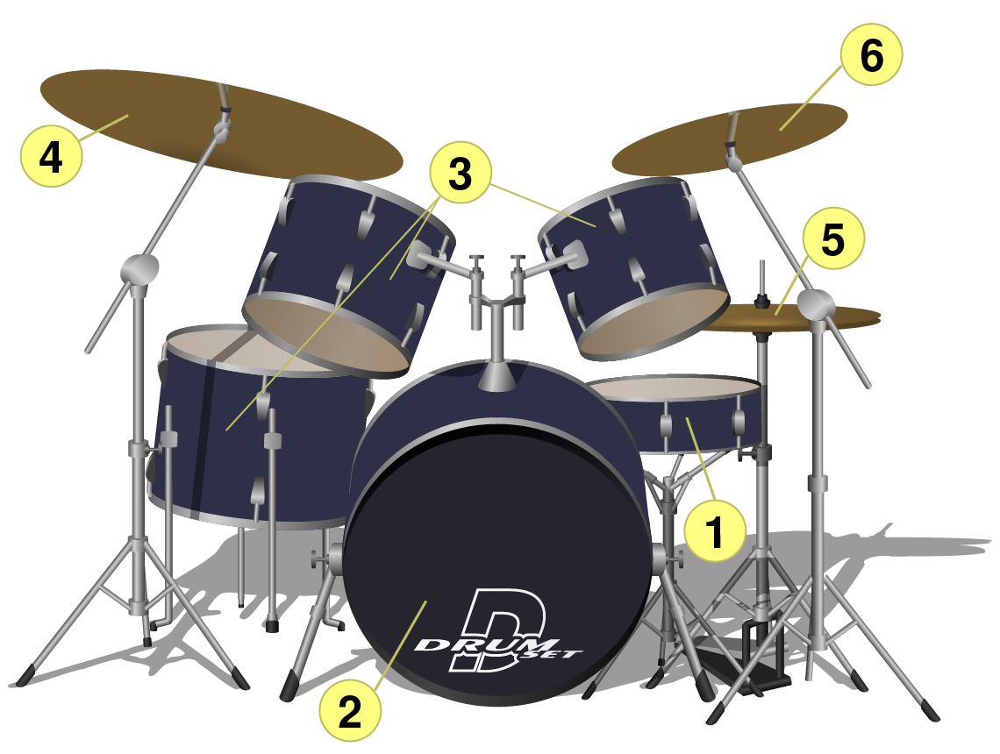
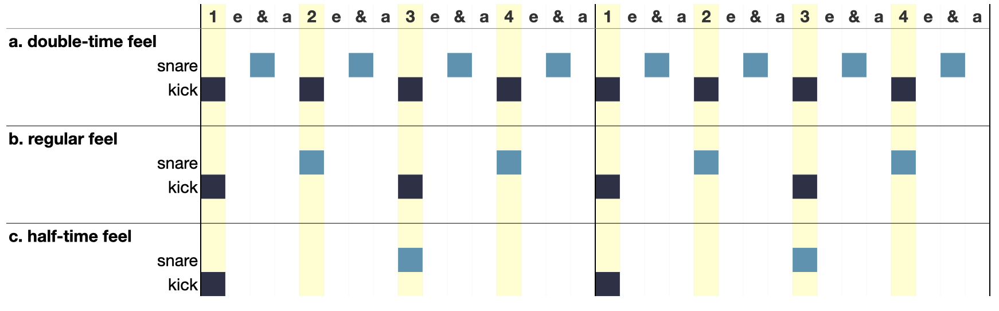

# 鼓点

> **要点**
>
> - 反拍（backbeat）是大多数流行鼓点共有的特征。反拍指四拍子中第二、四拍上的强调发声，通常由小鼓（军鼓）演奏。
> - 底鼓（kick drum）经常带有切分。
> - 镲类乐器——踩镲、叮叮镲和强音镲——常在拍、拍的划分或拍的细分层级上演奏规则的脉动。
> - 除基本摇滚鼓点之外，常见的鼓点还有双倍速、半速、四拍踩底（four on the floor）和登波（dembow）。
> - 四拍子是流行音乐中远远最常见的节拍，其次是单三拍子。流行音乐中的单三拍子鼓点，常在第三拍上击打小鼓。

[本章播放列表](https://open.spotify.com/playlist/43Fu9cn3RbUTr82fmJYwhl?si=4edc1056a6e74fd0)

鼓点是许多流行音乐风格——包括说唱、摇滚和爵士——的节奏基石。鼓点有时由架子鼓实际演奏，有时从既有录音中采样，或编入音序器、DAW（数字音频工作站）之中。在这篇入门讲解里，我们会了解这件乐器本身、鼓组声部的记谱，以及许多风格共有的鼓点特征；也会看到几种特定鼓点如何与特定风格联系在一起。

## 原声架子鼓

谱例 1 展示了鼓组的六个常见组成部分，下文逐一说明。

*谱例 1. 一套标准的原声架子鼓。*

|  | 乐器　音频 | 说明 |
| --- | --- | --- |
| 1. | 小鼓（snare drum）🔊 [snare.mp3](../media/2023/07/snare.mp3) | 鼓面下方绷着金属响弦，击鼓时响弦会振动。因此它的声音是噪性的（也就是占据可听频谱中很大一部分）。用力击打时，听起来像木头的爆裂声或一声霹雳；轻轻击打时，从“嗒”声、轻叩到嗡嗡的滚奏，能提供一系列效果。 |
| 2. | 底鼓（kick drum，或称 bass drum）🔊 [kick.mp3](../media/2023/07/kick.mp3) | 鼓组中音高最低的鼓，用脚踏板演奏。它最初源于改装过的音乐会大鼓，有些至今仍带有同样隆隆作响的特质。另一些底鼓音色是沉闷的“咚”，或是一种次低频效果，在合适的音箱上听来，身体的感受不亚于耳朵的听闻。 |
| 3. | 嗵鼓（toms，或称 tom-toms）🔊 [toms.mp3](../media/2023/07/toms.mp3) | 基音比小鼓更集中，音高比底鼓高。一套鼓上通常有两三个嗵鼓，各有一个独立的音高。音高可以是嗵鼓音色中或明显或不明显的特征。 |
| 4. | 叮叮镲（ride cymbal）🔊 [ride.mp3](../media/2023/07/ride.mp3) | 一片大型悬吊镲。视镲片的厚薄而定，叮叮镲可能是一团温暖的音雾（较薄的镲片，爵士乐中常见），也可能是尖锐、明亮的“锵”（较厚的镲片，金属乐中常见）。敲击镲片中央的“镲帽”，可以得到高而纯净的鸣响。 |
| 5. | 踩镲（hi-hat）🔊 [hi-hat.mp3](../media/2023/07/hi-hat.mp3) | 两片尺寸相同的镲，下面一片倒扣，只有边缘相互接触。镲片默认是张开的，踩下脚踏板时合拢。击打时，踩镲的音色取决于两片镲张开或合拢的程度。最常敲击的是合拢状态，产生标志性的明亮“嗒嗒嗒”；张开的声音更具冲击力，有镲片撞击或哗啦作响的质感；两者之间还有大量中间音色。只用脚踏板操作时，镲片会发出“泼”的一声。 |
| 6. | 强音镲（crash）与重音镲（accent cymbal）🔊 [crash.mp3](../media/2023/07/crash.mp3) | 视尺寸、轮廓和演奏手法而定，这类镲可以发出各种撞击、泼溅、嘶响和“吠叫”般的声音。它们的尺寸（直径 6–18 英寸很常见）与厚薄不一。有些的形状与轮廓与其他镲不同，或加上铆钉、开出大孔。 |

架子鼓是独一无二的模块化乐器——也就是说，它的大多数部件（有人会说全部部件）都是可选的。有些鼓组还配有其他辅助打击乐器：牛铃、铃鼓、木鱼，以及能触发预置音色的电子打击垫。鼓组元件及其配置组合的多样性几乎无穷无尽。

并非所有流行音乐都用原声架子鼓演奏打击乐。鼓机、电子鼓组以及数字音频工作站的插件，让音乐创作与制作有更多的定制空间。电子打击乐使用的声音，大多是原声乐器的采样或模仿。

## 鼓组的五线谱记谱

许多鼓点在创作、演奏和录制过程中从未被写下来。但鼓手、编曲者以及其他音乐行业从业者，常用五线谱来传达鼓点的细节。由于演奏实践具有即兴性和模块性，鼓组记谱并未完全标准化，但下文给出、并在本书中通篇使用的惯例，代表了一种特别常见的写法。只要记谱有丝毫可能引起歧义，最佳做法总是附上说明文字和 / 或鼓谱图例（drum key）。

谱例 2 说明了谱表的各条线和各个间分别代表鼓组的哪个部分：

- **谱号：**作为打击乐器，鼓使用打击乐谱号。
- **符头类型：**鼓（小鼓、底鼓、嗵鼓等）用标准的椭圆形符头，镲类则用叉形（x）符头。
- **位置：**
	- 底鼓使用谱表最下面的间。
	- 小鼓位于自下而上的第三个间。
	- 嗵鼓记在谱表其余各线和各个间上。
	- 踩镲位于谱表上方的间。
	- 叮叮镲位于最上面一条线上。
	- 其他强音镲与重音镲使用谱表上方的加线。
	- 用脚踏板而不是鼓槌演奏踩镲时，记在紧接谱表下方的间里。
- **非常规乐器：**其他元件和效果可能没有标准写法，应当加以标注以免混淆。

*谱例 2. 鼓组各部位的常见记谱。这些特定的符干方向和符头类型对清晰呈现很重要。*

记写鼓声部时，要把不同的内容分成两个声部，如谱例 3 所示：

1. 镲类，通常保持稳定的脉动；符干朝上。
2. 底鼓和小鼓，常配合起来勾勒鼓点的特征；符干朝下。

🎼 [MuseScore 曲谱](https://musescore.com/user/32728834/scores/10460137)

谱例 3. 标准的摇滚鼓点：底鼓在第一、三拍，小鼓反拍在第二、四拍，踩镲演奏规则的八分音符。

这些规则的例外往往也能讲得通。例如用脚踏板演奏踩镲时，符干可以朝上也可以朝下：朝上表示与其他镲类发声明示协同，朝下表示与双脚（也就是底鼓）协同。记写的鼓加花（drum fill）也是可能打破双声部规则的场合，因为这时规则的镲脉动常常会停下，好让鼓手用双手去演奏小鼓、嗵鼓等。

## 小鼓与反拍

大多数流行歌曲是单四拍子（记谱者通常写作 $\mathbf{^4_4}$），而这种节拍下的大多数流行鼓点都有反拍。反拍指第二拍和第四拍，通常由小鼓演奏。上面的谱例 3 展示了小鼓反拍如何成为基本摇滚鼓点的一层：底鼓在第一、三拍，与小鼓反拍交替，再由踩镲规则的八分音符脉动加以补足。同样的底鼓与小鼓交替，也是大量黄金时代嘻哈中“boom-bap”鼓点的基础。

在许多风格中，小鼓反拍是三个层次中最稳定的一层。下面我们会看到，底鼓层和镲层如何被改动，从而改变律动的性格，同时又不牺牲反拍给人的熟悉感。歌曲作者和制作人改动反拍有两种常见方式：

- 把反拍的节奏交给小鼓以外的乐器演奏
- 把反拍节奏加快或放慢到足以改变它与律动速度之间关系的程度。

下面分别讨论这两种手法。

### 非军鼓反拍 {#non-snare-backbeats}

小鼓并不是唯一能演奏反拍的乐器。在 Queen 的“We Will Rock You”中（**谱例 4**），基本摇滚鼓点是用跺脚和拍手代替鼓做出来的。在嘻哈和电子音乐中，用拍手或响指取代小鼓击打很常见。还可以把多种反拍声音叠在一起，做出各类反拍音色（如下文的**谱例 8** 和**谱例 9**）。

▶️ [视频：Queen - We Will Rock You（官方视频）](https://www.youtube.com/watch?v=-tJYN-eG1zk)

<!-- video-begin: https://www.youtube.com/watch?v=-tJYN-eG1zk -->
<div class="omt-video"><iframe src="https://www.youtube-nocookie.com/embed/-tJYN-eG1zk" title="video" loading="lazy" allow="accelerometer; autoplay; clipboard-write; encrypted-media; gyroscope; picture-in-picture; fullscreen" allowfullscreen></iframe></div>
<!-- video-end -->

谱例 4. [Queen“We Will Rock You”（1977）](https://open.spotify.com/track/0a9sd6MEXZXIPHk0fAxpZ4?si=e3d2dad288ff42d8)中不用鼓的反拍。

在许多爵士子风格（包括摇摆和 bop）中，鼓手可能用脚踏板把两片镲合拢，在踩镲上打出反拍（更多信息见[摇摆节奏](../06-jazz/01-swing-rhythms.md)）。结果通常是短促、尖锐、打击性的声音，在许多方面近似小鼓的音色。这种踩镲反拍是小鼓反拍的前身。**谱例 5** 取自 Ella Fitzgerald 演唱的“Fascinating Rhythm”，展示了第二、四拍上的踩镲反拍（外加一个八分音符的先现）。注意这个小鼓例子中的小鼓演奏的是切分节奏，而踩镲则规则得多。

🎼 [MuseScore 曲谱](https://musescore.com/user/32728834/scores/11302333)

谱例 5. [Ella Fitzgerald 录制的“Fascinating Rhythm”（1959）](https://open.spotify.com/track/03whQz2AOGIKgNU3NQW6a0?si=bb7b24077f95405c)中踩镲上典型的爵士反拍。

### 半速与双倍速的律动感

当速度在 80–160 bpm 之间时，基本摇滚鼓点中底鼓与小鼓的节奏很可能被理解为拍或基本拍（tactus）。这样的鼓点可以说具有常速律动（normal feel）：鼓与速度共同确立一个清晰的律动，让人容易跟着起舞。有时，律动用同样的底鼓与小鼓交替来暗示超过 160 bpm 或慢于 80 bpm 的速度。这些快、慢鼓点仍可能支撑律动的速度——只要那个速度也确实让人感到明显偏快或偏慢。然而另一些时候，*尽管*反拍异常地快或慢，律动的其余部分仍暗示 80–160 bpm 的基本拍。这种情况下，我们用双倍速（double-time）和半速（half-time）来描述鼓与律动其余部分之间的错位（谱例 6）。

[](../media/2022/12/feel-chart.001.png)*谱例 6. 用格子记谱（box notation）展示 (a) 双倍速、(b) 常速和 (c) 半速律动感。黄色阴影表示基本拍，三种律动感中相同。深蓝色表示底鼓，浅蓝色表示小鼓。*

Metallica 的“Trapped Under Ice”的主体律动是双倍速感（见**谱例 7**）。小鼓暗示的反拍以约 320 bpm 的速度交替——在这个速度上，数“1 2 3 4”都不舒服，更别说跟着动了。甩头的歌迷更可能锁住反拍一半速度的基本拍（160 bpm）。异常快的鼓与较慢（但仍然很快！）的基本拍之间的不一致，赋予这首歌一种狂乱、推进的能量。歌曲后面（2:00），鼓转为常速感。

🎼 [MuseScore 曲谱](https://musescore.com/user/32728834/scores/11302186)

谱例 7. [Metallica“Trapped Under Ice”（1984）](https://open.spotify.com/track/3lVAAVOkfNyCii1aLgH3JX?si=d95d361c588b4fc7)中的双倍速反拍。

Phil Collins 的“Take Me Home”速度为 119 bpm，正处于基本拍最理想的速度区间正中。这首歌缓慢的反拍却只暗示 60 bpm 的速度——对多数听众来说太慢了（见谱例 8）。如果改按 119 bpm 的脉动来打拍子，我们听到的就是半速鼓点。缓慢的反拍（用拍手代替小鼓）、飞掠的十六分音符踩镲、切分的嗵鼓与木鱼（由同样快速的合成器固定音型支撑）之间的张力，让这个律动有一种破碎之感，既松弛又焦虑。

🎼 [MuseScore 曲谱](https://musescore.com/user/32728834/scores/11302207)

谱例 8. [Phil Collins“Take Me Home”（1985）](https://open.spotify.com/track/2s6wCS3vDZFPY9NOTlPXJZ?si=1e22036fca244dcf)中的半速反拍。

### 登波

小鼓并不总是演奏反拍，有一种非反拍的小鼓音型尤其值得注意。登波（dembow）既指一种音乐风格，也指该风格以及其他风格（如雷鬼冻、dancehall）中常见的一种节奏型。最简单形态的登波鼓点，底鼓打在全部四拍上，小鼓演奏[特雷西略](01-rhythm-and-meter-in-pop-music.md)（3+3+2）节奏的后两部分。Bad Bunny 的“LA CANCIÓN”的副歌就是一个例子（见**谱例 9**，0:52）。

🎼 [MuseScore 曲谱](https://musescore.com/user/32728834/scores/15249751)

谱例 9. [Bad Bunny“LA CANCIÓN”（2019）](https://open.spotify.com/track/0fea68AdmYNygeTGI4RC18?si=321cdfad870d445a)中的登波音型。

## 底鼓

小鼓反拍是四拍子律动中最常见的特征，相比之下底鼓音型更为灵活。如我们所见，底鼓打在第一、三拍是常见选择，构成基本摇滚鼓点的一部分。另一种常见音型叫四拍踩底（four on the floor）：底鼓每拍都打，通常与小鼓反拍同时进行，如 Blondie 的“Heart of Glass”（**谱例 10**），或者干脆没有小鼓。

🎼 [MuseScore 曲谱](https://musescore.com/user/32728834/scores/11346568)

谱例 10. [Blondie“Heart of Glass”（1978）](https://open.spotify.com/track/4v2rkl1mC3zVAz0nXMx9r4?si=d70e3f22c9bc4821)中四拍踩底加反拍的音型。

在流行鼓点中，[切分](01-rhythm-and-meter-in-pop-music.md)出现在底鼓上的情况比出现在小鼓上更多。**谱例 11** 展示了 Kendrick Lamar 的“HUMBLE.”的鼓点：拍手提供了一以贯之的反拍，但底鼓上有大量的方整切分。注意，尽管别处有切分，底鼓仍稳稳地在每小节的第一拍进入。

🎼 [MuseScore 曲谱](https://musescore.com/user/32728834/scores/11302264)

谱例 11. [Kendrick Lamar“HUMBLE.”（2017）](https://open.spotify.com/track/131OLY5J8XyfGuSjXRiTRM?si=aedacd0be3c346e8)中的底鼓切分。部分踩镲上方的“o”表示镲片用脚踏板微微张开。小鼓位置上的“x”表示拍手。

## 镲类

相对于小鼓反拍，镲类也可以有各种不同的节奏。最常见的节奏选择是规则的八分音符或十六分音符，不过稳定的四分音符也绝不罕见。其他音型也是可能的，比如在“Heart of Glass”中踩镲大多只打弱拍（见上文**谱例 10**）。在许多风格中，踩镲是维持这一脉动最常用的镲；叮叮镲也很常见；强音镲多用于较慢的脉动和 / 或更具冲击力的律动与风格。

下面两个例子展示了鼓点中镲类选择的幅度。第一个取自肖战的“Made to Love” [^1]，踩镲上是规则的十六分音符脉动（**谱例 12**；你还可以听到反拍上清脆的非小鼓采样，以及约从 0:10 开始切分的底鼓）。第二个例子取自 Dream Theater 的“As I Am”（见**谱例 13**）。这首歌的第一个鼓点（0:55）是半速反拍，中国镲（china cymbal）上打四分音符，强音镲标出每小节的第一拍。下一个律动（1:14）稍快一些，转为常速感，强音镲演奏八分音符。

🎼 [MuseScore 曲谱](https://musescore.com/user/32728834/scores/15052381)

谱例 12. [肖战“Made to Love”（2020）](https://open.spotify.com/track/2pTdfCzO7W79Qy7DGfRgvK?si=7c9c418f19bb485e)中的十六分音符踩镲。

🎼 [MuseScore 曲谱](https://musescore.com/user/32728834/scores/11302321)

谱例 13. [Dream Theater“As I Am”（2003；0:55）](https://open.spotify.com/track/6hz6lrQtLcxOOjflnYjF9o?si=f602e72444ea4e01)中使用重音镲（中国镲与强音镲）的两个鼓点。

## 复四拍子与单三拍子鼓点

大多数流行音乐是单四拍子，但在多数流行音乐风格中，其次最常见的节拍是复四拍子和单三拍子。

在复四拍子中，基本摇滚鼓点只需按新的三分法拍子划分稍作调整：底鼓仍打在一、三拍，小鼓仍在二、四拍打反拍，镲类（或别的乐器）仍勾勒出拍的划分。这三个要素构成了 Harold Melvin & the Blue Notes 的“If You Don't Know Me by Now”中的鼓点（见**谱例 14**）[^2]。

🎼 [MuseScore 曲谱](https://musescore.com/user/32728834/scores/11374390)

谱例 14. [Harold Melvin & the Blue Notes“If You Don't Know me By Now”（1972）](https://open.spotify.com/track/3NElqDNNnzvWYOwsbxLQKN?si=91327e962a814e29)中缓慢的复四拍子鼓点。

在单三拍子中，无法让等长的底鼓与小鼓击打在每小节里交替出现。最常见的做法是把小鼓“反拍”推迟到每小节的第三拍；Paramore 的“That's What You Get”就是这样（见**谱例 15**）。在一段小鼓上兴高采烈地敲着“3 e + a”加花的引子之后，鼓组进入下面记写的律动。特雷西略式的底鼓节奏让一切保持趣味，同时又推迟了小鼓的击打。这首歌的第二段主歌（0:27）也值得注意：鼓转为基本摇滚鼓点（仿佛在四拍子里），而乐队其余部分仍延续此前确立的三拍子。

🎼 [MuseScore 曲谱](https://musescore.com/user/32728834/scores/11302192)

谱例 15. [Paramore“That's What You Get”（2007）](https://open.spotify.com/track/1JdKrFyoU05abww0Zv0ayQ?si=6b147ab14b2e46e4)中的 3/4 鼓点。

> **试一试！**
>
>  用这个小测验检查你对本章的理解。
>
> 🧩 互动练习（H5P）：鼓点理解自测，见[在线版](02-drumbeats.md)。

> 延伸阅读

- Brennan, Matthew, Joseph Michael Pignato, and Daniel Akira Stadnicki, editors. 2021. *The Cambridge Companion to the Drum Kit*. Cambridge: Cambridge University Press.
- de Clercq, Trevor. 2020. “Rhythmic Influence in the Rock Revolution.” In *The Cambridge Companion to Rhythm* 182–95, edited by Russell Hartenberger and Ryan McClelland. Cambridge: Cambridge University Press.
- Geary, David. 2019. “Analyzing Drums and Other Beats in Twenty-First Century Popular Music.” Ph.D. diss., Indiana University.
- Ohriner, Mitchell. 2020. “Rhythm in Contemporary Rap Music.” In *The Cambridge Companion to Rhythm* 196–213, edited by Russell Hartenberger and Ryan McClelland. Cambridge: Cambridge University Press.

> 作业

1. 鼓点（[.pdf](https://viva.pressbooks.pub/app/uploads/sites/12/2023/07/WK-Drumbeats.pdf)）。要求学生辨认鼓点的特征并记写下来。[练习表播放列表](https://open.spotify.com/playlist/16op4Jb7vPnRXZ5Qw4crrE?si=13d79c3318284ed7)

    <!-- lilylet-begin: media/2023/07/WK-Drumbeats.mscz -->
    ```lyl.play
    [measures "2*[1], 2..5, 6, 7, 8, 9, 10, 11, 12"]

    \key c \major \numericTimeSignature \time 4/4 \clef "percussion" \tempo 4=100 \stemUp g''16^\markup "Shuffle 16ths"[ g g g] g[ g g g] g[ g g g] g[ g g g] \bar ":|." \\
    \stemDown f4 c' r16 f,[ f8] c' r16 f, | %1

    \tempo 4=132 \stemUp g''8[ g] r g g4_\markup "snaps" g \\
    \stemDown f4 r c' r | %2

    \stemUp g''8[ g] r g g4 r \\
    \stemDown f4 r c' | %3

    \stemUp g''8[ g g g] g4 g \\
    \stemDown f4 r c' r8 c | %4

    \stemUp g''8[ g] r4 e8[ e e e] \bar ":|." \\
    \stemDown f8[ c'] r4 <f, c'> f | %5

    \tempo 4=90 \stemUp g''8.[ d16^\markup "tamb."] g8[ d] g8.[ d16] g8[ d] \bar ":|." \\
    \stemDown f8.[ c'16] f,8[ c'] f,8.[ c'16] f,8[ c'] | %6

    s1^\markup " = ___" | %7

    s1 \bar ":|." | %8

    \time 12/8 s1.^\markup ". = ___"^\markup "Shuffle 16ths" | %9

    s1. \bar ":|." | %10

    \time 3/4 s2.^\markup " = ___" | %11

    s2. \bar ":|." | %12
    ```
    <!-- lilylet-end -->

### 媒体署名

- [drum\_set](https://upload.wikimedia.org/wikipedia/commons/0/0d/Drum_set.svg) © [Pbrks](https://commons.wikimedia.org/wiki/User:Pbrks)，由 Megan Lavengood 改编，遵循 [CC BY-NC-SA（署名–非商业性使用–相同方式共享）](https://creativecommons.org/licenses/by-nc-sa/4.0/)许可协议
- Drum key © Megan Lavengood，遵循 [CC BY-NC-SA（署名–非商业性使用–相同方式共享）](https://creativecommons.org/licenses/by-nc-sa/4.0/)许可协议
- Feel chart © Megan Lavengood，遵循 [CC BY-NC-SA（署名–非商业性使用–相同方式共享）](https://creativecommons.org/licenses/by-nc-sa/4.0/)许可协议

---

[^1]: “Made to Love”又名“Spotlight”，中文名《光点》（“Guāngdiǎn”）。
[^2]: 注意速度只有 31 bpm！基本拍很可能感觉在八分音符这一拍的划分层级上。
