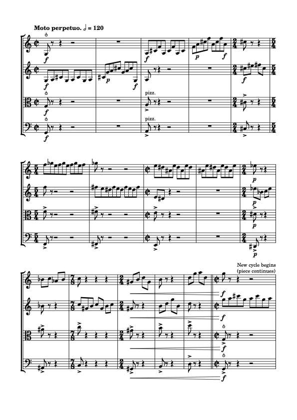

# 用十二音作曲

> **要点**
>
> 本章完整走一遍一首新十二音音乐的创作过程。像这样紧跟着别人的思路走，往往很有帮助；自己动手做类似的事，当然也有益。

到目前为止，我们看到的是一些抽象的音列与序列属性，以及它们在若干既有作品中的用法。现在让我们补上一环：写一首新作品。值得重申的是——与任何其他音乐风格或技法一样——用十二音音列作曲有无数种途径，所以这里只能算一个例子，而非有代表性的样本；事实上，单篇分析也同样如此。尽管如此，一个用音列写作的例子，仍能很好地说明我们如何在理论与实践中穿行。我们不妨以巴托克（Béla Bartók）精彩的《小宇宙》（*Mikrokosmos*）曲集为标杆：短小的乐曲，带着明确的创作「纲要」，同时作为「真正的」作品也相当有趣。

接下来，我们先挑选并考察音列，然后至少写出若干段落的开头，这些段落处理同一素材的方式各不相同，尤其在运用序列程序的「自由」或「严格」程度上有所差别。

## 选择音列

先来挑选一些要用的音列。选择音列的动机可以有很多，我倾向于寻找这样的音列：

- 具有「有趣」的内部属性……
- ……这些属性暗示着某些作曲策略
- 并且在既有作品中相对较少被发掘。

对我来说，「全三音组」（all-trichord）音列非常符合这些标准。艾伦·马斯登（Alan Marsden，2012，162）把它们定义为「12 音序列，若按循环方式处理，则在 12 组三个连续音级中包含了全部 12 种可能的三音组集合类」。[^1]

马斯登已经证明，这种音列恰好有四种不同的形式：

1. [0, 2, 6, 10, 5, 3, 8, 9, 11, 7, 4, 1],
2. [0, 2, 6, 10, 11, 9, 8, 3, 5, 1, 4, 7],
3. [0, 2, 6, 10, 7, 4, 11, 9, 8, 3, 5, 1],
4. [0, 2, 6, 10, 1, 4, 5, 3, 8, 9, 11, 7]

下面是它们作为从 C 开始的十二音音列的样子，并附有相应的三音组及其标记：

🎼 [MuseScore 乐谱](https://musescore.com/user/30425053/scores/403299860346169)

[全三音组音列](https://musescore.com/user/30425053/scores/6793408/s/CovNzk)，作者 [FourScoreAndMore](https://musescore.com/fourscoreandmore)

既然所有标准音列都包含全部十二个音，而包含全部十一种音程的「全音程」音列也为人熟知、相当常见，那么你可以把全三音组音列看作这些熟悉属性的逻辑延伸。它们确实有用，因为用十二音作曲的目标就是追求最大的变化。

也许最有说服力的一点是，马斯登的结论是：他「始终没有找到令人信服的办法，把这一点用于创作」（2012，163）。对某些作曲家来说，这样的话简直无法抗拒。

## 示例作品

下面给出几部示例作品，并讨论如何用一个音列来生成一部音乐作品所需的音高材料。

### 一段（相对）自由的幻想曲

从最不严格的做法开始。这里我们把对这些音列的运用、以及对相互重叠的三音组的强调视为足够的约束，其余一切则留待自由的创作选择，包括：

- 音或三音组的重复（但或许不包括二音组、四音组之类的其他分组）。
- 具体的节奏与分句（只要通常强调三个一组的划分）。
- 用于拓展表现力的音区与音色变化。

这一出发前提可以有无穷多种实现方式。下面是一个中提琴独奏的开头，从第一个三音组走到第二个（即上述四条音列开头共有的那两个）：


<!-- lilylet-begin: media/2021/05/Solo.png -->
```lyl.play
\numericTimeSignature \clef "alto" \key c \major \time 4/4 \tempo "Very slow and free" c,16--\f[ d-- fs8--] r4 r r8 c'8-._\markup "echo"\pp( | %1

r8 d8-. r fs-.) r4 r8 c,16\f[( d)] | %2

\time 5/8 fs,8--[ c'16\p( d] fs8)[ c,16--\f( d fs) bf] | %3

\time 4/4 d,4-- fs-- bf-- r | %4
```
<!-- lilylet-end -->
许多作曲家——无论是否写序列——都觉得以这种方式设定初始约束很有帮助，部分原因是这可以让你放手去处理更细致的层面。这些限制为后续走向留下了广阔的可能。比如，我们或许想造出一条整体轮廓：逐步推向高点，再从中回落；又或者，我们更想要一段静态的、明显受约束的段落。一切皆有可能。

### 由过程驱动的「无穷动」

我们也可以用更有活力、更有节奏感的方式处理这些相互重叠的三音组。比如，可以写成一种极简主义式的无穷动（moto perpetuo）风格，执拗地把每个三音组重复许多次，再进入下一个。我们先从一连串持续的音开始，按顺序重复三音组（即音高 1-2-3-1-2-3-……）。要进入下一个三音组，只需把第二个音当作新循环的起点，得到 2-3-4。所以，如果我们重复的是 1-2-3-，那么到了某处会出现 1-2-3-1-，接下来的 2 就标志着 2-3-4- 循环的开始。

我们可以在完成任意数量的三音循环再加一个音之后作此切换：也就是在第 4 个音之后（一个循环 +1），或在第 7 个（两个循环）、10 个、13 个、16 个之后，依此类推。这应当促使我们思考节奏与节拍。假设把这个以三为组的模式放进 $\mathbf{^2_2}$ 这样的二拍子中，音乐便会带上一种迷人而熟悉的、三对四的节拍不协和。无论选什么拍号，我们都得为某些循环长度作调整：有些会与节拍「吻合」，有些则会打乱它。比如在我们的二拍子里，4 循环可以算作「一拍」（例如把四个八分音符当作 $\mathbf{^2_2}$ 中的一拍），16 循环则可以是 2 小节（4×4 拍）。相比之下，10 循环意味着把节拍稍微打破（例如用 $\mathbf{^5_4}$），而 7 循环则延伸到另一个更低的节拍层级（$\mathbf{^7_8}$）。

下面是为弦乐四重奏写的短小段落，实现了其中一些想法；每个循环现在都由中提琴与大提琴的拨弦、以及把音型从一把小提琴移到另一把来明确标出（这也让每位演奏者得以稍事休息！）。大多数循环长 16 个音，但也有一些较短的，用来打破流动感，并更多地停留在某些三音组上。同样，选哪些是自由的。



<!-- lilylet-begin: media/2021/05/Moto-perpetuo.png -->
```lyl.play
[staves "<v1-v2-va-vc>"]

\key c \major \time 2/2 \clef "treble" \tempo "Moto perpetuo." 2=120 g8^\markup "snap pizz."\f r r4 r2 \\\\
\clef "treble" g8\f[ a cs g] a[ cs g a] \\\\
\clef "alto" g8^\markup "snap pizz."\f r r4 r2 \\\\
\clef "bass" g,8^\markup "snap pizz."\f r r4 r2 | %1

R1 \\\\
cs8[ g'\p a cs] g[ a cs g,\f] \\\\
R1 \\\\
R1 | %2

a8\f[ cs f a,] cs[ f a, cs] \\\\
a8 r r4 r2 \\\\
a8->^\markup "pizz." r r4 r2 \\\\
a,8->^\markup "pizz." r r4 r2 | %3

f8\p[ a cs f] a,[ cs f a,\f] \\\\
R1 \\\\
R1 \\\\
R1 | %4

\time 2/4 cs'8 r r4 \\\\
cs'8\f[ es] fs[ cs] \\\\
cs8-> r r4 \\\\
cs,8-> r r4 | %5

\time 5/4 f'8[ gf e f gf e] f[ gf e f] \\\\
f'8 r r2 r \\\\
f8-> r r2 r \\\\
f,,8-> r r2 r | %6

gf''8 r r2 r \\\\
fs'8[ e ds fs e ds] fs[ e ds fs] \\\\
fs8-> r r2 r \\\\
fs,,8-> r r2 r | %7

\time 2/2 e'8[ ds as e'] ds[ as e' ds] \\\\
e8[ ds] r4 r2 \\\\
e8-> r r4 r2 \\\\
e,,8-> r r4 r2 | %8

as'8[ e' ds as] e'[ ds as e'] \\\\
R1 \\\\
R1 \\\\
R1 | %9

\time 2/4 ef'8\p r r4 \\\\
ef'8\p[ bf] c[ ef] \\\\
ds8->\p r r4 \\\\
ds,,8->\p r r4 | %10

bf'8[ c] af[ bf] \\\\
bf'8 r r4 \\\\
as'8-> r r4 \\\\
as,8-> r r4 | %11

\time 7/8 c'8 r4 r r \\\\
c'8[ gs b] c[ gs] b[ c] \\\\
c'8-> r4 r r \\\\
c,8-> r4 r r | %12

\time 2/4 gs'8\<[ b] d[ gs,] \\\\
gs'8\< r r4 \\\\
gs'8->\< r r4 \\\\
gs,8->\< r r4 | %13

b'8 r r4 \\\\
b'8[ d] g[ b,] \\\\
b'8-> r r4 \\\\
b,8-> r r4 | %14

d'8[ g] a[ d,] \bar "||" \\\\
d'8 r r4 \bar "||" \\\\
d'8-> r r4 \bar "||" \\\\
d,8-> r r4 \bar "||" | %15

\time 2/2 g''8^\markup "New cycle begins (piece continues)"\!\f r r4 r2 \\\\
g''8\!\f[ a cs g] a[ cs g a] \\\\
g8^\markup "snap pizz."\!->\f r r4 r2 \\\\
g,8^\markup "snap pizz."\!->\f r r4 r2 | %16
```
<!-- lilylet-end -->
### 一首严格、固定的赋格

最后，让我们探索一种更严格的做法：不重复音，并同时使用一个以上的音列。我们把这放在经典的严格复调形式——赋格——的语境中来做。[^2] 我们可以把其中一条音列直接写成一个十二音主题，再取一个与该主题构成六音组组合性的对题。主题与对题按定义要一起演奏，因此六音组组合性可以保证我们在半个循环之内不重复任何音高。

我们还可以保证，即使第三、第四声部进入也不重复音高——也就是在三音组的层面。我们的音列并不是三音组组合性的，但既然已经有了一对六音组组合性的音列，我们就可以通过交换每条音列中的三音组，得到一对新的音列；它们与原有两条合在一起，将保证每一组三音组中都出现全部十二个音。

更确切地说，单纯交换三音组会破坏这些音列的次序，也就会失去其标志性的「全三音组」属性；不过我们仍有办法在保持与原音列结构一致的前提下达到同样的效果。注意，「交换每一半的三音组」意味着取出三音组 1,2,3,4，最终得到 2,1,4,3。要在保持同样次序的情况下从前者变到后者，我们可以做逆行，再轮转半个循环。例如，对于一条上行半音阶音列，我们会得到：

| 音列 | 1 | 2 | 3 | 4 | 5 | 6 | 7 | 8 | 9 | 10 | 11 | 12 |
| --- | --- | --- | --- | --- | --- | --- | --- | --- | --- | --- | --- | --- |
| 逆行并轮转 6 位 | 6 | 5 | 4 | 3 | 2 | 1 | 12 | 11 | 10 | 9 | 8 | 7 |

于是，把这一过程用于初始音列和一对六音组组合性的音列，我们就能得到如下这样的方案：

| 1. 初始音列（如上） | 1 | 2 | 3 | 4 | 5 | 6 | 7 | 8 | 9 | 10 | 11 | 12 |
| --- | --- | --- | --- | --- | --- | --- | --- | --- | --- | --- | --- | --- |
| 2. 六音组组合性配对 | 7 | 8 | 9 | 10 | 11 | 12 | 1 | 2 | 3 | 4 | 5 | 6 |
| 3. 对 1. 作逆行轮转（如上） | 6 | 5 | 4 | 3 | 2 | 1 | 12 | 11 | 10 | 9 | 8 | 7 |
| 4. 对 2. 作逆行轮转 | 12 | 11 | 10 | 9 | 8 | 7 | 6 | 5 | 4 | 3 | 2 | 1 |

请注意，在以下范围内都没有音高的重复：

- 四条音列中任何一条单独来看（当然，它们都是十二音音列）。
- 初始音列的前半与六音组组合性音列的前半、这两条音列的后半、或轮转后那一对音列的前半或后半。
- 任何离散的三音组子集（例如所有音列合起来之后的第 1–3 个音）。

这一属性对任何音列都按定义成立，所以值得把它放进作曲的锦囊之中。

#### 组合性的实际运用

决定使用组合性的配对固然很好，但我们得知道至少有一条音列真的具备这一属性。事实上它们全都具备，只是程度不同：每条音列都至少有一些轮转是倒影组合性的（记住，轮转这些音列会保留至关重要的全三音组属性！），不过第 3、4 条音列这样的轮转比第 1、2 条略多一些。例如，以下是第 3 条音列的列表：

| **轮转** | **音列** | **组合性** |
| --- | --- | --- |
| 0 | [0, 2, 6, 10, 7, 4, 11, 9, 8, 3, 5, 1] | I3 |
| 1 | [2, 6, 10, 7, 4, 11, 9, 8, 3, 5, 1, 0] | I5 |
| 2 | [6, 10, 7, 4, 11, 9, 8, 3, 5, 1, 0, 2] |  |
| 3 | [10, 7, 4, 11, 9, 8, 3, 5, 1, 0, 2, 6] |  |
| 4 | [7, 4, 11, 9, 8, 3, 5, 1, 0, 2, 6, 10] | I2 |
| 5 | [4, 11, 9, 8, 3, 5, 1, 0, 2, 6, 10, 7] |  |
| 6 | [11, 9, 8, 3, 5, 1, 0, 2, 6, 10, 7, 4] | I4 |
| 7 | [9, 8, 3, 5, 1, 0, 2, 6, 10, 7, 4, 11] | I10 |
| 8 | [8, 3, 5, 1, 0, 2, 6, 10, 7, 4, 11, 9] |  |
| 9 | [3, 5, 1, 0, 2, 6, 10, 7, 4, 11, 9, 8] |  |
| 10 | [5, 1, 0, 2, 6, 10, 7, 4, 11, 9, 8, 3] | I4 |
| 11 | [1, 0, 2, 6, 10, 7, 4, 11, 9, 8, 3, 5] |  |

下面的图示则说明：从第二个音开始的轮转，意味着我们可以围绕三音组轮转，而仍然保持倒影组合性（即上表中的第 1、4、7、10 次轮转）：


<!-- lilylet-begin: media/2021/05/Rows_and_rotations.png -->
```lyl.play
[staves "{a-b},{c-d}"]
[instrument-a-b "Hexachord-combinatorial pair:"]
[instrument-c-d "Both rows in retrograde and rotated by 6"]

\staff "1" \omit Score.TimeSignature \key c \major \time 3/4 \clef "treble" d4^\markup "Trichord A" fs bf \\
\staff "2" \clef "bass" f,4^\markup "A(i)" cs a \\\\
\staff "1" \clef "treble" b'4^\markup "B(r)" e, g \\
\staff "2" \clef "bass" af,4^\markup "B(ri)" ef' c | %1

\staff "1" g'4^\markup "B" e b' \\
\staff "2" c,4^\markup "B(i)" ef af, \\\\
\staff "1" bf'4^\markup "A(r)" fs d \\
\staff "2" a,4^\markup "A(ri)" cs f | %2

\staff "1" a'4^\markup "C" af ef \\
\staff "2" bf,4^\markup "C(i)" b! e \\\\
\staff "1" c4^\markup "D(r)" df f \\
\staff "2" g4^\markup "D(ri)" fs d | %3

\staff "1" f4^\markup "D" df c \bar "|." \\
\staff "2" d,4^\markup "D(i)" fs g \bar "|." \\\\
\staff "1" ds4^\markup "C(r)" gs a \bar "|." \\
\staff "2" e,4^\markup "C(ri)" b as \bar "|." | %4
```
```lyl.play
[staves "{a-b},{c-d}"]

\staff "1" \omit Score.TimeSignature \key c \major \time 3/4 \clef "treble" g'4^\markup "B"_\markup "Now I2" e b' \\
\staff "2" \clef "bass" d,4 f as, \\\\
\staff "1" \clef "treble" ds4^\markup "C" gs a \\
\staff "2" \clef "bass" fs,4 cs c! | %1

\staff "1" a'4^\markup "C" af ef \\
\staff "2" c,4 cs fs \\\\
\staff "1" b'4^\markup "B" e, g \\
\staff "2" as,4 f' d | %2

\staff "1" f4^\markup "D" df c \\
\staff "2" e,4 gs a \\\\
\staff "1" bf'4^\markup "A" fs d \\
\staff "2" b,4 ds g | %3

\staff "1" d4^\markup "A" fs bf \bar "|." \\
\staff "2" g4 ds b \bar "|." \\\\
\staff "1" c4^\markup "D" df f \bar "|." \\
\staff "2" a4 gs e \bar "|." | %4
```
```lyl.play
[staves "{a-b},{c-d}"]

\staff "1" \omit Score.TimeSignature \key c \major \time 3/4 \clef "treble" a'4^\markup "C" af ef \\
\staff "2" \clef "bass" bf,4 b! e \\\\
\staff "1" \clef "treble" c4^\markup "D" df f \\
\staff "2" \clef "bass" g4 fs d | %1

\staff "1" f4^\markup "D" df c \\
\staff "2" d,4 fs g \\\\
\staff "1" ds4^\markup "C" gs a \\
\staff "2" e,4 b as | %2

\staff "1" d4^\markup "A" fs bf \\
\staff "2" f,4 df a \\\\
\staff "1" b'4^\markup "B" e, g \\
\staff "2" gs,4 ds' c | %3

\staff "1" g'4^\markup "B" e b' \bar "|." \\
\staff "2" c,4 ef af, \bar "|." \\\\
\staff "1" bf'4^\markup "A" fs d \bar "|." \\
\staff "2" a,4 cs f \bar "|." | %4
```
```lyl.play
[staves "{a-b},{c-d}"]

\staff "1" \omit Score.TimeSignature \key c \major \time 3/4 \clef "treble" f4^\markup "D" df c \\
\staff "2" \clef "bass" e,4 gs a \\\\
\staff "1" \clef "treble" bf'4^\markup "A" fs d \\
\staff "2" \clef "bass" b,4 ds g | %1

\staff "1" d4^\markup "A" fs bf \\
\staff "2" g4 ds b \\\\
\staff "1" c4^\markup "D" df f \\
\staff "2" a4 gs e | %2

\staff "1" g'4^\markup "B" e b' \\
\staff "2" d,4 f as, \\\\
\staff "1" ds4^\markup "C" gs a \\
\staff "2" fs,4 cs c! | %3

\staff "1" a'4^\markup "C" af ef \bar "|." \\
\staff "2" c,4 cs fs \bar "|." \\\\
\staff "1" b'4^\markup "B" e, g \bar "|." \\
\staff "2" as,4 f' d \bar "|." | %4
```
<!-- lilylet-end -->
为了这一属性，我们可以从这些三音组／轮转中的任何一个出发。在这些选项中，我们选择从第二个音开始，部分原因是这样能得到增三和弦，而这似乎是个很好的出发点：用一个对称三音组，写一段主题与对题呈倒影关系的赋格段。

#### 真正的音乐！

剩下的就是写音乐了！让各条音列保持分离，分属不同声部、不同的进入点与节奏。我们先写一个呈示部（第 1–8 小节），它包含：

- 一个被拆成四个三音组的主题，并带有类似无穷动中所用那样的三对四模式。
- 每个声部都以主题进入（当然），但每次都上移一个半音。
- 对题采用互补的节奏，逐步填补空隙。

呈示部之后，我们探索上文讨论过的三音组轮转属性：大提琴循环演奏同样的四个三音组，每次音列之间重叠一个三音组。这就使其他声部也进入音列相应的轮转形式（如上文的音列表格所示）。此外，由于大提琴始终保持在同样的音高上，其他声部也必须移到新的音高层次上，以保持组合性（这与上表不同：上表中最上方谱表停留在同一音高层次，其余各声部则随之调整）。

对赋格段而言，这种密度上的增长是典型的（几乎不可避免）。与此相配，这一实现也提高了变化的速率：既通过 poco a poco 的渐快，也通过下面这种删去休止的方案，逐次缩短乐句跨度：

*逐步压缩的节奏循环。每个 X 标出的是在后续陈述中被删去的休止。*

#### 接下来的步骤

最后，在围绕四个三音组轮转之后，我们再往回轮转一个音，回到音列最初那个以 [0, 2, 6, 10] 模式开头的轮转——这个模式为全部四条音列所共有，是它们的「开头」。这一轮转当然会带来变化。到此刻为止，我们一直处在音列的某种特定分割方式之中，因而只强调了十二个三音组中的四个。轮转一位就来到另一组四个三音组。如果这些音列中有一条能在连续三次轮转（即最后那组四个）中都支持六音组组合性，我们本可以围绕这三者平均地构建段落；但这些音列都没有这一属性，所以我们聚焦于其中一个，并把转向另一个的时刻当作段落即将结束的信号。再说一次，这不过是众多可能做法中的一种。

### 综合起来

如此，你便看到了处理这些音列的多种可能方式。接下来的步骤，也许是把其中一种扩展成完整作品，或者把三者（也许还有其他段落）组合成一组短小的乐章，或许是练习曲。

总而言之，下面是本作品的一种实现。我们以自由的幻想曲开头（现在简称为「独奏」），接着是赋格段与无穷动，最后以一个更接近开头那种放松精神的短小段落收束。同样，每一步都有广泛的选择余地，从选择「自由」还是「严格」的做法，到实践中的具体实现。

🎼 [MuseScore 乐谱](https://musescore.com/user/8641586/scores/6803044)

[4x4x4x4](https://musescore.com/user/8641586/scores/6803044/s/O60h3c)，作者 [Mark.Gotham](https://musescore.com/user/8641586)

 

> 延伸阅读

- Marsden, Alan (2012): “Final Response: Ontology, Epistemology, and Some Research Proposals.” *Journal of Mathematics and Music*, 6(2): 161–67. doi:10.1080/17459737.2012.698157

 

> 在线资源

- Robert Morris 慷慨地在[这个页面](http://ecmc.rochester.edu/rdm/downloads.html)提供了丰富的资源，其中包括 [“Elementary Twelve-Tone Theory”](http://ecmc.rochester.edu/rdm/pdflib/el.12ttth.pdf) 一文。

> 作业

1. 试着做一件与上面类似的事：
	- 挑选一条或几条你喜欢的音列。
	- 带着这些属性来构思并写作音乐。
	- 思考如何在严格的约束与自由的写作之间取得平衡。不要害羞。无论你是否自认为「作曲家」，边做边学总是有益的，作曲正是一个极好的例证。

### 媒体署名

- Solo © Mark Gotham
- Moto perpetuo © Mark Gotham is licensed under a [All Rights Reserved](https://choosealicense.com/no-license/) license
- Rows\_and\_rotations © Mark Gotham
- Rhythmic cycles © Mark Gotham

---

[^1]: 注意，有时用 "all-trichord rings" 一语指称这一话题，而 "all-trichord row" 则指不环绕（因而略去两个三音组）的音列。参见 Robert Morris 的 [“Elementary Twelve-Tone Theory”](http://ecmc.rochester.edu/rdm/pdflib/el.12ttth.pdf) 等文献，并注意（承巴比特之说）全三音组音列的定义："A ten-trichord row that excludes SC 3-10[036] and 3- 12[048]."
[^2]: 不熟悉赋格写法的读者，可以先读[「盛期巴洛克赋格呈示部」一章](../02-counterpoint/09-high-baroque-fugal-exposition.md)。
