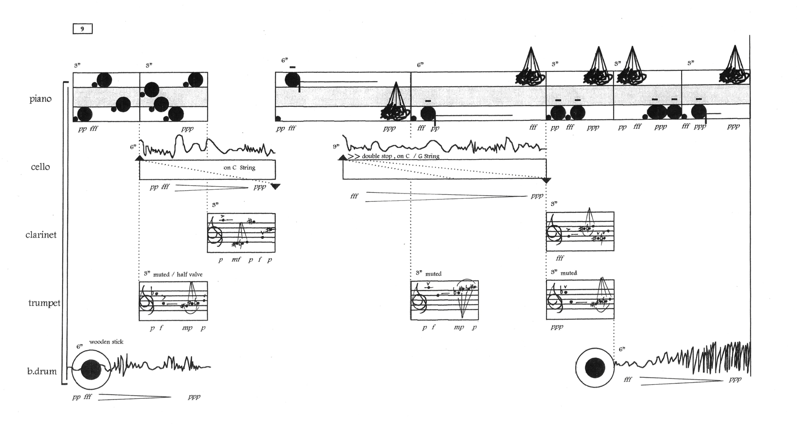
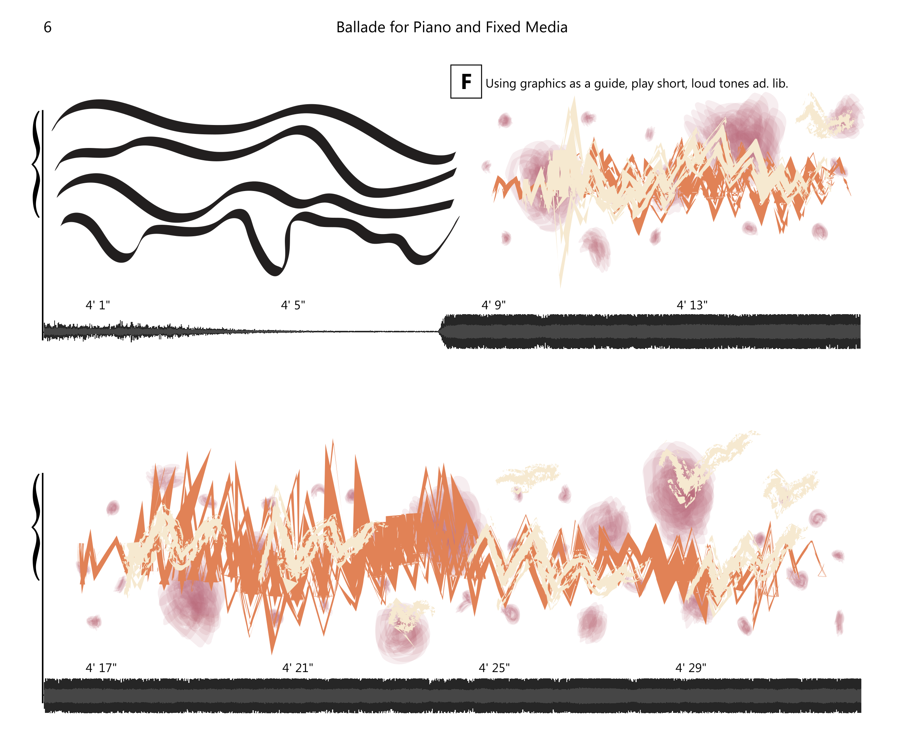
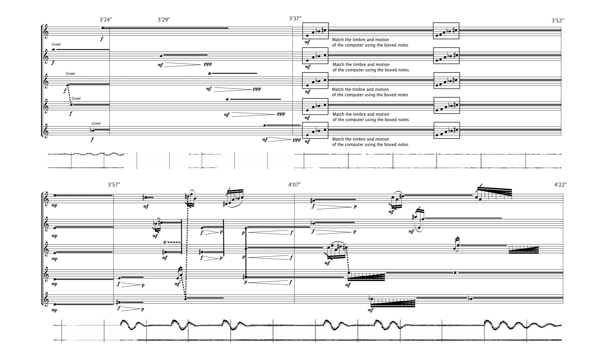

# 图形记谱法与乐谱

> **要点**
>
> - 图形记谱法（graphic notation）几乎没有任何规则。图形乐谱（graphic score）中常见抽象形状、线条、图像、图案、颜色甚至文字。
> - 视觉音乐（Augenmusik）使用传统的五线谱记谱法，但通过改变音乐特征来呈现某种图像或图案，为其演奏者提供额外的象征意义。这类乐谱有时会构成一个表意图形（ideogram），即用一幅图画或一个符号来表达某种观念或概念。
> - 不确定音乐（indeterminate music）把作品中的某些要素交给演奏者或交给偶然（chance）来决定。偶然是指在作品创作中引入随机要素，通常借助掷硬币、掷骰子等程序来实现。
> - 审美相对主义（aesthetic relativism）是一种哲学观点，认为对美的判断相对于个人或文化而言（即不存在普遍的审美标准）。
> - 混合使用图形记谱法和西方传统记谱法的乐谱，有时称为混合记谱（hybrid score）。
> - 作曲家有时会为自己的图形乐谱提供说明或准则。这些说明可以详略不一，也可能使演奏结果更确定或更不确定。解读带说明的乐谱时，应尽力遵循其中的指示或准则。
> - 图形乐谱有时采用时间线记谱法（timeline notation），即用秒而不是小节线和拍号来衡量时间。
> - 作曲家也可能不给出任何关于时间推移的提示。在这种情况下，我们说这段音乐是自由节拍（free time）的。

谱例 1 展示了一份图形乐谱：[^1]

*谱例 1. Henrik Colding-Jørgensen 的《Museik No. 10》（1979）。*

谱例 1 看起来也许不像音乐，但它确实传达了音乐。如你所见，它不含我们在前面各章所见过的西方传统音乐记谱法的任何特征，例如谱表、音符、休止等。然而，这两种记谱体系在向演奏者传达作品信息方面，同样正当、同样有效。正如作曲家 Malcolm Goldstein（生于 1936 年）所说："图形记谱法并非一种……客套……它是把想法传达给其他演奏者、并了解能做到什么的一种必要手段。"[^2] 传统的五线谱记谱法对乐谱的写法有许多规则，而图形记谱法几乎没有规则。图形乐谱中常见抽象形状、线条、图像、图案、颜色甚至文字——图形乐谱没有必须遵守的限制。

因此，这类记谱法理解起来要曲折得多。本章的理解将依赖审美相对主义和不确定性等概念，我们很快就会深入探讨。但首先需要讨论作曲家是何时、以何种方式开始使用图形记谱法的。

## 图形记谱法简史

虽然图形记谱法的使用兴起于 20 世纪，但包含图形要素的作品早在文艺复兴时期就已出现。这类早期的非传统视觉要素之一，德语称为 Augenmusik，意为"视觉音乐"（eye music）。视觉音乐一般使用传统的五线谱记谱法，但通过改变音乐特征来呈现某种图像或图案，为其演奏者提供额外的象征意义。[^3]

在某些情况下，作曲家会改变谱表的形状以构成一个表意图形。这类视觉音乐可以视为图形乐谱。不过应当注意，它的视觉象征意义实际上并不改变作品的音响或演奏；它仅仅是作品记谱的一个方面。

谱例 2 展示了视觉音乐最早、也最著名的用例之一，它同时也是一个表意图形：15 世纪法国作曲家 Baude Cordier 的回旋歌（rondeau）《美丽、善良、聪慧》（"Belle, Bonne, Sage"）。这首情歌以心形呈现给演奏者，进一步传达了浪漫的主题。

*谱例 2. Baude Cordier 的《美丽、善良、聪慧》。*

你可以在谱例 3 中观看《美丽、善良、聪慧》的演出并对照乐谱。视频中的记谱已被转写为现代五线谱，以便跟读。

▶️ [视频：Baude Cordier：心形回旋歌《美丽、善良、聪慧》（手稿动画）](https://www.youtube.com/watch?v=ZcOtQNR8lzE)

<!-- video-begin: https://www.youtube.com/watch?v=ZcOtQNR8lzE -->
<div class="omt-video"><iframe src="https://www.youtube-nocookie.com/embed/ZcOtQNR8lzE" title="video" loading="lazy" allow="accelerometer; autoplay; clipboard-write; encrypted-media; gyroscope; picture-in-picture; fullscreen" allowfullscreen></iframe></div>
<!-- video-end -->

谱例 3. 由 Jordan Alexander Key 博士制作的《美丽、善良、聪慧》动画演出。

视觉音乐的另一个较晚近的例子来自作曲家 [John Dante Prevedini](https://prevedini.com/)（生于 1987 年）。Prevedini 于 2020 年发布了他的作品《自拍》（"Selfie"，见谱例 4），[^4] 这一年新冠疫情暴发。他注意到在居家期间，人们在社交媒体上变得更加活跃。他意识到"社交媒体是一个观看而非聆听的场所"，于是要求自己找到一种方法，让音乐对网络受众更具视觉吸引力。[^5] 《自拍》描绘的是作曲家本人的自画像，便是这一尝试的成果之一。

*谱例 4. John Dante Prevedini 的《自拍》（2020）。*

你可能已经注意到，这份乐谱是无拍的（ametric），这一点在[二十世纪节奏技法](../08-20th-and-21st-century-techniques/01-twentieth-century-rhythmic-techniques.md)中有进一步讨论。你可以在谱例 5 中听到《自拍》的演出：

▶️ [视频：自拍入乐](https://www.youtube.com/watch?v=9-Nbi3Sozdc)

<!-- video-begin: https://www.youtube.com/watch?v=9-Nbi3Sozdc -->
<div class="omt-video"><iframe src="https://www.youtube-nocookie.com/embed/9-Nbi3Sozdc" title="video" loading="lazy" allow="accelerometer; autoplay; clipboard-write; encrypted-media; gyroscope; picture-in-picture; fullscreen" allowfullscreen></iframe></div>
<!-- video-end -->

谱例 5. 作曲家本人演奏的 John Dante Prevedini《自拍》。

20 世纪初，一些作曲家写作的音乐日益复杂，已经难以用传统的西方记谱法传达。例如，"古斯塔夫·马勒（Gustav Mahler）的音乐中充斥着大量书写说明……用以传达当时任何记谱法都无法提供的音乐意义"，而"阿诺德·勋伯格（Arnold Schoenberg）用 X 形符头来表示他使用了诵唱音（Sprechstimme）。"[^6] 这些作曲家之一亨利·考威尔（Henry Cowell，1897–1965）认为西方节奏记谱法并不充分。[^7] 考威尔在《新音乐资源》（*New Musical Resources*，1930）一书中明确呼吁为连音（tuplet）建立新的节奏记谱体系，并提出："那么，所需做的只是为不同时值的音符提供新的形状——三角形、菱形等等……"[^8]

在 1922 年的作品《织物》（"Fabric"）中，考威尔运用了他的新节奏记谱体系。谱例 6 展示了第 10–12 小节：

*谱例 6. Henry Cowell《织物》第 10–12 小节。*

<!-- lilylet-begin: media/2025/06/image-2.png -->
```lyl.play
[composer "Henry Cowell"]
[staves "{-}"]

\staff "1" \omit Score.TimeSignature \time 2/4 \clef "treble" \stemUp \tuplet 7/4 { r8 gf''8[( f! d ds e cs]) } \\
\staff "1" \stemDown \tuplet 3/2 { fs2 g4\<( } \\
\staff "2" \clef "bass" \tuplet 9/8 { ef,,16[( bf' df f!) ef'( ff df cf bf]) } | %10

\staff "1" \stemUp \tuplet 3/2 { r8 fs''[( gs,] } \tuplet 3/2 { a8[ e c!]) } \\
\staff "1" \stemDown fs'4\sf\> cs8[\! a] \\
\staff "2" \tuplet 9/8 { a,16[( fs' cs' e) gs( a fs d cs]) } | %11

\staff "1" \stemUp \tuplet 7/4 { r8 b''8[( g gf f e ef]) } \\
\staff "1" \stemDown \tuplet 3/2 { b'2) c4\< } \\
\staff "2" gs,16[( ds' fs) b]( bs[ a g fs]) | %12
```
<!-- lilylet-end -->
在这个例子中，方形符头表示"九连音"（每小节九个音），三角形符头表示"三连音"（每拍三个音，也就是我们通常所说的三连音），菱形符头表示"七连音"（每小节七个音）。

图形要素的使用在 20 世纪中叶日益流行。最早完全采用原创记谱法的图形乐谱之一，是莫顿·费尔德曼（Morton Feldman）于 1950 年创作的。[^9] 谱例 7 展示了费尔德曼《投影 1》（*Projection 1*，1950）为独奏大提琴而作的滚动谱演出：

▶️ [视频：Morton Feldman - Projection I（附乐谱）](https://www.youtube.com/watch?v=seQsmYSnQn8)

<!-- video-begin: https://www.youtube.com/watch?v=seQsmYSnQn8 -->
<div class="omt-video"><iframe src="https://www.youtube-nocookie.com/embed/seQsmYSnQn8" title="video" loading="lazy" allow="accelerometer; autoplay; clipboard-write; encrypted-media; gyroscope; picture-in-picture; fullscreen" allowfullscreen></iframe></div>
<!-- video-end -->

谱例 7. 由 Helmut Menzler 演奏的 Morton Feldman《投影 1》。

如谱例 7 所示，《投影 1》不含传统的五线谱记谱，但音乐仍从左向右读，每个方框大约占 72 bpm 下的四拍。费尔德曼标出了三种不同的音色——泛音、拨弦和拉弦——在每种音色之内，音高可以在三个音区（高、中、低）中"由演奏者自由选择"。[^10] 在当时，这种程度的演奏自由相当具有革命性；接下来我们将更仔细地探讨这种演奏选择的自由。

## 不确定性与约翰·凯奇

不确定性是一个重要的概念，无论对于图形乐谱还是对于 20 世纪音乐整体而言都是如此。不确定性既可以被视为一种作曲取向，也可以被视为一种音乐哲学，它把作品中的某些要素交给演奏者或交给偶然。偶然是指在作品创作中引入随机要素，通常借助掷硬币、掷骰子等程序来实现。偶然音乐（chance music）属于不确定性，即兴演奏之类的演奏选择同样属于不确定性。

在 20 世纪，不确定性被约翰·凯奇（John Cage，1912–92）构想为一种音乐创作哲学。凯奇有意让记谱含混不清，并有意让演奏者来实现他的乐谱。[^11] 这意味着同一份乐谱的不同演出会有所不同，有时差异还相当大。这与用西方记谱法写成的音乐的演出不同——后者在不同演出之间只会表现出细微的差别，例如速度差异或力度的轻微变化。

凯奇最著名——也许是名声最坏——的作品之一是《4′33″》（读作"四分三十三秒"）。这部高度不确定的作品可供任意数量的演奏者和任意编制演奏。作品的指示是：所有演奏者在三个乐章中保持沉默（tacet），整场演出的总时长应为 4 分 33 秒。然而，这部作品的现场演出永远无法达到"纯粹的"静默。观众席中总会有挪动双脚的声音、呼吸的声音等等。在音乐厅里，可能会听到手机响起或有人咳嗽；在户外环境中，则可能听到完全不同的声音。

请在谱例 8 中聆听《4′33″》的这次演出，并注意整场演出中你能听到的一切不同声音：

▶️ [视频：John Cage: 4'33'' / Petrenko · 柏林爱乐乐团](https://www.youtube.com/watch?v=AWVUp12XPpU)

<!-- video-begin: https://www.youtube.com/watch?v=AWVUp12XPpU -->
<div class="omt-video"><iframe src="https://www.youtube-nocookie.com/embed/AWVUp12XPpU" title="video" loading="lazy" allow="accelerometer; autoplay; clipboard-write; encrypted-media; gyroscope; picture-in-picture; fullscreen" allowfullscreen></iframe></div>
<!-- video-end -->

谱例 8. 柏林爱乐乐团演出《4′33″》。

用凯奇的一段相关名言来结束我们对不确定性的讨论，也许是合适的："我没有什么要说的，而我正在说它，这就是我所需要的那种诗。"[^12]

## 解读不带说明的图形乐谱

对于图形乐谱以及 20 世纪音乐整体而言，另一个需要理解的重要概念是审美相对主义。审美相对主义是一种哲学观点，认为对美的判断相对于个人或文化而言——换言之，不存在普遍的审美标准。演奏图形乐谱时，思考审美相对主义、努力保持开放的心态很重要。人们很容易对图形乐谱的价值或美感作出仓促的判断，但应尽可能避免。

有些图形乐谱带有明确的说明，应尽力遵循（就像用西方记谱法写成的作品一样），我们将在下一节进一步讨论。但许多图形乐谱很少或完全没有给演奏者的说明，这意味着由演奏者自行决定如何解读这些图形。解读基于个人看法，因此本身不能被判定为"对"或"错"、"正确"或"不正确"。但是，在做出演奏决定时，仍应有其理由；你必须带着意图去阅读和解读。

图形乐谱的不同方面会吸引不同的演奏者。解读图形乐谱时，你也许可以考虑颜色、形状和大小。如果时间没有记谱，应该如何保持时间，为什么？音高和节奏应该怎样读，为什么？其他音乐参数——例如力度、奏法和音色——又当如何？如果图形乐谱上有文字，应该演奏它们吗？怎样演奏？这些都是在着手演奏一份图形乐谱之前值得考虑的问题。

让我们来看几个不含明确指示的图形乐谱。谱例 9 再次展示了 [Henrik Colding-Jørgensen](https://hc-j.dk/) 的《Museik No. 10》（1979）。[^13]

*谱例 9. Henrik Colding-Jørgensen 的《Museik No. 10》（1979）。*

这部作品可供任意数量的音乐家演奏，其配器是不确定的。如你所见，有许多不同的图形要素可能影响演奏者，例如鲜艳的色彩和抽象的形状。但乐谱应该怎样读？从上到下、从左到右——还是反过来？或者另一种方式？不同的形状和颜色之间如何联系——还是并不联系？

在聆听谱例 10 的演出之前，先想想这些问题。视频中，你会听到当代音乐乐团 "[Alarm Will Sound](https://www.alarmwillsound.com)" 演奏《Museik No. 10》。视频在作曲家的乐谱与演奏者之间来回切换。一边观看屏幕上出现的图形乐谱，一边注意不同演奏者的动作，并思考他们的声音与他们所读的图形乐谱之间是什么关系。

▶️ [视频：Alarm Will Sound 成员在大都会博物馆](https://www.youtube.com/watch?v=VOmQMOprB_E)

<!-- video-begin: https://www.youtube.com/watch?v=VOmQMOprB_E -->
<div class="omt-video"><iframe src="https://www.youtube-nocookie.com/embed/VOmQMOprB_E" title="video" loading="lazy" allow="accelerometer; autoplay; clipboard-write; encrypted-media; gyroscope; picture-in-picture; fullscreen" allowfullscreen></iframe></div>
<!-- video-end -->

谱例 10. Alarm Will Sound 演奏《Museik No. 10》，配动画乐谱。

演奏者对乐谱的解读与你所做的相似吗？还是与你自己的演奏方式大不相同？不带说明的图形乐谱的妙处之一，就在于它可以被以许多不同却同样有效的方式解读。[^14]

谱例 11 是第二个图形乐谱的例子：Kyong Mee Choi 的《世界 I 的概念视图》（"Conceptual View of Worlds I"，2002）第 9 页，[^15] 为钢琴、大提琴、单簧管、小号和低音鼓而作。

*谱例 11. Kyong Mee Choi 的《世界 I 的概念视图》（2002）。*

这部作品有确定的配器，而《Museik No. 10》没有。它还融合了一些西方传统记谱法的要素，包括谱表、谱号和力度记号，同时也包含弯曲的线条、抽象形状等图形要素。混合使用图形记谱法和西方传统记谱法的乐谱，有时称为混合记谱（hybrid score）。

《世界 I 的概念视图》中的时间也比《Museik No. 10》更为确定。每件乐器都有给定的水平空间，作品采用时间线记谱法，这在[二十世纪节奏技法](../08-20th-and-21st-century-techniques/01-twentieth-century-rhythmic-techniques.md)中有更多讨论。在这份乐谱中，音乐事件被划分为不等长的秒数分组，从而产生一种无拍的感觉。

请聆听谱例 12 中《世界 I 的概念视图》的录音，并对照谱例 11 的乐谱。同样请想一想，演奏者对乐谱的解读与你自己的解读是否相似。[^16]

谱例 12 即将推出！

谱例 12. Scott Amman、Benjamin Corbin 博士、Rebecca Gilmore Phillips、Kelly Rossum 博士与 XXX（单簧管）演奏的《世界 I 的概念视图》，由 Zach Gist 录音。

## 解读带说明的图形乐谱

作曲家有时会为自己的图形乐谱提供说明或准则。这些说明可以详略不一，也可能使演奏结果更确定或更不确定。解读带说明的乐谱时，应尽力遵循其中的指示或准则。在接下来的例子中，我们将探讨几份带有指示的图形乐谱。[Dimitris Maronidis](https://maronid.webpages.auth.gr/wordpress/)（生于 1980 年）的《星座》（"Constellation"，2002）为四支高音小笛（ottavino）、三支双簧管、D 调小号、竖琴、钢片琴、钢琴、钟和三面吊镲（suspended plate）而作。[^17] 作品时长约五分钟。作曲家对作品的说明和准则如下：

"指挥同时承担着本曲作曲家的角色。[他们确定]整体音响的密度、强度和空间运动。每位乐手根据指挥的信号，在各自单一的动机上即兴。乐队就是乐器，而指挥在某种意义上就是演奏者。音乐会之前可能需要多次排练，以便乐队与指挥建立起相互的、快速的沟通。所有即兴乐句都应以一个 F♯ 结束。作品结尾处，一个完整音域的 C 大三和弦以尽可能的 *fff* 力度响起，然后缓缓淡出。最后这个和弦的时长应恰好为 20 秒。当声音完全消失后，乐队保持静止约 15 秒。这份乐谱应当对乐手产生一种身体上的效果。作品的第一部分应像一个带有频谱展开的水晶般音响世界，而第二部分（大三和弦）则应听来像一块坚实的音响体，标示作品的结束。"

谱例 13 展示了《星座》的图形乐谱，谱例 14 可以听到录音：

*谱例 13. Dimitris Maronidis 的《星座》（2002）。*

谱例 14 即将推出！

谱例 14. 由 ??? 演奏的《星座》。

将谱例 14 的录音与谱例 13 的乐谱作比较。你认为演奏者成功地传达了这份图形乐谱吗？你认为他们遵循作曲家的准则的程度如何？如果有的话，你会对演出作何改动？

另一个带指示的图形乐谱的例子，是 [Julien Monette](https://www.youtube.com/channel/UCWI-WtFWAmvZG90I10WgiwA)（生于 2001 年）的《叙事曲》（"Ballade"，2024），为钢琴和固定媒体（fixed media）而作。[^18]

作曲家的演奏说明见谱例 15：

*谱例 15. Julien Monette《叙事曲》的指示。*

谱例 16 展示了《叙事曲》图形乐谱第 6 页的一个片段：

*谱例 16. Julien Monette《叙事曲》（2024）第 6 页的一个片段。*

你可能已经注意到，Monette 的图形乐谱使用了时间线记谱法，这在[二十世纪节奏技法](../08-20th-and-21st-century-techniques/01-twentieth-century-rhythmic-techniques.md)中有更多讨论。谱例 17 可以听到作曲家本人（固定媒体）与 Jonathan Martin（钢琴）的演出录音。从 4:36 开始聆听，即可听到谱例 16 所示的片段：

▶️ [视频：J. Monette：《叙事曲》（2024）—— Jonathan Martin 钢琴](https://www.youtube.com/watch?v=0agEwEElFys)

<!-- video-begin: https://www.youtube.com/watch?v=0agEwEElFys -->
<div class="omt-video"><iframe src="https://www.youtube-nocookie.com/embed/0agEwEElFys" title="video" loading="lazy" allow="accelerometer; autoplay; clipboard-write; encrypted-media; gyroscope; picture-in-picture; fullscreen" allowfullscreen></iframe></div>
<!-- video-end -->

谱例 17. Julien Monette 的《叙事曲》，由 Julien Monette（固定媒体）与 Jonathan Martin（钢琴）演奏。

同样地，将谱例 17 的录音与谱例 16 的图形乐谱作比较，并问自己类似的问题：你认为演奏者成功地传达了这份图形乐谱吗？你认为他们遵循作曲家的准则的程度如何？如果有的话，你会对演出作何改动？

谱例 18 展示了另一个附有作曲家指示的图形乐谱例子：[Malcolm Goldstein](https://www.philmultic.com/artists/goldstein/)（生于 1936 年）的《玉山回响》（"Jade Mountain Soundings"，1983），为一件弓弦独奏乐器而作。[^19]

*谱例 18. Malcolm Goldstein 的《玉山回响》（1983）。*

这部作品的说明比我们前面的例子更详细、也更长。作曲家的指示见谱例 19：

*谱例 19. Malcolm Goldstein《玉山回响》（1983）的指示。*

谱例 20 可以听到乐团 [Extradition](https://extraditionpdx.com) 演奏的《玉山回响》录音（属于其 [Extradition Plays Goldstein](https://extraditionpdx.com/epg) 系列音乐会）：

▶️ [视频：Malcolm Goldstein – Jade Mountain Soundings (1983)](https://www.youtube.com/watch?v=2tL5igtk2c8)

<!-- video-begin: https://www.youtube.com/watch?v=2tL5igtk2c8 -->
<div class="omt-video"><iframe src="https://www.youtube-nocookie.com/embed/2tL5igtk2c8" title="video" loading="lazy" allow="accelerometer; autoplay; clipboard-write; encrypted-media; gyroscope; picture-in-picture; fullscreen" allowfullscreen></iframe></div>
<!-- video-end -->

谱例 20. Malcolm Goldstein 的《玉山回响》，由乐团 Extradition 演奏。

当你聆听谱例 20 的录音、并与谱例 18 的图形乐谱（以及谱例 19 中的指示）作比较时，不妨问自己与我们此前提出的类似问题：你认为演奏者成功地传达了这份图形乐谱吗？你认为他们遵循作曲家的准则的程度如何？如果有的话，你会对演出作何改动？

## 时间的衡量与混合记谱

在本章中，我们提到了几份用时间线记谱法衡量时间的图形乐谱。时间线记谱法用秒而不是小节线和拍号来衡量时间。时间线记谱法中的秒可以用两种方式之一来衡量：均匀的或不均匀的。Julien Monette 的《叙事曲》（谱例 16）展示了秒的均匀划分（每四秒以网格状排出），而 Kyong Mee Choi 的《世界 I 的概念视图》（谱例 11）则是秒被不均匀记写的图形乐谱的例子（即秒以 3 或 6 为一组出现）。

然而，作曲家也可能不给出任何关于时间推移的提示。在这种情况下，我们说这段音乐是自由节拍（free time）的。Henrik Colding-Jørgensen 的《Museik No. 10》（谱例 9）就是一份自由节拍的图形乐谱。

我们还提到了混合记谱，即同时包含图形乐谱要素和西方传统记谱法要素的乐谱。本章中我们已经见过几个混合记谱的例子，包括 Baude Cordier 的《美丽、善良、聪慧》（谱例 2）、John Dante Prevedini 的《自拍》（谱例 4）、Henry Cowell 的《织物》（谱例 6）和 Kyong Mee Choi 的《世界 I 的概念视图》（谱例 11）。从这些不同的例子可以看出，有些混合记谱包含较多的五线谱记谱，有些包含较多的图形记谱，还有一些两者大致相当。

我们将以 [Maxwell Tfirn](https://maxwelltfirn.com)（生于 1987 年）《不稳定的革命》（"Unstable Revolutions"，2019）的一个片段结束本章，见谱例 21，这是混合记谱的又一个例子：

*谱例 21. Maxwell Tfirn 的《不稳定的革命》（2019）。*

《不稳定的革命》的录音见谱例 22，由 [Fifth Bridge 电声小号乐团](https://www.fifthbridge.org/)演奏：

▶️ [视频：Unstable Revolutions，为高音小号、4 支小号、计算机与视频而作](https://vimeo.com/408528430)

<!-- video-begin: https://vimeo.com/408528430 -->
<div class="omt-video"><iframe src="https://player.vimeo.com/video/408528430" title="video" loading="lazy" allow="accelerometer; autoplay; clipboard-write; encrypted-media; gyroscope; picture-in-picture; fullscreen" allowfullscreen></iframe></div>
<!-- video-end -->

谱例 22. Maxwell Tfirn 的《不稳定的革命》，由 Fifth Bridge 电声小号乐团演奏，Maxwell Tfirn 制作视觉影像。

聆听谱例 21 中的片段，它从谱例 22 的 3:15 处开始。注意《不稳定的革命》使用了时间线记谱法，但各个时间点并不构成均匀的节拍网格（例如 3′24″ 到 3′29″ 是五秒，而 3′29″ 到 3′37″ 是八秒）。你还可以看出这份乐谱的混合性质：其中有西方传统记谱法的要素，例如谱表、谱号和符头，但也有图形要素，例如谱行底部的线条，它代表计算机声部。

> 延伸阅读

- Bent, Ian et. al. 2001, "Notation." *Grove Music Online*. <https://doi.org/10.1093/gmo/9781561592630.article.20114>.
- Behrman, David. 1965. "What Indeterminate Notation Determines." *Perspectives of New Music* 3, no. 2: 58–73.
- Cowell, Henry. 1930. *New Musical Resources.* New York: Alfred A. Knopf.
- Dart, Thurston. 2001. "Eye Music." *Grove Music Online*. <https://doi.org/10.1093/gmo/9781561592630.article.09152>.
- Gutkin, David. 2012. "Drastic or Plastic?: Threads from Karlheinz Stockhausen's *Musik und Graphik*, 1959." *Perspectives of New Music* 50, nos. 1/2: 255–305.
- Inglis, Brian. 2015. "Towards an analytical framework for graphic scores, and a proposed typology." *Putting the Graphic in Music: Notation, Analysis, and Performance.* London: Senate House Library, [link](https://repository.mdx.ac.uk/download/c277ed26187483bb4590776c25749bfd967f5b6293905da264717c524eb88a56/893765/Inglis%20Graphic%20scores%20analytical%20framework%20%26%20typology%20ED%2031.12.2018.pdf).
- Hitchcock, H. Wiley, revised by Christopher Hopkins. "Notation in the United States." *Grove Music Online.*<https://doi.org/10.1093/omo/9781561592630.013.90000330322>.
- Karkoschka, Erhard, trans. Ruth Koenig. 1972 trans. *Notation in New Music*. New York: Praeger Publishers.
- Kohs, Juraj. 2011. "Beyond Notation: Communicating Music." *Leonardo Music Journal* 21: 65–72.
- Kontarsky, Aloys and Vernon Martin. 1972. "Notation for Piano." *Perspectives of New Music* 10, no. 2: 72–91.
- Lewis, Kevin D. 2010. "A Historical and Analytical Examination of Graphic Systems of Notation in Twentieth-Century Music." MM Thesis, University of Akron.
- Manning, Peter et. al. 2001. "Computers and Music." *Grove Music Online*. <https://doi.org/10.1093/gmo/9781561592630.article.40583>.
- Pritchett, James, Laura Kuhn, and Charles Hiroshi Garrett. 2013. "Cage, John (Milton, Jr.)." *Grove Music Online.* <https://doi.org/10.1093/gmo/9781561592630.article.A2223954>.
- Read, Gardner. 1998. *Pictographic Score Notation*. Westport, CT: Greenwood Press.
- Sauer, Theresa ed. 2009. *Notations 21.* New York: Mark Batty Publisher.
- Smith, Sylvia, and Stuart Smith. 1981–1982. "Visual Music." *Perspectives of New Music* 20, nos. 1/2: 75–93.
- Vigil, Ryan. 2009. "Compositional Parameters: 'Projection 4' and an Analytical Methodology for Morton Feldman's Graphic Works." *Perspectives of New Music* 47, no. 1: 233–67.
- Weisser, Benedict J. 1998. "Notational Practice in Contemporary Music: A Critique of Three Compositional Models (Luciano Berio, John Cage, and Brian Ferneyhough)." Ph.D. Diss, the City University of New York.

> 在线资源

- [图形记谱法：音乐视觉化简史（DOC Magazine）](https://www.doc.cc/articles/graphic-notation)
- [图形乐谱（面向儿童）（Birmingham Contemporary Music Group）](https://resources.bcmg.org.uk/creating-music-at-home/graphic-scores)
- [图形乐谱的乐趣与挑战（Scanner，作曲家 Robin Rimbaud 的网站）](https://scannerdot.com/graphic-music-scores/)
- [制作图形乐谱（samxumusic，Sam Xu 的音乐教育资源网站）](https://samxumusic.wixsite.com/symbolsofsound/graphic-scores)
- [什么是图形乐谱？（School of Noise）](https://schoolofnoise.com/global-graphic-score-project/what-are-graphic-scores/)

> 在线资源（作曲家与演奏者网站）

- [Alarm Will Sound](https://viva.pressbooks.pub/] performing "Museik No. 10." The video goes back and forth between the composer's score and the performers. Follow along with the graphic score as it appears on screen and pay attention to what the different performers are doing. Think about how their) （乐团）
- [Extradition](https://extraditionpdx.com)（乐团）
- [Fifth Bridge 电声小号乐团](https://www.fifthbridge.org/)（乐团）
- [John Cage Trust](https://www.johncage.org)
- [Kyong Mee Choi](http://www.kyongmeechoi.com/)
- [Henrik Colding-Jørgensen](https://hc-j.dk/)
- [Rajmil Fischman](https://www.keele.ac.uk/humanities/ourpeople/rajmilfischman/)
- [Malcolm Goldstein](https://www.philmultic.com/artists/goldstein/)
- [Barbara Heller](https://www.schott-music.com/en/person/barbara-heller)
- [Mara Helmuth](http://marahelmuth.com/)
- [Christoph Herndler](https://www.herndler.net/)
- [Panayiotis Kokoras](https://panayotiskokoras.com/)
- [John Kannenberg](https://www.johnkannenberg.com/)
- [John Lane](https://www.innovativepercussion.com/artists/john_lane)
- [Martin Loyato](https://martinloyato.com/home)
- [Dimitris Maronidis](https://maronid.webpages.auth.gr/wordpress/)
- [Julien Monette](https://www.youtube.com/channel/UCWI-WtFWAmvZG90I10WgiwA)
- [John Dante Prevedini](https://prevedini.com/)
- [Maxwell Tfirn](https://maxwelltfirn.com/)

> 作业

1. 创作图形乐谱（[.pdf](https://viva.pressbooks.pub/app/uploads/sites/12/2025/07/WK-Composing-Graphic-Scores.pdf)、[.docx](https://viva.pressbooks.pub/app/uploads/sites/12/2025/07/WK-Composing-Graphic-Scores.docx)）。要求学生创作一份图形乐谱，并提供指示和说明。
2. 分析不带说明的图形乐谱（黑白）（[.pdf](https://viva.pressbooks.pub/app/uploads/sites/12/2025/07/WK-Analyzing-Graphic-Scores-Without-Instructions-1.pdf)、[.docx](https://viva.pressbooks.pub/app/uploads/sites/12/2025/07/WK-Analyzing-Graphic-Scores-Without-Instructions-1.docx)）。要求学生观看一份不带说明的图形乐谱，并回答关于它的问题。
3. 分析不带说明的图形乐谱（彩色）（[.pdf](https://viva.pressbooks.pub/app/uploads/sites/12/2025/07/WK-Analyzing-Graphic-Scores-Without-Instructions-2.pdf)、[.docx](https://viva.pressbooks.pub/app/uploads/sites/12/2025/07/WK-Analyzing-Graphic-Scores-Without-Instructions-2.docx)）。要求学生观看一份不带说明的图形乐谱，并回答关于它的问题。

### 媒体署名

- Museik No. 10 Henrik Colding-Jorgensen © Henrik Colding-Jørgensen，依据 [CC BY-SA（署名—相同方式共享）](https://creativecommons.org/licenses/by-sa/4.0/) 许可使用
- [Belle Bonne Sage Baude Cordier](https://commons.wikimedia.org/wiki/File:Bellebonnesage.jpg) © Wikimedia Commons，依据[公有领域](https://creativecommons.org/publicdomain/mark/1.0/)许可使用
- Selfie John Dante Prevedini © John Dante Prevedini，依据 [CC BY-SA（署名—相同方式共享）](https://creativecommons.org/licenses/by-sa/4.0/) 许可使用
- [Fabric Henry Cowell](https://imslp.org/wiki/Fabric,_HC_307_(Cowell,_Henry)) © IMSLP，依据[公有领域](https://creativecommons.org/publicdomain/mark/1.0/)许可使用
- Conceptual View of Worlds I Page 9 Kyong Mee Choi © Kyong Mee Choi，依据[保留所有权利](https://choosealicense.com/no-license/)许可使用
- Constellation Dimitris Maronidis © Dimitris Maronidis，依据 [CC BY-SA（署名—相同方式共享）](https://creativecommons.org/licenses/by-sa/4.0/) 许可使用
- Ballade Julien Monette Directions © Julien Monette，依据[保留所有权利](https://choosealicense.com/no-license/)许可使用
- Ballade Page 6 Julien Monette © Julien Monette，依据[保留所有权利](https://choosealicense.com/no-license/)许可使用
- Jade Mountain Soundings Malcolm Goldstein © Malcolm Goldstein，依据[保留所有权利](https://choosealicense.com/no-license/)许可使用
- Jade Mountain Soundings Directions Malcolm Goldstein © Malcolm Goldstein，依据[保留所有权利](https://choosealicense.com/no-license/)许可使用
- Unstable Revolutions Maxwell Tfirn © Maxwell Tfirn，依据[保留所有权利](https://choosealicense.com/no-license/)许可使用

---

[^1]: 经作曲家许可使用。本作品任何人都可以自由复制或演奏，条件是演出和视觉复制品对任何人免费。
[^2]: Malcolm Goldstein（作曲家），Zach Gist 采访，2025 年 6 月 25 日。
[^3]: Thurston Dart, "Eye music," *Grove Music Online*, https://doi.org/10.1093/gmo/9781561592630.article.09152.
[^4]: 经作曲家许可使用。
[^5]: John Dante Prevedini, "How Audiences See the World," in *Classical Music Daily*, December 2020, https://www.classicalmusicdaily.com/2020/12/socialmedia.htm.
[^6]: Kevin D. Lewis, "A Historical and Analytical Examination of Graphic Systems of Notation in Twentieth-Century Music" MM Thesis, (University of Akron, 2010).
[^7]: Henry Cowell, *New Musical Resources* (New York: Alfred A. Knopf, 1930). 关于西方节奏记谱法，考威尔写道："某些局限立刻显现出来"（第 49 页）。
[^8]: 同上，第 56 页。
[^9]: Lewis, "A Historical and Analytical Examination," 20.
[^10]: Morton Feldman, *Projection 1* (C.F. Peters, composed 1950, published 1961), 1.
[^11]: James Pritchett, Laura Kuhn, and Charles Hiroshi Garrett, "Cage, John (Milton, Jr.)" *Grove Music Online*, <https://doi.org/10.1093/gmo/9781561592630.article.A2223954>.
[^12]: Pritchett, et. al, "Cage, John," *Grove Music Online*.
[^13]: 经作曲家许可使用。本作品任何人都可以自由复制或演奏，条件是演出和视觉复制品对任何人免费。
[^14]: 关于《Museik No. 10》，作曲家 Henrik Colding-Jørgensen 曾说："演奏或排练这部音乐、或解读这些图形，都没有预先设定的'正确'方式。你必须找到自己的方式来整理想法和灵感，而与乐团合作时，你还需要建立一种相互信任、相互信赖的合作关系。"引自 Theresa Sauer 编《Notations 21》（New York: Mark Batty Publisher），第 54 页。
[^15]: 经作曲家许可使用。
[^16]: 作曲家 Kyong Mee Choi 谈到她为麾下乐手所提供的独特创造性："我发现，在乐谱中加入图形维度，给了我发挥创造力的空间，也让我能在自己的音乐上打上个人印记。能发明属于自己独有的东西，感觉很好。毕竟每一部作品都是独一无二的。"《Notations 21》，第 53 页。
[^17]: 经作曲家许可使用。
[^18]: 经作曲家许可使用。
[^19]: 经作曲家许可使用。
