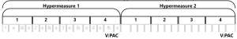
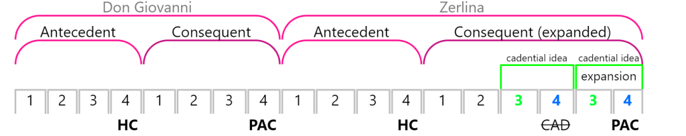

# 超节拍（新版）

> **要点**
>
> - 超节拍（hypermeter）是一种听觉感知到的（不记写在谱面上的）节拍组织，在概念上处于比常规节拍更高的层级。
> - 超节拍存在于一个连续谱上：在某些音乐中，它可能很弱甚至不存在；在另一些音乐中（例如大多数舞曲），它可能很强、很清晰。
> - 四拍子是最常见的超节拍类型。
> - 超拍（hyperbeat）可以与音乐特征相关联：
> 	- 第 1 超拍：与开头相关联
> 	- 第 4 超拍：与结尾/终止式相关联
> 	- 第 2、3 超拍：与中段相关联
> - 规整的超节拍可以因重新解释和重复而被打断。

[章节播放列表](https://open.spotify.com/playlist/1DeMz9X1TzaVC0QPuvlwqE)

## 概述

前缀"hyper-"意为"在上"或"高于"。超节拍是一种听觉感知到的（不记写在谱面上的）节拍组织，在概念上处于比常规节拍更高的层级。即使在有记谱的音乐中，超节拍也*不*被记写出来——它是你在察觉到比一小节更长的规则时间跨度时听到的东西。

超节拍可靠地出现在舞曲中。例如，在蕾哈娜（Rihanna）2012 年的歌曲《Diamonds》中，四小节循环的和声进行（G–Bmi–A–A）标示出超节拍。每一次和弦循环的重复都开启一个新的超小节（hypermeasure）——请听它们分别开始于歌词"Find light in the beautiful …""You're a shooting star I see …""I knew that we'd become …"等句。在谱例 1 中，最下面一排彩色拱形表示各个超小节，每个超小节由四个超拍（小节）组成。

[](https://www.brianedwardjarvis.com/MusicTheoryWebApps/BriFormer/briformer_editor.html?activity_type=open_from_web_link_youtube&shared_briform_id=v_1_0/2021_1_9_3_47_670_uekj4)

谱例 1. [蕾哈娜《Diamonds》（2012）](https://open.spotify.com/track/1z9kQ14XBSN0r2v6fx4IdG?si=bba2ac977301403d)的超节拍分析。点击查看互动谱例。

和常规节拍一样，超节拍也可以是四拍子、三拍子或二拍子：

- 四拍子：四小节（超拍）＝一个超小节
- 三拍子：三小节（超拍）＝一个超小节
- 二拍子：两小节（超拍）＝一个超小节

四拍子是最常见的超节拍，二拍子较少见，三拍子最少见。我们通常因为某段时间跨度内发生的改变和/或重复而感知到超小节。在《Diamonds》中，这种触发是四小节和弦循环的重复，但还有其他方法。如果一段音乐包含一个四小节乐句及其紧接的重复，这段音乐可以听成两个四拍子超小节。同样，一个四小节乐句后接一个明显对比的四小节乐句，也可以产生两个四拍子超小节。

和常规节拍一样，超节拍在一部作品中往往大致保持一致（例如始终是四拍子），但也可能出现不规整的长度，通常是由于[乐句扩展](../04-form/04-expansion-and-contraction.md)技法造成超节拍的中断，详见[下文](#hypermetric-disruptions-reinterpretation-and-repetition)。如果长度始终极不规整，一部作品或一段音乐可能就没有可感知的超节拍。而且一如既往，音乐中常常会出现歧义，对一首作品超节拍的不同解读都是可能的。

### 超拍的关联

聆听常规节拍时，某些音乐特征与某些拍相关联，这使我们在节拍中有了方位感。例如，和弦变化通常发生在第 1 拍；反拍（backbeat）发生在第 2、4 拍。同样，在超节拍中，如果你知道该听什么，通常就能听出正在进行的是哪一个超拍。在四拍子超节拍中，你可以注意以下这些：

- **第 1 超拍：** 与开头相关联。可以是新乐句或次一级乐句（subphrase）的开头，也可以是已经听过的乐句的重复。
- **第 4 超拍：** 与结尾相关联。在有终止式的音乐中，终止式通常出现在第 4 超拍。
- **第 2、3 超拍：** 与中段相关联。这两个超拍往往不像第 1、4 超拍那样容易辨认。在有终止式的音乐中，第 3 超拍可能让人感觉正导向第 4 超拍上的终止式。

## 超节拍的例子

### 蕾哈娜《Diamonds》：超节拍与乐句划分

我们以《Diamonds》（谱例 1）引入超节拍，是因为它有清晰、规整的四拍子超节拍。但乐句与超节拍对齐的方式值得进一步留意。

请注意，在主歌部分，蕾哈娜的乐句从每个超小节的第 1 超拍开始，但*并不*从节拍的强拍开始。而在每个副歌的最开头，她的唱句含有一个弱起，这个弱起确实引向节拍强拍与超节拍强拍的同时到达。节拍强拍、超节拍强拍与旋律重音三者对齐，强调了副歌的到来。

🎼 [MuseScore 乐谱](https://musescore.com/user/32728834/scores/27040801)

谱例 2. [《Diamonds》](https://open.spotify.com/track/1z9kQ14XBSN0r2v6fx4IdG?si=bba2ac977301403d)中的乐句在主歌（a，0:11）与副歌（b，0:51）中的节拍位置不同。

### 披头士《A Hard Day's Night》（1964）：超节拍重复

这首歌同样包含四拍子超节拍。要听出它，请注意每个歌词乐句的开头（"It's been a hard …""But when I get home …""When I'm home …"）以及每个和声进行的开头（前两个乐句为 I–IV–I–♭VII–I，或称 G–C–G–F–G）。注意，除了最末一个乐句之外，四拍子超节拍在整首歌中都非常一致。

在谱例 3 中，最末一个乐句的超拍计数是 $\overbrace{1-2-3-4-\mathbf{3-4-3-4}}$，而我们原本期待的是再一次规整的 $1-2-3-4$ 超拍计数。在这个最末乐句中，与第 3、4 超拍对应的音乐在重复，于是我们感知到的是这两个超拍在重复，而不是从第 1 超拍的材料重新开始（超节拍重复，hypermetric repetition）。要听出这种解读，请比较每个 A 段的最后一个乐句，特别留意以"feel all right"或"feel okay"结尾的几行。它们在每个 A 段中只出现一次，但在最后一个 A 段中，它不断重复，而不是像之前那样继续进入到别的东西。

把最后几个乐句标记为两个超小节 $(\overbrace{1-2-3-4}\quad\overbrace{1-2-3-4})$，也是对这段音乐的准确解读，但标记为重复的 3–4 的好处在于，超节拍分析能更好地反映音乐上的重复。

[](https://www.brianedwardjarvis.com/MusicTheoryWebApps/BriFormer/briformer_editor.html?activity_type=open_from_web_link_youtube&shared_briform_id=v_1_0/beatles_a_hard_days_night_hypermeter_01)

谱例 3. 披头士（The Beatles）《[A Hard Day's Night](https://open.spotify.com/track/5J2CHimS7dWYMImCHkEFaJ?si=5ae3f18b58ce4155)》（1964）的超节拍分析。点击查看互动谱例。

## 超节拍、节拍与拍感

谱例 4 展示了斯科特·乔普林（Scott Joplin）《Harmony Club Waltz》（1896）的一个谱面片段，并标注了超节拍分析。标记超节拍时，本教材倾向于把每个计数（1、2、3、4 等）写在两行谱表之间，并把每个数字圈起来。（这个谱例还进一步标出"超小节 1""超小节 2"等，但在典型的超节拍分析中这既不必要也不常见——这里只是为了在谱例中看得更清楚。）

[](https://www.brianedwardjarvis.com/TheoryTopics/images/hypermeter_joplin_1.png)

<!-- lilylet-begin: media/2025/08/hypermeter_joplin_1.png -->
```lyl.play
[composer "Scott Joplin"]
[staves "{-}"]

\staff "1" \omit Score.TimeSignature \key bf \major \time 4/4 \clef "treble" \stemUp <f bf d f>4\arpeggio <d f bf d>\arpeggio \stemDown <a' c ef g>\arpeggio <a c ef f>\arpeggio \\
\staff "2" \clef "bass" \stemUp <f,, f'>4 \stemDown <bf bf'> \stemUp <f f'> \stemDown <f' a c f> | %1

\staff "1" \stemDown <bf' d f bf>4 <c ef g c>8[ <cs g' cs>] <d fs a d>4 <d fs a d>\fermata \bar ".|:" \\
\staff "2" \stemDown <bf, bf'>4 \stemUp <g g'>8[ <ef ef'>] <d d'>4 <d d'>\fermata \bar ".|:" | %2

\staff "1" \undo \omit Score.TimeSignature \time 3/4 \tempo "Waltz" \stemDown <a' c ef>2\segno^\markup "Hypermeasure 1" <a c ef f>4 \\
\staff "2" \stemUp f,,4^\markup "1" \stemDown <f' a c ef> <f a c ef> | %3

\staff "1" \stemDown <a' c ef g>2 <a c ef f>4 \\
\staff "2" \stemUp f,,4^\markup "2" \stemDown <f' a c ef> <f a c ef> | %4

\staff "1" \stemDown <bf' d>2 <bf d f>4 \\
\staff "2" \stemUp bf,4^\markup "3" \stemDown <f' bf d> <f bf d> | %5

\staff "1" \stemDown <bf' d g>2 <bf d f>4 \\
\staff "2" \stemDown d,4^\markup "4" <f bf d> <f bf d> | %6

\staff "1" \stemDown <a' c ef a>8[^\markup "Hypermeasure 2" <a c ef a>] <a c ef a>4. <a c ef a>8 \\
\staff "2" \stemUp f,,4^\markup "1" \stemDown <f' a c ef> <f a c ef> | %7

\staff "1" \stemDown <a' c ef a>2 <a c ef g>4 \\
\staff "2" \stemUp f,,4^\markup "2" \stemDown <f' a c ef> <f a c ef> | %8

\staff "1" \stemDown <bf' d g>8[ <bf d g>] <bf d g>4. <bf d g>8 \\
\staff "2" \stemUp bf,4^\markup "3" \stemDown <f' bf d> <f bf d> | %9

\staff "1" \stemDown <bf' d g>2. \\
\staff "2" \stemDown d,4^\markup "4" <f bf d> <f bf d> | %10

\staff "1" \stemDown <a' c ef>2^\markup "Hypermeasure 3" <a c ef f>4 \\
\staff "2" \stemUp f,,4^\markup "1" \stemDown <f' a c ef> <f a c ef> | %11

\staff "1" \stemDown <a' c ef g>2 <a c ef f>4 \\
\staff "2" \stemUp f,,4^\markup "2" \stemDown <f' a c ef> <f a c ef> | %12

\staff "1" \stemDown <bf' d>2 <bf d f>4 \\
\staff "2" \stemUp bf,4^\markup "3" \stemDown <f' bf d> <f bf d> | %13

\staff "1" \stemDown <bf' d g>2 <gs d' f>4 \\
\staff "2" \stemUp bf,4^\markup "4" \stemDown <f' bf d> \stemUp <b,, b'> | %14

\staff "1" \stemDown <c' f a>8[^\markup "Hypermeasure 4" <c f a>] <c f a>2 \\
\staff "2" \stemUp <c,, c'>4^\markup "1" \stemDown <a'' c f> <a c f> | %15

\staff "1" \stemDown <bf' e g>8[ <bf e g>] <bf e g>2 \\
\staff "2" \stemUp <c,, c'>4^\markup "2" \stemDown <bf'' c e> <bf c e> | %16

\staff "1" \stemDown f'8[ c a' f c a] \\
\staff "2" \stemUp <f,, f'>4^\markup "3" \stemDown <a' c f> <a c f> | %17

\staff "1" \stemUp f2. \bar ":|." \\
\staff "2" \stemUp <f,, f'>4^\markup "4" \stemDown <f' a c ef> <f a c ef> \bar ":|." | %18
```
<!-- lilylet-end -->
谱例 4. 斯科特·乔普林《Harmony Club Waltz》第 9–16 小节，超拍计数写在两行谱表之间（[0:26](https://open.spotify.com/track/1A2Lc1129R4FrhOrdoKftx?si=54575d35db5341a0)）。

[](https://www.brianedwardjarvis.com/MusicTheoryWebApps/BriFormer/briformer_editor.html?activity_type=load_from_web_link_audio_file&shared_briform_id=v_1_0/brian_custom/Joplin_-_HarmonyClubWaltz_Cropped_Regular_Speed)*谱例 5. 斯科特·乔普林《Harmony Club Waltz》的常速版本。点击查看互动谱例。*

[](https://www.brianedwardjarvis.com/MusicTheoryWebApps/BriFormer/briformer_editor.html?activity_type=load_from_web_link_audio_file&shared_briform_id=v_1_0/brian_custom/Joplin_-_HarmonyClubWaltz_Cropped_Double_Speed)*谱例 6. 斯科特·乔普林《Harmony Club Waltz》的倍速版本。点击查看互动谱例。*

[](https://www.brianedwardjarvis.com/MusicTheoryWebApps/BriFormer/briformer_editor.html?activity_type=load_from_web_link_audio_file&shared_briform_id=v_1_0/brian_custom/Joplin_-_HarmonyClubWaltz_Cropped_Half_Speed)*谱例 7. 斯科特·乔普林《Harmony Club Waltz》的半速版本。点击查看互动谱例。*

谱例 5–7 是互动谱例，以三种不同的速度呈现谱例 4 中的音乐。请聆听各个版本（点击每张图片），试着用手臂指挥节拍，看看自己在每种速度下会与哪个层次的拍感（tactus）同步。尤其是倍速版与半速版之间，结果很可能不同：

- 谱例 5：这是按本曲记谱的正常速度演奏的。你多半会照谱面指挥单三拍子。你也很可能轻松地感受到四小节超节拍。
- 谱例 6：这个版本比正常速度快一倍。在这个速度下，你可能会把拍感转移到超拍上，按照复合四拍子或复合二拍子来指挥。实际上，你在指挥的是超节拍而不是记写的节拍。因此超节拍变得非常容易感知——甚至可能比记写的节拍更容易。
- 谱例 7：这个版本比正常速度慢一半。在这个速度下，你的拍感可能会慢得几乎不舒服。由于拍感（以及拍）太慢，谱例 4 中记写的超节拍可能很难感知——时间跨度太长，难以同步。

如果你听不出超节拍（无论是这个例子还是其他例子），请记住：超节拍是一种既可感知、又依赖解读的现象，你对它的感知会随速度而改变。正如你能在这些不同速度下听到不同层次的节拍，即使速度不变，你也能听到不同层次的节拍。你可能体验到的拍感上的知觉变化，不过是你的心智在与不同层次的节拍同步而已。

## 超节拍的中断：重新解释与重复 {#hypermetric-disruptions-reinterpretation-and-repetition}

### 重新解释

超节拍重新解释（hypermetric reinterpretation）是超节拍中断的一种类型，发生在单个超拍同时发挥两种作用的时候。几乎总是发生在乐句省略（phrase elision）处：一个超小节的结尾（第 4 超拍）同时是一个新超小节的开头（第 1 超拍）。[^1] 在分析中，我们用一个等号来标记：$4=1$。带有重新解释的两个超小节，其计数可写成 $1-2-3-\mathbf{4=1}-2-3-4$。

以沃尔夫冈·莫扎特（Wolfgang Mozart）《第 21 钢琴协奏曲》K. 467 第一乐章（1785）为例。在谱例 8 中，第 12 小节处，第一个乐句的结尾与第二个乐句的开头相省略。注意发生超节拍重新解释的那一小节中写有 $4=1$ 的标记。第 3 超小节的音乐与第 2 超小节完全相同，因此第 2 超小节充当了第 3 超小节应如何进行的模型。请听第 12 小节如何仍在发挥第一个乐句结尾的作用，而新乐句同时接过来，清晰地给出新超小节的开头感。[](https://www.brianedwardjarvis.com/MusicTheoryWebApps/BriFormer/briformer_editor.html?activity_type=open_from_web_link_youtube&shared_briform_id=v_1_0/2021_1_9_22_9_974_nw1wx)

谱例 8. [莫扎特《第 21 钢琴协奏曲》第一乐章](https://open.spotify.com/track/7tT9zTIefCCYR9lXO4pGdx?si=dd82979ec97d47b2)（1785）中乐队的呈示部。点击查看互动谱例。

### 重复

超节拍重复（hypermetric repetition）是超节拍中断的另一种类型，表示一个超小节被扩展到超出预期的长度（例如从四小节变为五小节）。如果你说你听到了超节拍重复，意思是：你认为某个超小节内的一个或多个超拍被立即重复了。例如，除了 $1-2-3-4$ 之外，也可以是第 4 超拍重复 $(1-2-3-4-\mathbf{4})$，或者像《A Hard Day's Night》那样，第 3、4 超拍一起重复 $(1-2-3-4-\mathbf{3-4})$。当所涉及的音乐材料是此前陈述过的段落的变体时，超节拍重复通常最有说服力，因为相似的音频通常应当得到相似的解读。超节拍重复是超节拍中断的一种类型。

在莫扎特《唐璜》（*Don Giovanni*）中的二重唱《那么，我们手挽手》（"Là ci darem la mano"）中，唐璜（Don Giovanni）唱了一个平行乐段；紧接着，采琳娜（Zerlina）唱了基本相同的平行乐段（歌词不同），但这一次最后的乐句被扩展了。比较唐璜的后乐句与采琳娜的后乐句：因为我们先听到唐璜的乐句，它就充当了采琳娜的版本听起来会怎样的模型；而采琳娜的版本随后违背了我们的预期，造成一种轻微的惊喜，把乐句从预期的四小节扩展到六小节。谱例 9 把这一扩展显示为超节拍重复，其中第 3、4 超拍被立即重复。它们略有变化，但终止功能与整体效果仍非常相似。标记 CAD 标出了那个曾被告知、随后被回避的终止式的位置，以及两小节之后被告知并被接受的 PAC 的位置。

[](https://www.brianedwardjarvis.com/MusicTheoryWebApps/BriFormer/briformer_editor.html?activity_type=open_from_web_link_youtube&shared_briform_id=v_1_0/2021_1_9_6_23_945_i5t08)*谱例 9. [莫扎特《唐璜》中《那么，我们手挽手》](https://open.spotify.com/track/34Df5x8fH4cVWro8N5YokO?si=c9b09a205e634c51)（1787）第 1–18 小节。点击查看互动谱例。*

> 延伸阅读

- Rothstein, William. 1989. *Phrase Rhythm in Tonal Music*. New York, Schirmer Books.

> 作业

- 即将推出！

### 媒体署名

- joplin-harmony-club-waltz-briformer-regular-speed
- joplin-harmony-club-waltz-briformer-double-speed
- joplin-harmony-club-waltz-briformer-half-speed
- mozart-la\_ci\_darem\_la\_mano-don-giovanni-briformer

---

[^1]: 超节拍重新解释几乎总是发生在省略处，但并非所有省略都涉及超节拍重新解释。
